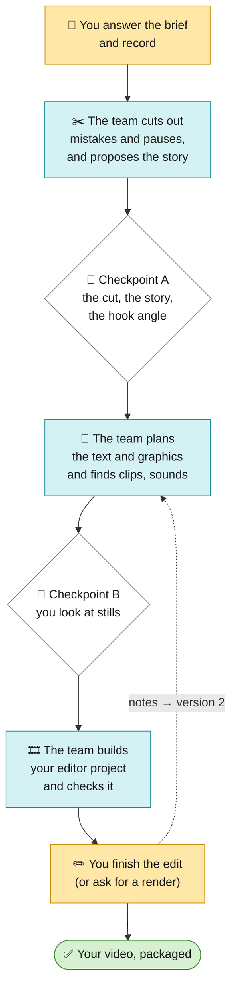
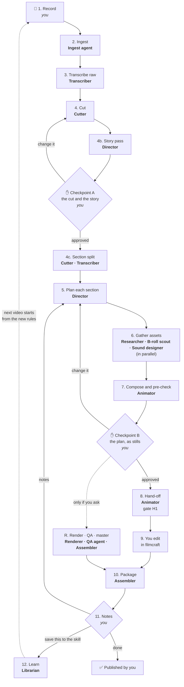
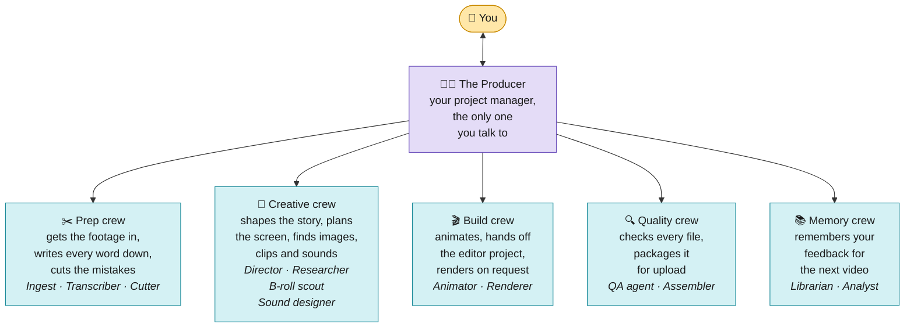
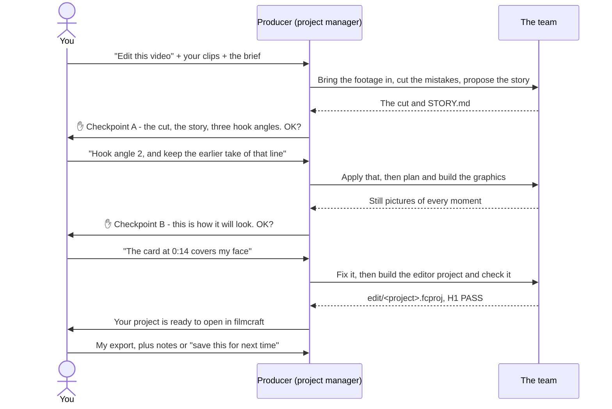
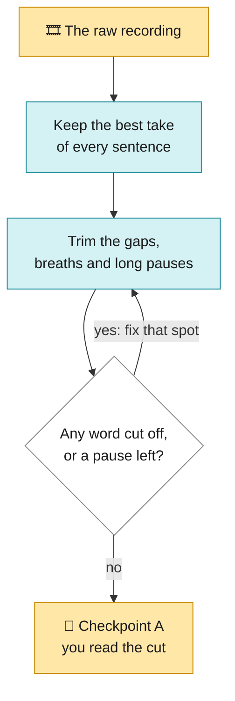
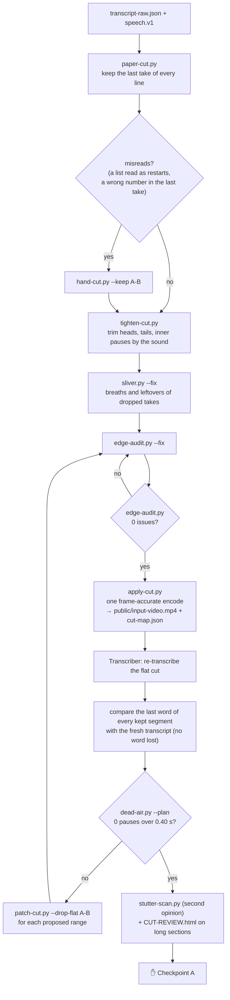
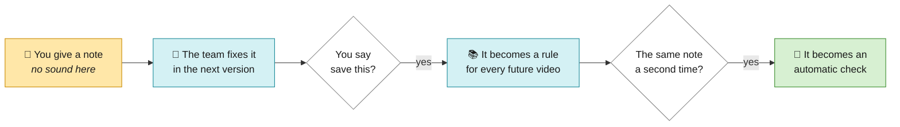
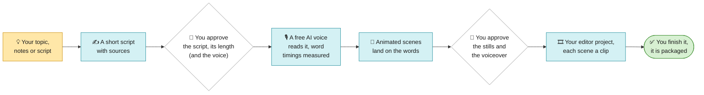

# Editing workflow

The design of the whole system: how a video goes from your camera (or, for an explainer, from a topic) to an editor
project you finish, who does each part, how the parts hand work to each other, where you decide, and which checks stand
between every stage. For setup and a first walkthrough, start with the [repository README](../README.md).

Everything is built on a kit, kept in [`kit/`](kit/README.md): a YouTube creator's Claude Code editing skill, kept as it
came apart from a few fixes (real DM Sans font files, `storyboard-md.py`, bugs found in code review) and the editor
hand-off scripts added since. The kit supplies the rules (`youtube-edit/SKILL.md`), the scripts
(`youtube-edit/scripts/`), the look (`STYLE-GUIDE.md`) and the prompts (`PROMPTS.md`). This folder adds the layer on
top: three teams of agents with clear jobs, a fixed order, file hand-offs, two human checkpoints, quality gates, an
editor hand-off and a learning loop.

| Folder | What it is |
|---|---|
| this README | the workflow, the team, the stages, the gates, the profiles |
| [`kit/`](kit/README.md) | the base everything builds on: the `youtube-edit` skill (rules, 38 scripts and their 114 tests, fonts), the hand-off to filmcraft (`handoff_lib.py`, `nle_xml.py`, `filmcraft.py`, `handoff-check.py`, `qa-export.py`), the wording and post-caption checks, the style guide, the setup guide and the prompts |
| [`templates/`](templates/README.md) | the four project files every profile uses: `STATUS.md`, `ASSET-REQUESTS.md`, `QA.md`, `NOTES.md` |
| [`longform/`](longform/README.md) | the team for **YouTube long-form** (8 to 25 min, 16:9, 4K, 30 fps): the Producer skill, the long-form playbook, 13 agent files, and the research behind them |
| [`reels/`](reels/README.md) | the team for **Reels** (9:16, 1080x1920, 60 fps): the Producer skill, the Reels playbook, 11 agent files, tested vertical scripts (79 tests), and the research behind them |
| [`explainer/`](explainer/README.md) | the team for **animated explainer reels** with no camera (9:16, 1080x1920, 60 fps, 30 to 90 s): a local AI voice (Kokoro), 60 code-drawn scenes plus custom scenes and a continuous stage, three looks and five palettes, word captions or none; the Producer skill, the playbook, 4 new agents plus 5 reused from Reels, tested scripts (600 tests), and the research behind them |
| [`wf.py`](wf.py) | one command for every profile: `install`, `doctor`, `test`, `gates`, `handoff`, `render` (section 12) |
| [`tests/`](tests/) | checks that the docs and `wf.py` tell the truth: every profile ends at the hand-off, the render is opt-in, every script a doc cites exists |

> **Free tools only.** Every profile uses free tools and free licences, nothing else. The kit's paid routes (Tella,
> Epidemic Sound, AI B-roll) are never used, nor paid stock or music, paid voices or avatars, AI video generators
> (Motion by Mosaic, Runway and the like) or paid trials. The one paid part is the Claude plan that runs Claude Code.

> **Markings used in this document**
> - `kit`: comes from the kit in [`kit/`](kit/README.md).
> - `new`: added by this workflow (a file, a step or a rule the kit does not have).

---

## Contents

1. [The workflow at a glance](#1-the-workflow-at-a-glance)
2. [The team: a Producer and thirteen agents](#2-the-team-a-producer-and-thirteen-agents)
3. [How the agents work together](#3-how-the-agents-work-together)
4. [The project folder: every file, who writes it, who reads it](#4-the-project-folder-every-file-who-writes-it-who-reads-it)
5. [Stage by stage](#5-stage-by-stage)
6. [The agents in detail](#6-the-agents-in-detail)
7. [Quality gates](#7-quality-gates)
8. [When something fails](#8-when-something-fails)
9. [The learning loop](#9-the-learning-loop)
10. [Output profiles: YouTube, Reels and Explainer](#10-output-profiles-youtube-reels-and-explainer)
11. [What you type](#11-what-you-type)
12. [Setup, tests and `wf.py`](#12-setup-tests-and-wfpy)
13. [Glossary](#13-glossary)

Sections 1 to 9 follow the YouTube long-form profile, the fullest one; section 10 says what the Reels and Explainer
profiles change.

---

## 1. The workflow at a glance

> **The end of every run is a project you edit, not a finished video.** After you approve the stills, the team hands
> you an editor project: open `<project>.fcproj` in [filmcraft](https://github.com/storytold/filmcraft) (free, open
> source; or import the `.xml` into filmcraft, Premiere Pro or DaVinci Resolve). Your own camera files are cut by word
> on the first track (never re-encoded), every card or scene is its own transparent clip on its own track, the voice,
> music and sound effects are on theirs, captions come as an editable `.srt`, and markers show the hook, the chapters,
> each scene's word and source, and every note. You trim, re-time, mix and export. A finished render is still there
> when you want one: just ask (`python3 Editing-Workflow/wf.py render ...`).

You do five things: answer **the brief**, **record**, approve **Checkpoint A** (the cut and the story), approve
**Checkpoint B** (the stills), and **finish the edit** (with notes for a version 2 if you want one). Everything else is
the agents' job.



<sub>🟨 yellow = you · 🟦 blue = the AI team · ⬜ white = the team waits for you · 🟩 green = finished</sub>

<details>
<summary>Show the detailed version (every stage and the agent that runs it)</summary>



</details>

The **Producer** (the main Claude Code conversation) sits above all of this. It starts each agent, keeps the project's
status, and is the only one that talks to you.

### 1.1 Where you decide `new`

The team does the work; the choices are yours. It stops and waits at each of these points, and only you can move it on.

| When | What you decide | What you are shown |
|---|---|---|
| **The brief** | the title and thumbnail idea, the promise, who it is for, the length, the files and their order, a sponsor, music, names and terms to spell right, the language, anything that must be in it; optionally 3 to 6 of your own scripts or videos for a **voice profile** | one message of numbered questions, each with its default, so "defaults" is a valid answer |
| **Checkpoint A** | what is cut and kept, the sections and their order, the **hook angle** (two or three offered), every weak join, the colour, level and voice-polish proposals | `PAPER-CUT.md` (every removal and its reason), `STORY.md`, the wording notes, numbered questions |
| **Checkpoint B** | every picture before anything is built for real: formats, timing, diagrams, B-roll, sounds | `snaps/sheet.png` per section, a list of what is on screen when, a before/after voice-polish pair to listen to |
| **The hand-off** | how it ends: you finish the editor project yourself (the default), or ask for a finished render | `edit/<project>.fcproj` (or `.xml`) with every layer separate, `HANDOFF.md` |
| **Notes** | what to change, in plain words with a time | each note in `NOTES.md`, routed to the agent that owns it, then the gates again |
| **"Save this to the skill"** | what becomes a lasting rule | a line in the playbook, or a new automatic check with a test |

Three rules make it a loop you stay in, not a pipeline you watch:
- **Nothing is made before you approve it.** No plan before the cut is approved, no hand-off or render before the
  stills are.
- **A vague note gets one specific question back**, recorded as a decision in `STATUS.md`.
- **A check that fails twice comes to you**, with what was tried, instead of looping.

### 1.2 The same thing as a timeline

| # | Stage | Agent | You | Output you can look at |
|---|---|---|---|---|
| 1 | Record | none | record the clips | raw files |
| 2 | Ingest | Ingest agent | drop the files in, say what they are | `ingest.json`, `metadata.json` |
| 3 | Transcribe | Transcriber | none | `transcript-raw.json` |
| 4 | Cut | Cutter | none | `PAPER-CUT.md`, `CUT-REVIEW.html`, the wording notes |
| 4b | Story pass | Director | none | `STORY.md` |
| A | **Checkpoint A** | Producer | read the cut and the story, pick a hook angle, reply in plain words | none |
| 4c | Section split | Cutter, Transcriber | none | one folder per section |
| 5 | Plan | Director | confirm any diagram it proposes | `storyboard.json`, `ASSET-REQUESTS.md` per section |
| 6 | Assets | Researcher, B-roll scout, Sound designer | none | `ASSET-REQUESTS.md` filled in (every file + source + licence) |
| 6v | Voice polish (if proposed) | Sound designer | listen to the pair | `voice/before.wav`, `voice/after.wav` |
| 7 | Compose | Animator | none | `public/index.html`, `snaps/sheet.png` |
| B | **Checkpoint B** | Producer | look at the stills, reply in plain words | none |
| 8 | Hand-off | Animator | none | `edit/<project>.fcproj`, `.xml`, `captions.srt`, `HANDOFF.md` |
| 9 | You edit | you | trim, re-time, mix, export | your export |
| 10 | Package | Assembler | none | `chapters.txt`, `captions.srt`, `DESCRIPTION.md`, `STORYBOARD.md` |
| R | Render (opt-in) | Renderer, QA agent, Assembler | ask for it | `output-*.mp4`, `QA.md`, the master |
| 11 | Notes | Producer | give timestamped notes | v2, v3... |
| 12 | Learn | Librarian | say "save this to the skill" | an updated playbook or skill, a new test |

---

## 2. The team: a Producer and thirteen agents



<sub>🟨 yellow = you · 🟪 purple = the Producer · 🟦 blue = the AI team</sub>

The long-form team, file by file in [`longform/agents/`](longform/agents/). The Reels team has 11 of these roles under
`reels-*` names; the Explainer team adds four of its own (section 10).

| # | Agent | One-line job | Scripts it runs | Model tier |
|---|---|---|---|---|
| 0 | **Producer** | Runs the project: asks the brief, starts agents, holds the status, runs the checkpoints, routes fixes, talks to you | none (it delegates) | strongest |
| 1 | **Ingest agent** | Collects, probes, orders and joins the raw files; lines up face and screen recordings | `ingest.py`, `sync-tracks.py` | small |
| 2 | **Transcriber** | Turns audio into words with exact times, every time the cut changes | `npx hyperframes transcribe`, `auto-editor` | small |
| 3 | **Cutter** | Removes retakes, restarts, stutters and dead air until the flat cut is clean; flags weak wording; splits sections | `paper-cut.py`, `hand-cut.py`, `tighten-cut.py`, `sliver.py`, `edge-audit.py`, `apply-cut.py`, `dead-air.py`, `patch-cut.py`, `stutter-scan.py`, `cutlist-to-edl.py`, `wording.py` | mid |
| 4 | **Director** | The story pass (sections, joins, hook angles), then what the viewer sees and when: formats, timing, camera, sound cues, B-roll slots | `phrase-times.py` | strongest |
| 5 | **Researcher** | Gets the real pages, logos, posts and screenshots the Director asked for | `npx hyperframes capture`, Chrome | mid |
| 6 | **B-roll scout** | Finds, checks the licence of, downloads and conforms free stock footage | `broll-conform.py` | small |
| 7 | **Sound designer** | Picks, trims and levels sound effects and music; prepares a voice-polish pair for you to judge | ffmpeg | small |
| 8 | **Animator** | Builds the composition from the storyboard, proves it before anything is built for real, and makes the editor hand-off | `compose.py`, `formats/claude_chat.py`, `npx hyperframes check`, `beat-check.py`, `gap-scan.py`, `snap-beats.py`, `reels-handoff.py`, `handoff-check.py` | mid (strongest for a new format) |
| 9 | **Renderer** (opt-in) | Renders the video and fixes its colour tags; patches a window of a long render | `npx hyperframes render`, `window-patch.py` | small |
| 10 | **QA agent** | Checks a rendered file, or your own export, independently; passes or fails it | `verify-render.py`, `qa-export.py`, ffmpeg | mid |
| 11 | **Assembler** | Packages your export (chapters, captions, description); on request joins and levels a master | `assemble.py`, `storyboard-md.py` | small |
| 12 | **Librarian** | Turns your notes into rules, and repeated notes into tested checks | the skill's test suite | strongest |
| 13 | **Analyst** (optional) | Every two videos, measures a channel you admire against your own edits; reads your retention graph | `teardown.py` | mid |

"Model tier" follows the kit's own advice: routine passes run fine on a mid-size model, searches on a smaller one, and
a new format or an unfamiliar problem deserves the strongest.

---

## 3. How the agents work together

### 3.1 The mechanics

- **Every agent is a Claude Code subagent** `new`: a markdown file in the project's `.claude/agents/` folder with a
  name, a description, the tools it may use and a model tier. The Producer starts them with the Agent tool.
- **Agents start cold.** A subagent does not see the conversation. The Producer hands each one a **brief**: the
  project folder, the input files, the task, the SKILL.md sections to follow and the "done when" test (see 3.3).
- **Files are the hand-off.** All agents share one disk. An agent reads its inputs from the project folder, writes its
  outputs there, and returns a short report to the Producer: what it made, what it checked, what worries it.
- **Only the Producer talks to you.** Subagents cannot ask you questions and cannot start other subagents. When an
  agent needs a decision, it stops and says so in its report; the Producer asks you.
- **Only the Producer writes `STATUS.md`** `new`, the one-page state of the project (which stage, which version,
  what is waiting on whom). That way two agents never fight over it.
- **Makers never grade their own work.** The QA agent checks what the Renderer made (or your export); the Animator's
  pre-checks and the hand-off check are scripts, not opinions. A FAIL goes back through the Producer to the agent that owns the fix.
- **You can still run it all in one conversation.** The agents are roles. Splitting them keeps each context small and
  lets independent jobs run at once; it does not change the steps or the rules.

### 3.2 One video, end to end



<details>
<summary>Show the detailed version (every hand-off and file)</summary>

```mermaid
sequenceDiagram
    autonumber
    actor You
    participant P as Producer
    participant ING as Ingest
    participant TR as Transcriber
    participant CUT as Cutter
    participant DIR as Director
    participant AS as Researcher / B-roll / Sound
    participant ANI as Animator
    participant ASM as Assembler
    participant LIB as Librarian

    You->>P: "Edit this video. Clips: C0001, C0002. Screen recording: demo.mov"
    P->>You: the brief: numbered questions, each with a default
    You->>P: answers (or "defaults")
    P->>ING: brief: raw/ folder, order, profile
    ING-->>P: ingest.json, source.mp4, metadata.json
    P->>TR: brief: transcribe source audio
    TR-->>P: transcript-raw.json, speech.v1
    P->>CUT: brief: cut stage to 0 issues and 0 pauses
    loop until edge-audit = 0 and dead-air = 0
        CUT->>TR: re-transcribe the flat cut
        TR-->>CUT: transcript.json
    end
    CUT-->>P: PAPER-CUT.md, cut-map.json, wording notes
    P->>DIR: brief: story pass
    DIR-->>P: STORY.md (sections, weak joins, hook angles)
    P->>You: ✋ Checkpoint A: the cut and the story
    You->>P: "hook angle 2; keep the earlier take of the studio line"
    P->>CUT: brief: apply the note, split the sections
    CUT-->>P: one folder per section, each transcribed
    P->>DIR: brief: storyboard for each section
    DIR-->>P: storyboard.json, ASSET-REQUESTS.md (+ diagram proposals)
    P->>You: "I want a flow diagram for 0:42 to 1:15. OK?"
    You->>P: "yes"
    par in parallel
        P->>AS: Researcher: pages, logos, posts
    and
        P->>AS: B-roll scout: stock clips
    and
        P->>AS: Sound designer: effects, music, voice-polish pair
    end
    AS-->>P: files in public/, ASSET-REQUESTS.md filled
    P->>ANI: brief: compose, check, snapshot
    ANI-->>P: index.html, snaps/sheet.png, all checks clean
    P->>You: ✋ Checkpoint B: here are the stills
    You->>P: "the card at 0:14 covers my face"
    P->>DIR: change one beat
    P->>ANI: rebuild, snapshot, then hand off
    ANI-->>P: edit/<project>.fcproj, HANDOFF.md, H1 PASS
    P->>You: open it in filmcraft; trim, mix, export
    You->>P: "here's my export"
    P->>ASM: brief: package from the export
    ASM-->>P: chapters.txt, captions.srt, DESCRIPTION.md
    P->>You: the package, with the agents' concerns
    You->>P: "at 0:22 no sound. Save this to the skill."
    P->>LIB: brief: the note, the section it belongs to
    LIB-->>P: playbook updated, tests OK
```

</details>

A render is a side road: when you ask for a finished file, the Renderer renders each approved section, the QA agent
checks each one, and the Assembler joins and levels the master, which QA checks again (Stage R).

### 3.3 The brief: what the Producer sends every agent `new`

Every brief has the same parts, so no agent has to guess:

```
PROJECT   videos/<project> · part <NN-slug or -> · version v<n> · profile youtube (3840x2160, 30 fps)
VOICE     your voice profile, if you gave 3 to 6 of your own scripts or videos (rhythm, openers, words you never
          use, how you ask); never invented: "none" when you gave none
JOB       the agent's job name (each agent file lists its jobs: the Director has story, plan and replan)
INPUTS    the exact files to read
TASK      what to produce, in one or two sentences
RULES     the playbook and SKILL.md sections to follow, plus your notes' ids and their exact words
DONE WHEN the gate that proves it is finished, in the agent file's words
REPORT    files written, checks run and their result, concerns, decisions needed from you
```

### 3.4 What runs in parallel, and what must wait

| Can run at the same time | Why it is safe |
|---|---|
| Researcher, B-roll scout, Sound designer | each fills its own part of `ASSET-REQUESTS.md` and writes to its own folder |
| B-roll scout's *search* and the Cutter's dead-air loop | the search only needs the storyboard's slot list, not final times |
| Different sections at different stages | section 2 can compose while section 1 is at Checkpoint B; sections are joined only at the hand-off |

| Must wait | For |
|---|---|
| Story pass | the cut's gates (G2 to G4) |
| Section split and Director's plan | Checkpoint A (planning on a cut that changes wastes the plan) |
| Animator | every asset request filled or marked "skip" (G6) |
| Hand-off, or a render | Checkpoint B and every pre-check clean |
| Package | your export (or a QA **PASS** on the master, for a render) |
| Librarian | your "save this to the skill" |

Never two agents on the same file at once.

### 3.5 Project state `new`

Four files `new` hold everything the kit's scripts don't: where the video is, what assets it uses, whether a file
may go out, and what you asked for. Their templates, every field, every allowed value and filled-in examples are in
[`templates/`](templates/README.md).

| File | Answers | Written by |
|---|---|---|
| [`STATUS.md`](templates/STATUS.md) | Where is this video, and who is it waiting on? | Producer only |
| [`ASSET-REQUESTS.md`](templates/ASSET-REQUESTS.md) | What does the plan need, who gets it, where did it come from, may we use it? | Director (request), owner agent (fulfilment) |
| [`QA.md`](templates/QA.md) | Can this file go out? | QA agent only |
| [`NOTES.md`](templates/NOTES.md) | What did you ask for, and what was done about it? | Producer only |

A short excerpt of `STATUS.md` ([full example](templates/examples/STATUS.md)):

```
| # | Stage | State | Owner | Gate | Updated | Note |
|---|---|---|---|---|---|---|
| 4 | Cut | done | Cutter | G2 G3 G4 | 2026-10-05 10:30 | 2:11 → 38.2 s; 0 edge issues; 0 pauses |
| A | Checkpoint A: the cut | done | you | A | 2026-10-05 11:02 | A01, A02 applied |
| 8 | Hand-off | done | Animator | H1 | 2026-10-06 16:42 | edit/demo.fcproj; 4 sections, 23 cards |
```

Any new conversation can pick the project up from `STATUS.md`; its Decisions list (D01...) keeps every question the
Producer asked you and your answer.

---

## 4. The project folder: every file, who writes it, who reads it

One folder per video under `videos/`, plus one shared folder for things every video reuses. A long-form video has one
sub-folder per section after the split (`01-hook/`, `02-setup/`...), each with its own storyboard, `public/` and
snapshots; a reel or an explainer keeps them at the top.

```
videos/
├── _shared/                       sounds and images every video can use (copied by compose.py --shared)
│   ├── sfx/                       pop.mp3, typing.mp3, click.mp3 ...
│   └── img/                       logos, thumbs/
└── <project>/
    ├── STATUS.md                  new   the project's state and every decision for you (Producer)
    ├── NOTES.md                   new   every note you gave, per version, and what was done (Producer)
    ├── raw/                       your original files, never changed
    ├── ingest.json, source.mp4    Ingest             clip order, and where each clip starts in source.mp4
    ├── metadata.json              Ingest
    ├── audio-raw.wav              Transcriber
    ├── transcript-raw.json        Transcriber        words in RAW time
    ├── speech.v1                  Transcriber        speech chunks from auto-editor
    ├── cut-list.json              Cutter             what is kept, in raw time
    ├── PAPER-CUT.md               Cutter             the transcript with cuts struck through  → Checkpoint A
    ├── CUT-REVIEW.html            Cutter             side-by-side review page (long sections) → Checkpoint A
    ├── cut-edl.json, candidates/  Cutter             the review page's list; stutter-scan findings
    ├── cut-map.json               Cutter             every jump cut in the flat cut
    ├── audio.wav                  Transcriber        the flat cut's audio
    ├── transcript.json            Transcriber        words in FLAT-CUT time (everything after the cut uses this)
    ├── STORY.md                   new  Director      sections, weak joins, hook angles, wording notes → Checkpoint A
    ├── <NN-slug>/                 Cutter             one per section after the split; inside, per section:
    │   ├── storyboard.json        Director           the plan AND the source of the composition
    │   ├── ASSET-REQUESTS.md      new  Director + asset agents   every asset: request, file, source, licence
    │   ├── broll-shortlist.md     B-roll scout       two candidates per slot
    │   ├── public/                the composition HyperFrames draws
    │   │   ├── input-video.mp4    Cutter             the section's flat cut
    │   │   ├── index.html         Animator           built by compose.py
    │   │   ├── fonts/ sfx/ img/   Animator           staged by compose.py
    │   │   └── broll/             B-roll scout       conformed clips
    │   ├── snaps/sheet.png        Animator           one still per moment → Checkpoint B
    │   └── layers/                Animator           each card as a transparent clip, for the hand-off
    ├── voice/before.wav, after.wav  Sound designer   the voice-polish pair, if proposed → Checkpoint B
    ├── edit/                      new  Animator      THE HAND-OFF: <project>.fcproj, <project>.xml, captions.srt,
    │                                                 HANDOFF.md, media/ (b-roll, sound effects, cards)
    ├── output-4k-raw.mp4, output-4k.mp4   Renderer   opt-in only; the second with BT.709 tags
    ├── VERIFY.md, render-sheet.png  QA agent         verify-render.py's report (on a render or your export)
    ├── QA.md                      new  QA agent      the full verdict: verify + sound + motion + loudness
    ├── assembly.json, ASSEMBLY.md Assembler          the manifest and log for a rendered master (opt-in)
    ├── chapters.txt, DESCRIPTION.md  Assembler       the package, from your export (or the master)
    └── STORYBOARD.md              Assembler          time / beat / what is on screen, every stock clip and its licence
```

The editor project's tracks are fixed, so every project opens the same way: **V1** your footage (your own camera
files, cut by word, never re-encoded; a kept segment across two files becomes two clips), **V2** B-roll, **V3** the
cards, **V4** styled captions (off by default), **A1** your voice, **A2** music, **A3** sound effects. Markers carry the
hook, a chapter at each section's start, and every note. `HANDOFF.md` lists what is where. With `filmcraft-cli`
installed you get the native `.fcproj`; without it, the `.xml` imports into filmcraft, Premiere Pro or DaVinci Resolve.

---

## 5. Stage by stage

Each stage lists its trigger, the agent, the steps, what comes out, and the gate it must pass.

### Stage 1. Record (you)

| Rule | Why |
|---|---|
| 4K, flat: no in-camera zooms, captions or transitions | the system adds those; 4K keeps zooms sharp (1080p goes soft past ~112 %) |
| 30 fps for YouTube, 60 fps for reels | must match the profile (section 10) |
| Mic on every file; a second of silence at each end | the cut is decided by the audio |
| **Fluffed a line? Pause about two seconds, then say the whole sentence again** | the last take wins |
| "Cut that" / "scratch that" | drops the sentence before it |
| No spoken notes to yourself; clap instead | speech gets kept |
| Say lists as lists, name tools out loud, say money in full | lists become graphics, names become logos, "1K" can't be shown |
| Tutorials: face and screen at once, both with the mic, one clap, the same file name | the Ingest agent lines them up by sound |

### Stage 2. Ingest (Ingest agent)

**Trigger:** you drop files and say what they are. **Route by input:**

| You hand over | What happens next |
|---|---|
| One raw clip, 1 to 3 min | Cut → Plan → Render |
| Several raw clips | `ingest.py --concat` orders and joins them into `source.mp4`, then the same |
| A talking section over 3 min | Cut with windowed transcription + `stutter-scan.py` + `CUT-REVIEW.html`; plan under the long-form rules; render per section |
| A flat cut you made yourself | re-encode it with dense keyframes, transcribe (Stage 3), then straight to Stage 5 (the Pipeline in SKILL.md) |
| Face file + screen file | `sync-tracks.py --write-aligned`; the face file is cut, the screen becomes full-frame `clip` cutaways |
| All the finished parts of one video | straight to Stage 10 |

**Steps:**
1. Copy the files into `raw/` (never work on the card; eject it only after the copy is confirmed).
2. `ingest.py --raw raw --out .` probes every clip and writes `ingest.json` (order, length, size, frame rate, and where
   each clip starts in `source.mp4`). `--concat` writes `source.mp4`, re-encoding only the clips that don't match.
3. `ffprobe` → `metadata.json` (size, frame rate, colour, length).
4. Two-file tutorial: `sync-tracks.py --a <face> --b <screen> --write-aligned aligned/`.
5. Reels profile `new`: phone footage records at a variable frame rate. Convert every clip to a constant 60 fps before
   the cut, or the sound drifts away from the picture after the cuts.

**Done when:** `ingest.json` lists every clip in the right order and every clip has sound.

### Stage 3. Transcribe (Transcriber)

**Trigger:** a new source file, and again after **every** `apply-cut.py`.

1. `ffmpeg … -vn -acodec pcm_s16le -ar 16000 -ac 1` → a 16 kHz mono WAV.
2. `npx hyperframes transcribe <wav> <engine> --json`, the engine by the Brief's **language**: `--engine parakeet` for
   English and European languages, `--engine whisper --model large-v3 --language <code>` for Hindi and the rest. Never
   `auto`: a missing Parakeet silently falls back to another engine.
3. Raw files over ~3 min: transcribe ~25 s windows cut at silences, shift each window's word times by its start, merge
   (Parakeet can drop whole sentences on long files).
4. On the raw file only: `auto-editor <clip> --edit audio:<threshold> --margin 0.12s,0.35s --export v1 -o speech.v1`
   (where you speak, by loudness). The threshold comes from the noise floor Ingest measured: `-30dB` for a camera mic in
   a quiet room, about floor + 20 dB for phone audio; a `speech.v1` with no pauses in a talking clip is a FAIL.

**Outputs:** `transcript-raw.json` (raw time) or `transcript.json` (flat-cut time). **Done when:** the word count is
plausible for the length and the last word sits near the end of the audio.

### Stage 4. Cut (Cutter)

**Trigger:** a raw transcript exists. **Goal:** a flat cut with every retake, restart, stutter and long pause gone and
no word clipped.



<details>
<summary>Show the detailed version (every script and check)</summary>



</details>

| Script | What it decides | Writes |
|---|---|---|
| `paper-cut.py` | restarts inside a sentence, "cut that" markers, retakes (keeps the last), false starts, long pauses | `cut-list.json`, `PAPER-CUT.md` |
| `hand-cut.py` | rebuilds the list from the lines you keep, when paper-cut misreads | `cut-list.json` |
| `tighten-cut.py` | lead-ins 0.07 s, tails 0.11 s, inner pauses over 0.30 s, by the sound | `cut-list.json` |
| `sliver.py --fix` | breath-only segments, a dropped word's tail riding in, the next word's onset leaking out | `cut-list.json` |
| `edge-audit.py --fix` | every edge that starts or ends mid-sound, restart fragments | `cut-list.json` |
| `apply-cut.py` | encodes the flat cut, every edge snapped to the frame grid, 20 ms fades at joins; checks duration and sync | `public/input-video.mp4`, `cut-map.json` |
| `dead-air.py --plan` | every pause over 0.40 s after a sentence (0.45 s elsewhere), with a range that brings it to 0.30 s | a plan |
| `patch-cut.py --drop-flat` | removes a flat-cut range, mapped back to the raw through `cut-map.json` | `cut-list.json` |
| `stutter-scan.py` | word stutters ("the the") and a second retake pass, for a human to read | `candidates/` |
| `cutlist-to-edl.py` + `build-edl-review.mjs` | the side-by-side review page | `CUT-REVIEW.html` |

**Rules the Cutter must follow** `kit`: sentence starts come from Parakeet, sentence ends from the audio. Heads move
backward to the quiet gap, never forward. A cut in the quiet dip before a sentence's last word deletes that word, so
check the last word of every segment after each encode. Deliberate air is room tone, never digital silence. If
`apply-cut.py` prints DRIFT, the file is not used.

Last, `wording.py --transcript transcript-raw.json --kept cut-list.json` reads the kept words sentence by sentence and
writes notes for the story pass (never a rewrite).

**Done when:** `edge-audit.py` prints 0 issues, `dead-air.py` prints 0 pauses, `apply-cut.py` printed no DRIFT, and no
word was lost.

### Stage 4b. Story pass (Director) `new`

**Trigger:** the cut's gates are clean. **Output:** `STORY.md`, the editorial read of the flat cut, before you see it.

- **Sections** with chapter titles and lengths, and the **but / therefore** line that runs through them.
- Every **WEAK** join (an "and then" where a "but" or "therefore" should be) with a suggested fix.
- The **hook plan**, with two or three **hook angles** for you to pick or rewrite (and a flash-forward, if one fits).
- The **wording notes** from `wording.py` on the kept words: stock phrases, a hook that opens on a preamble ("in this
  video"), lines too long to follow. Notes to read, never automatic rewrites.
- The re-engagement map (where attention dips and what brings it back), candidate cuts (tangents, repeats), and any
  colour, level or voice-polish proposal.

**Done when:** `STORY.md` has every part above and every question for you is numbered and answerable in a few words
(gate G5, story).

### Checkpoint A: the cut and the story (you, through the Producer)

The Producer sends one message: `PAPER-CUT.md` (and `CUT-REVIEW.html` for anything over 3 minutes) with raw length →
flat length and every removal with its reason; `STORY.md`; and the numbered questions. You answer in plain words:
*"hook angle 2"*, *"keep the earlier take of the studio line"*, *"the joke at 1:12 goes"*. Each answer is written into
`NOTES.md` word for word (A01, A02...) and routed: a cut answer to the Cutter, an on-screen answer to the Director for
the plan. The Cutter runs its loop and gates again. Nothing is planned until you approve.

### Stage 4c. Section split (Cutter, Transcriber)

**Trigger:** Checkpoint A approved. The Cutter splits the flat cut into the sections `STORY.md` named, one folder each
(`<NN-slug>/`), and the Transcriber transcribes each section in its own time. From here on, each section moves through
Stages 5 to 7 on its own, so one can compose while another waits on you.

### Stage 5. Plan (Director)

**Trigger:** the section split, per section. **Inputs:** the section's `transcript.json`, `cut-map.json`,
`metadata.json`, `STORY.md`, your Checkpoint A answers, the footage itself (a few frames per shot), the long-form
PLAYBOOK, SKILL.md, STYLE-GUIDE.md. **Output:** the section's `storyboard.json` and `ASSET-REQUESTS.md`.

The Director works through these in order:

1. **Read the footage, not just the words.** Find shot changes
   (`ffmpeg -vf "select='gt(scene,0.12)',metadata=print"`), measure where your face is in each shot, and mark the
   face-safe zone. **A card never covers your face**; when copy won't fit the safe zone it becomes a lower line.
2. **The hook gate** (every hook, on the angle you picked at Checkpoint A): the first 3 seconds sell the video and the first frame is a real image; it works
   with the sound off; the first spoken word is never covered by a sound, a card or a cut; the promise has a payoff
   time (`"loops": [{"question", "planted", "payoff"}]`).
3. **Find the explainers** in the transcript: "first / second / third", "the way this works is", "and then", "which
   leads to", stage words, lists of tools. **Propose each diagram to you** (passage, format, step labels) before it is
   built; a diagram is 30 to 40 s of screen time.
4. **Pick a format for every moment** from the library (more than 40: lower line, glass card, logo card, site cutaway,
   pills, stat tiles, world camera, chat, doc read...). The chooser table in SKILL.md decides between candidates; a tie
   goes to the format used least. **Never the same device twice in a row.**
5. **Time every element to its word:** enter 0.15 to 0.25 s ahead of the anchor word (`phrase-times.py` finds the
   words). Every beat has an `anchor`, or `"-"` when it is deliberately unanchored.
6. **Plan the camera:** top-anchored origin (`"52% 0%"` centred, `"38% 0%"` when you sit left); `set 1.0` at every
   jump cut in `cut-map.json`, on the exact jump frame; punch-ins 118 to 125 % over 0.30 to 0.35 s; creeps 110 to
   112 % over 5 to 10 s; never carry a zoom across a cut. Jump cuts stay plain unless the energy changes.
7. **Plan the sound** (silence by default) and **the B-roll slots** (a person or job you name gets 2.5 to 3.5 s of
   footage right after you describe it).
8. **Check the budget:** about 7 overlays and 7 camera moves per 90 s; a hook about 6 overlay moments per 37 s; long
   form never more than 15 s (first 90 s), 20 s (after) or 30 s (ever) with nothing on screen.
9. **Long form** (over 3 min): one persistent world, the chapter fixture returning at every section, 40 % or more of a
   talking section full-frame, no list panels, one element at full brightness at a time.
10. **Write `ASSET-REQUESTS.md`** `new`, one row per thing the plan needs:

| id | kind | for beat | what exactly | who fills it |
|---|---|---|---|---|
| r1 | logo | `yt` | YouTube logo, white variant | Researcher |
| r2 | site | `sk` | example.com homepage, 2x capture | Researcher |
| r3 | b-roll | `br` | a designer at a desk, dark room, 3.5 s | B-roll scout |
| r4 | sfx | `yt` | pop on the logo landing | Sound designer |

**Done when:** every beat has a type, an id, in/out times and an anchor; every asset is requested; the budget holds.

### Stage 6. Gather assets (Researcher, B-roll scout, Sound designer, in parallel)

**Trigger:** `ASSET-REQUESTS.md` exists. Each agent takes its rows and fills in the file, source URL, licence and
seconds used on each one ([fields and states](templates/README.md#asset-requestsmd)).

| Agent | Gets | From | Rules |
|---|---|---|---|
| Researcher | logos | the brand's press kit, or the `<svg>` from `npx hyperframes capture <url>` | real vectors; white variants for dark plates |
| | sites | `npx hyperframes capture`, the explicit `/en` URL | the real page in a browser window, never a crop of a video frame |
| | posts on X | X's official embed in headless Chrome, text proven with the syndication JSON | never fake a user agent; never get around a block |
| | pages that block robots | read in a real browser, rebuilt in HTML with the site's fonts | never work around bot detection |
| | product photos | Open Food Facts (CC BY-SA, credited), cut out with `remove-background` | |
| | person photos | **ask you for the file** (via the Producer) | |
| B-roll scout | stock clips | Pexels first, then Coverr, Mixkit free licence | never Mixkit Restricted, never AI-labelled, never paid |
| | | two candidates per slot in `broll-shortlist.md`, take the first unless a risk rules it out | real people, moody screen-lit rooms, no watermark, nobody looking into the lens, no readable logos |
| | conform | `broll-conform.py --in … --out public/broll/<job>.mp4 --start s --dur d` | 30 fps, no audio, dense keyframes, BT.709; pick the sharpest window; blur anything readable |
| Sound designer | effects | the free HyperFrames library | only the allowed list (section 6.7) |
| | prepare | trim the silence before the hit; peak-normalise to -3 dBFS | the audible peak lands within two frames of its cause |
| | music | a tense track under the hook, a calm lo-fi bed after | ducked 16 dB (hook) / 19 dB (body) under your voice |

**Done when:** every row in `ASSET-REQUESTS.md` is `filled` (with its licence), `skip` (with a reason) or `dropped`:
Gate G6 is clear.

### Stage 6v. Voice polish (Sound designer, only if proposed) `new`

When the story pass proposed it and you said yes at Checkpoint A, the Sound designer prepares a **pair**:
`voice/before.wav` and `voice/after.wav`, 12 s of your speech untouched and through the chain (high-pass, light
de-noise, a gentle EQ and compressor, de-esser; the exact chain in `voice/CHAIN.txt`), never applied blind. You
listen at Checkpoint B on headphones and a phone speaker, and keep or skip it.

### Stage 7. Compose and pre-check (Animator)

**Trigger:** the storyboard is final and every asset is in. Every check below runs **before** the hand-off or any
render, because a snapshot takes seconds and a render takes minutes.

| Step | Command | Must show |
|---|---|---|
| 1 | `compose.py --spec storyboard.json --out public --shared videos/_shared` | no error, no "same device twice" WARN |
| 2 | hand-built formats (big number, flow diagram, staircase, funnel...) via `raw_html` / `raw_js`; the AI chat window via `formats/claude_chat.py` | built to the numbers in SKILL.md's format specs |
| 3 | `npx hyperframes check public` | clean (two known false alarms: `text_occluded` behind you, `text_not_painted` on gradient text) |
| 4 | `beat-check.py --index public/index.html --transcript transcript.json` | every element 0.10 s after to 0.60 s before its word; no missing anchors; transcript not older than the video |
| 5 | `gap-scan.py --index public/index.html` (long form) | no gap over the limits; density printed |
| 6 | `snap-beats.py --project .` | `snaps/sheet.png`: one still per moment |
| 7 | read every still | no card on your face, text readable, nothing cut off |

**Composition rules the Animator must follow** `kit`: every timed element has `class="clip"`; the footage keeps
`data-has-audio="true"`; every `<audio>` has an `id` and sits directly under the root; glass is never faded through
its parent's opacity; one opacity owner per element; no CSS transforms on things GSAP moves; text that changes step by
step comes from one tween; stay under about 40 heavy effects (blur, gradients, clip-paths) per composition.

**Done when:** steps 1 to 6 are clean and the stills have been read.

### Checkpoint B: the plan (you, through the Producer)

Per section, as each is ready (or all at once if you prefer), the Producer shows you `snaps/sheet.png`, a short list of
what is on screen when, every diagram or draft format waiting for a yes, the voice-polish pair if there is one, and the
Animator's concerns. Answer in plain words: *"the card at 0:14 covers my face"*, *"no sound on the logo"*. Changing a
time is one number in `storyboard.json`; the Animator rebuilds and re-snapshots, and you see the changed stills again.
Nothing is handed off or rendered until you approve.

### Stage 8. Hand-off (Animator) `new`

**Trigger:** Checkpoint B approved. This is the default end of every run.

| Step | Command | What it does |
|---|---|---|
| 1 | `layer-pages.py` and `render-layers.py` (run by the hand-off) | each card, once, as a transparent clip in `<section>/layers/` |
| 2 | `reels-handoff.py --project $W --format 16x9 --section $W/01-hook --section $W/02-... [--music FILE]` | lays every section end to end on one sequence: your camera files cut by word through `ingest.json` (never re-encoded), the cards, B-roll, sounds and music on their tracks, a chapter marker at each section, every note as a marker; writes `edit/` |
| 3 | `filmcraft.py` (when `filmcraft-cli` is installed) | the native `<project>.fcproj`; otherwise the `.xml` is the project |
| 4 | `handoff-check.py` | gate **H1** |

**Gate H1** fails on: a clip whose media is missing or runs past the end of its source; a sequence of the wrong size
or frame rate; a hole in the voice track where a word is said; a scene or card with no clip; captions missing words.

**Done when:** H1 passes. The Producer tells you where `edit/` is and what `HANDOFF.md` says.

### Stage 9. You edit

Open `edit/<project>.fcproj` in filmcraft (or import the `.xml` into filmcraft, Premiere Pro or DaVinci Resolve):
trim, re-time a card, ride the music, change a caption, export. If you want your export checked, the QA agent runs
`qa-export.py` on it (size and frame rate against the profile, loudness against -14 LUFS, black frames) and reports;
it never changes your file, and the call is yours.

### Stage 10. Package (Assembler)

**Trigger:** your export (or, after Stage R, a master that passed QA). The Assembler writes the package from it:
`chapters.txt`, `captions.srt` (timed to your export), `DESCRIPTION.md` with the publish checklist (chapters, captions
uploaded "with timing", ad breaks at 8 minutes or more, paid promotion declared for a sponsor, the end screen in the
last 5 to 20 s, links marked `<add link>`), and `STORYBOARD.md` (time, beat, what is on screen, every stock clip with
its page, licence and seconds). Then it reports **its own concerns** (a card held too long, a cut hidden under a
cutaway). **The team never uploads or publishes.**

### Stage R. Render, verify and assemble (only when you ask)

When you want a finished file instead of (or as well as) the edit project: *"render it"*, or
`python3 Editing-Workflow/wf.py render videos/<project> --profile longform`.

**R1. Render (Renderer)**, per approved section:

| Step | Command | Why |
|---|---|---|
| 1 | `npx hyperframes render public --resolution 4k --video-bitrate 45M [--gpu] --workers 4 -o output-4k-raw.mp4` | the 1920x1080 composition renders at 2x |
| 2 | `ffmpeg -i output-4k-raw.mp4 -c copy -color_primaries bt709 -color_trc bt709 -colorspace bt709 -color_range tv -movflags +write_colr+faststart output-4k.mp4` | the render drops colour tags; without them faces look redder |
| 3 | over ~2 min: one worker, streaming encode; over ~5 min: segmented capture with `--resume` | long renders can fill the disk, hang, or paint the footage black |
| 4 | a note on a long render: `window-patch.py --t0 --t1`, render only that window, overlay it | seconds of render instead of an hour |
| 5 | clean the frame cache in the temp folder when no render runs | it grows by gigabytes a day |

The Renderer does **not** judge its file; that is QA's job.

**R2. Verify (QA agent)**, on every render, every patch and the master. The QA agent never fixes anything; it reports.

| Check | How | FAIL when |
|---|---|---|
| Black frames | `verify-render.py` (blackdetect, catches a 2-frame flash) | any black run or flash |
| Size, colour tags, bitrate | `verify-render.py --res` | wrong size, a tag missing, bitrate under the scaled floor |
| Duration, A/V sync | `verify-render.py --index` | off by more than a frame; A/V over 0.12 s |
| Clipped words | transcribe the render's audio, `verify-render.py --words <render transcript> --kept transcript.json` | a kept word missing |
| Every sound is there | decode render and footage, gain-match, subtract, read the RMS in each sound's window against two quiet windows | a sound's window looks like the quiet ones |
| Motion | `ffmpeg … select='between(n,A,B)',tile=6x7` strips across every transition | a jump-then-crawl, a dead stop, a one-frame pop |
| Loudness | `ebur128` | on the master: far from -14 LUFS, or true peak over -1 dB. A part arrives at camera level (about -25 LUFS) and is only noted; `assemble.py` levels it |
| Lip sync (long cuts) | a flat frame against the source at `src_start + x` | more than one frame off |

It writes `VERIFY.md`, `render-sheet.png` and `QA.md` `new` with **PASS** or **FAIL** and, for each FAIL, the time, the
check, and which agent owns the fix (section 8). A 40 Mb/s bitrate miss on a mostly still screen, with everything else
passing, is noted, not failed.

**R3. Assemble (Assembler)**, when every part has a QA PASS:
1. `assembly.json` lists the parts in order from `STORY.md`, with optional `trim`, `"chapter": false` and `music`.
2. `assemble.py --manifest assembly.json --out <final>.mp4`: each part conformed once, levelled to -14 LUFS in two
   passes (camera renders arrive at -25 to -33), joined, tagged BT.709. Writes `ASSEMBLY.md` and `chapters.txt`.
3. Music, if any: the Sound designer's full-length bed, ducked under your voice with a -1 dB limiter; a no-music copy
   is kept.
4. QA runs again on the master; then Stage 10 packages it.
5. Copy to the delivery folder, check the md5 against the render. Never pass the MP4 through a chat download.

**The master is never edited by hand.** Changes go in the manifest and it runs again.

### Stage 11. Notes (you, through the Producer)

Watch the whole thing first, then give notes with times, in plain words. The Producer writes each note into `NOTES.md`
`new`, one idea per row, and routes it by its kind:

| Your note is about | Goes to | Stages it resets |
|---|---|---|
| what was cut or kept | Cutter | 4 onward |
| what is on screen, when, which format | Director, then Animator | 5 to 8, only for the sections it touches |
| a picture, page, logo or clip | Researcher or B-roll scout | 6 onward |
| a sound, the music or the voice polish | Sound designer | 6 onward |
| a glitch in a render (flash, freeze, sync) | Renderer, confirmed by QA | R (a window patch on a long section) |
| the order of parts, loudness between them, the package | Assembler | 10 |
| something vague ("make it better") | the Producer asks you one specific question first | none until answered |

A version is **clean** when every note on the one before is `done`, or `wont-do` with your OK. Version numbers keep
going (v2, v3...); only the sections a note touches are rebuilt.

### Stage 12. Learn (Librarian)

**Trigger:** you say *"save this to the skill"* (or *"learn from what we did and add it to the skill"*). See section 9.

---

## 6. The agents in detail

Each agent: its job, when it runs, what it reads and writes, the tools and rules it uses, when it is done, and what it
must never do.

### 6.0 Producer (orchestrator)

| | |
|---|---|
| **Job** | Run the project from first file to final delivery |
| **Runs** | the whole time; it is the main conversation |
| **Reads** | your messages, every agent's report, `STATUS.md`, `NOTES.md`, `QA.md` |
| **Writes** | `STATUS.md` (with every decision), `NOTES.md`, every agent's brief |
| **Does** | asks the brief in one numbered message with defaults; picks the route (section 5, Stage 2); starts agents in the right order and in parallel where safe (3.4); runs Checkpoints A and B; routes every FAIL and every note to the agent that owns it; asks one specific question for a vague note; tells you what each step cost in time |
| **Done when** | you say the video is done: the hand-off passed H1 and the package is written (and, for a render, the master passed QA) |
| **Never** | edits footage, writes compositions or grades a render itself; skips a checkpoint; renders unasked; ships past a QA FAIL; publishes anything |

### 6.1 Ingest agent

| | |
|---|---|
| **Job** | Turn a pile of camera, phone and screen files into ordered, probed sources |
| **Runs** | at the start, and when you add files |
| **Reads** | `raw/` |
| **Writes** | `ingest.json`, `source.mp4`, `metadata.json`, `aligned/` |
| **Uses** | `ingest.py` (`--order`, `--only`, `--concat`), `sync-tracks.py`, ffprobe, ffmpeg |
| **Done when** | every clip is listed in order with its length, size, frame rate and sound; two-file recordings are aligned |
| **Never** | changes or deletes anything in `raw/` |

### 6.2 Transcriber

| | |
|---|---|
| **Job** | Words with exact times, always for the current version of the cut |
| **Runs** | on the raw file; after **every** `apply-cut.py`; on every render for the clipped-word check |
| **Reads** | a video or WAV |
| **Writes** | `audio-raw.wav`, `transcript-raw.json`, `speech.v1`, `audio.wav`, `transcript.json` |
| **Uses** | ffmpeg, `npx hyperframes transcribe` (Parakeet, or Whisper large-v3 for Hindi and others), auto-editor |
| **Done when** | the transcript matches the file it was made from (beat-check fails a transcript older than the video) |
| **Never** | uses `--engine auto`; transcribes a long raw file in one pass |

### 6.3 Cutter

| | |
|---|---|
| **Job** | The flat cut: last take of every line, no restarts, no stutters, no dead air, no clipped words; then the section split |
| **Runs** | after the first transcript; after every note about the cut |
| **Reads** | `transcript-raw.json`, `speech.v1`, `audio-raw.wav`, then `transcript.json` |
| **Writes** | `cut-list.json`, `PAPER-CUT.md`, `CUT-REVIEW.html`, `candidates/`, `public/input-video.mp4`, `cut-map.json`, the wording notes, the section folders |
| **Uses** | the ten cut scripts (Stage 4) and `wording.py` |
| **Done when** | edge-audit 0 issues, dead-air 0 pauses, no DRIFT, no lost word |
| **Never** | trusts the transcript for where a sentence ends; puts approved stutter cuts into the raw cut list (they go in a second pass) |

### 6.4 Director

| | |
|---|---|
| **Job** | Shape the story, then decide what the viewer sees and hears, and when |
| **Runs** | the story pass before Checkpoint A; each section's plan after the split; again after every note about what is on screen |
| **Reads** | `transcript.json`, `cut-map.json`, `metadata.json`, frames of the footage, SKILL.md (formats, camera, pacing, sound, long form), STYLE-GUIDE.md |
| **Writes** | `STORY.md`; per section `storyboard.json`, `ASSET-REQUESTS.md`, diagram proposals for the Producer to ask you |
| **Uses** | `phrase-times.py`, ffmpeg scene detection, frame grabs |
| **Done when** | story: every part of `STORY.md` is there, every question numbered; plan: every beat is typed, timed and anchored, every asset requested, the hook gate and the budget hold |
| **Never** | invents a claim, number or step for a diagram; covers your face; uses the same device twice in a row; builds a diagram without asking |

### 6.5 Researcher

| | |
|---|---|
| **Job** | The real pages, logos, posts and screenshots the plan names |
| **Runs** | after the Director, in parallel with the B-roll scout and Sound designer |
| **Reads** | its rows in `ASSET-REQUESTS.md` |
| **Writes** | files into `public/img/` or `videos/_shared/img/`; the fulfilment columns of its rows in `ASSET-REQUESTS.md` |
| **Uses** | `npx hyperframes capture`, Chrome (Claude's browser setting), headless Chrome screenshots, `remove-background` |
| **Done when** | every row is filled, or marked "skip" with a reason, and every file has a source and licence |
| **Never** | works around a bot block, a paywall or a login; fakes a screenshot; uses a person's photo you didn't give |

### 6.6 B-roll scout

| | |
|---|---|
| **Job** | Stock footage for every B-roll slot, licensed and conformed |
| **Runs** | the search can start as soon as the slots are known; the conform after the storyboard is final |
| **Reads** | its rows in `ASSET-REQUESTS.md` |
| **Writes** | `broll-shortlist.md`, `broll/raw/`, `public/broll/*.mp4` (+ a 3-frame sheet each), `broll/conform-stock.sh`; the fulfilment columns of its rows in `ASSET-REQUESTS.md` |
| **Uses** | Pexels API (free key), Coverr, Mixkit free, `broll-conform.py` |
| **Done when** | every slot has a conformed clip whose sheet has been read |
| **Never** | uses a paid, restricted or AI-labelled clip; leaves a readable logo or third-party screen unblurred |

### 6.7 Sound designer

| | |
|---|---|
| **Job** | The few sounds that earn a place, the music bed, and the voice-polish pair |
| **Runs** | after the Director, in parallel (`assets`); before Checkpoint B when voice polish was proposed (`voice`); after assembly for a rendered master (`bed`) |
| **Reads** | its rows in `ASSET-REQUESTS.md` |
| **Writes** | `videos/_shared/sfx/*.mp3` (trimmed and levelled), the music bed; the fulfilment columns of its rows in `ASSET-REQUESTS.md` |
| **Uses** | the free HyperFrames sound library (`npx hyperframes skills update media-use`); ffmpeg (`silenceremove`, `volumedetect`) |
| **Done when** | every requested sound exists, trimmed to its hit and normalised to -3 dBFS peak |
| **Never** | adds a sound nothing on screen would make; applies the voice polish without your yes |

**The only sounds allowed** `kit`:

| Sound | Only on | Volume |
|---|---|---|
| Typing | real typing, a prompt or search typing in, for exactly the typing time | 0.22 |
| Pop | a logo appearing | 0.34 |
| Click | every on-screen cursor click | 0.28 |
| Ping / notification | a phone notification, literally | to taste |
| Cha-ching | a money count landing | 0.07 |
| Whoosh | **never on text** | none |

One or two per hook. Eight in a 38 s hook was "way too busy".

### 6.8 Animator

| | |
|---|---|
| **Job** | Turn the storyboard into a composition that passes every pre-check, then hand off the editor project |
| **Runs** | after assets are in; after every storyboard change; the hand-off after Checkpoint B |
| **Reads** | `storyboard.json`, `transcript.json`, `public/` assets, SKILL.md (formats, composition skeleton, animating glass, traps) |
| **Writes** | `public/index.html`, `public/fonts/`, `public/sfx/`, `public/img/`, `snaps/`, `layers/`, `edit/` |
| **Uses** | `compose.py`, `formats/claude_chat.py`, `npx hyperframes check`, `beat-check.py`, `gap-scan.py`, `snap-beats.py`, `reels-handoff.py`, `handoff-check.py` |
| **Done when** | Stage 7 steps 1 to 6 are clean and every still has been read; for the hand-off, H1 passes |
| **Never** | renders; ships past a compose WARN; builds a new format without a state sheet (every state and every change named first) |

### 6.9 Renderer

| | |
|---|---|
| **Job** | A rendered file with the right tags, as fast as safely possible |
| **Runs** | only when you ask for a render (Stage R); for patches after a note on a long render |
| **Reads** | `public/` |
| **Writes** | `output-*-raw.mp4`, `output-*.mp4`, `patch-*/` |
| **Uses** | `npx hyperframes render`, ffmpeg, `window-patch.py` |
| **Done when** | the tagged file exists |
| **Never** | grades its own render; uses `--gpu` without `--video-bitrate`; puts a backup composition inside `public/` (it doubles the audio) |

### 6.10 QA agent

| | |
|---|---|
| **Job** | Decide whether a file may be delivered |
| **Runs** | on every render, patch and master; on your own export when you ask (`qa-export.py`, which only reports) |
| **Reads** | the render, `public/index.html`, `transcript.json`, the footage |
| **Writes** | `VERIFY.md`, `render-sheet.png`, `QA.md` |
| **Uses** | `verify-render.py`, `qa-export.py`, the Transcriber, ffmpeg (blackdetect, ebur128, sound subtraction, frame strips) |
| **Done when** | every check in Stage 9 has a result and `QA.md` says PASS or FAIL |
| **Never** | fixes anything; claims to have heard audio from waveform numbers; compares a render to a previous render (two encodes differ enough to hide a quiet sound) |

### 6.11 Assembler

| | |
|---|---|
| **Job** | The delivery package from your export; on request, one master from all parts |
| **Runs** | after your export (`package`); after QA PASS on every part for a render (`master`) |
| **Reads** | your export or the parts, `assembly.json`, `STORY.md`, the storyboards |
| **Writes** | `chapters.txt`, `captions.srt`, `DESCRIPTION.md`, `STORYBOARD.md`; for a render also the master, `ASSEMBLY.md`, the delivery folder |
| **Uses** | `assemble.py`, `storyboard-md.py`, ffmpeg, md5 |
| **Done when** | the package is written from your export; for a render, the master passed QA and sits in the delivery folder with its documents and matching md5 |
| **Never** | edits the master by hand; uploads or publishes |

### 6.12 Librarian

| | |
|---|---|
| **Job** | Make the next video better than this one |
| **Runs** | when you say "save this to the skill"; after each delivery |
| **Reads** | `NOTES.md`, the profile's PLAYBOOK, SKILL.md, STYLE-GUIDE.md, the scripts |
| **Writes** | the PLAYBOOK, SKILL.md, STYLE-GUIDE.md, the colour tokens in `compose.py` (or the explainer's `tokens.json`), new checks in scripts, new tests in `scripts/tests/` |
| **Uses** | the skill's tests: `python3 -m unittest discover -s tests -t .` |
| **Done when** | the rule is in the right section, contradicting rules are replaced, and the tests end with `OK` |
| **Never** | leaves two rules that contradict; changes a script without running the tests; forgets to tell you which files under `.claude/` changed (copy them back to this repository) |

### 6.13 Analyst (optional)

| | |
|---|---|
| **Job** | Measure what a channel you admire does differently |
| **Runs** | every two videos; a week after publishing, on a screenshot of your retention graph |
| **Uses** | `yt-dlp` (private analysis only; if a download is refused, it is not forced), `teardown.py --video`, `--storyboard`, `--compare` |
| **Writes** | `videos/_teardown/COMPARE.md`, then hands each gap to the Librarian as one proposed rule |
| **Never** | claims to have heard audio it only measured |

---

## 7. Quality gates

A stage is not finished until its gate passes. No exceptions, no "it's probably fine". Every gate is a script with an
exit code or a written verdict; `python3 Editing-Workflow/wf.py gates videos/<project> --profile <p> --stage <id>`
runs the ones a stage needs.

**Long-form and Reels**

| Gate | After stage | Passes when | Checked by |
|---|---|---|---|
| G1 Ingest | 2 | every clip listed, ordered, with sound | Ingest agent |
| G2 Edges | 4 | `edge-audit.py` 0 issues | Cutter |
| G3 Encode | 4 | `apply-cut.py` no DRIFT; no lost last word | Cutter |
| G4 Dead air | 4 | `dead-air.py` 0 pauses | Cutter |
| G5 Story | 4b | `STORY.md` complete; every question numbered | Director |
| **A** | 4b | you approve the cut and the story | you |
| G5 Plan | 5 | every beat anchored; hook gate; budget | Director |
| G6 Assets | 6 | every request filled or skipped; every licence recorded | asset agents |
| G7 Compose | 7 | compose clean, `hyperframes check` clean | Animator |
| G8 Beats | 7 | `beat-check.py` clean | Animator |
| G9 Coverage | 7 | `gap-scan.py` clean (long form) | Animator |
| **B** | 7 | you approve the stills | you |
| **H1 Hand-off** | 8 | `handoff-check.py`: every clip's media exists and stays inside its source; the sequence's size and frame rate match the profile; no hole in the voice track where a word is said; every scene or card has its clip; the captions carry every word | Animator |
| G10 File | R | `verify-render.py` exit 0 | QA agent |
| G11 Sound / motion / loudness | R | all present, smooth, levelled | QA agent |
| G12 Master | R | QA PASS on the assembled master | QA agent |
| G13 Skill | 12 | the skill's tests → OK | Librarian |

**Explainer** (the voice and the picture are made, so the gates check them)

| Gate | Script | Passes when |
|---|---|---|
| E1 Script | `script-check.py` (+ `wording.py`) | 81 to 240 words, a hook of 12 words at most, every number sourced, no leaked AI text; warns when it never says "you", asks nothing, has no example, skips its format's shape, or ends on a call to action that doesn't ask for the goal |
| E2 Voice | `align-script.py` | 98 % of the spoken words heard back by the recogniser; no gap over 1.2 s inside a line (a gap between lines is a pause the script asked for) |
| E3 Compose | `explainer-compose.py` | every scene's data valid; every box inside the scene area by construction; no text under 28 px; every number with its source; the hook whole by 1 s; the last scene at least 1 s |
| E4 Pace | `beat-check.py`, `pace-check.py` | every element on its word; something changes at least every 3 s; no picture held over 8 s; one thing to read at a time |
| E5 Layout | `layout-check.py` (in Chromium, at every scene, every cut and every beat of a stage) | no text over text, no text under a shape (a formula judged glyph by glyph, so a subscript counts), nothing spilling out of its card or the safe area, no text drawn under 28 px or clipped, contrast on its own ground, never two scenes at once |
| E6 Motion | `motion-check.py` (on the page, and on a render or your export) | no still stretch over 1 s; still under 15 % of the reel |
| H1 Hand-off | `handoff-check.py` | as above |

---

## 8. When something fails

| Failure | Found by | Owner of the fix | What happens |
|---|---|---|---|
| A word clipped at a join | QA (`--words`), the Cutter, or your note | Cutter | `patch-cut.py --add`, edge-audit, apply-cut, re-transcribe, back through the gates |
| A breath or sliver of a dropped take at a join | Cutter (`sliver.py`, `edge-audit.py`) or your note | Cutter | fix in the cut list, re-encode |
| `apply-cut.py` prints DRIFT | Cutter | Cutter | that file is not used; rebuild |
| Element too early or late on its word | `beat-check.py` | Director (time) → Animator (rebuild) | `--suggest` gives the corrected time |
| Transcript older than the video | `beat-check.py` | Transcriber | re-transcribe the flat cut |
| Long stretch with nothing on screen | `gap-scan.py` | Director | add an overlay or camera move |
| Same device twice in a row | `compose.py` WARN | Director | swap one format |
| A card covers your face | stills or your note | Director | lower line instead, or move the card |
| Missing asset or blocked page | Researcher | Researcher → Producer | rebuild the page, ask you, or mark "skip" and the Director picks another format |
| H1: a clip's media missing, or past its source | `handoff-check.py` | Animator | run the hand-off again; a missing camera file goes to the Ingest agent |
| H1: a hole in the voice track where a word is | `handoff-check.py` | Cutter | the cut list and the hand-off disagree: fix the cut, hand off again |
| H1: wrong sequence size or frame rate, a card with no clip | `handoff-check.py` | Animator | the `--format` or a layer that failed to render |
| Black frames / flash | QA | Renderer | one worker, streaming or segmented capture, re-render (or patch the window) |
| Colour tags missing | QA | Renderer | the BT.709 remux |
| A sound missing in the render | QA | Animator (wiring) or Sound designer (file) | every `<audio>` needs an `id` and its own track index |
| Loudness jumps between parts | QA | Assembler | run `assemble.py` with `"loudness": -14` |
| Disk fills during a render | Renderer | Renderer | delete the frame cache and old `work-*` folders; stream long renders |
| A script breaks | any agent | Librarian | fix, add a test, run all tests |

**Retry rule:** an agent fixes and re-checks once. A second failure of the same check goes to the Producer with what
was tried, and the Producer tells you instead of looping.

---

## 9. The learning loop

The system improves because every note you give can become a rule, and a rule you need twice can become code.



<details>
<summary>Show the detailed version (where each rule is saved)</summary>



</details>

```mermaid
flowchart LR
    N["Your note<br/><i>'no sound on this part'</i>"] --> F["Producer routes it;<br/>the owner fixes v2"]
    F --> Q{"Worth keeping?"}
    Q -- "you: 'save this to the skill'" --> R["Librarian writes ONE plain rule<br/>in the right SKILL.md section"]
    R --> C{"Contradicts<br/>an old rule?"}
    C -- yes --> REP["replace the old rule"]
    C -- no --> KEEP["keep both"]
    REP --> L{"Look changed?"}
    KEEP --> L
    L -- yes --> SG["update STYLE-GUIDE.md<br/>+ colour tokens in compose.py"]
    L -- no --> T
    SG --> T{"Same note<br/>given twice?"}
    T -- yes --> CODE["turn it into a script check<br/>+ a test in scripts/tests/"]
    T -- no --> NEXT["next video starts<br/>from the new rules"]
    CODE --> RUN["run all tests → OK"] --> NEXT
```

| Kind of note | Becomes |
|---|---|
| A one-off fix ("move this card to 0:15") | a number in `storyboard.json`; nothing saved |
| A preference ("the text is too small") | a rule in SKILL.md, plus STYLE-GUIDE.md when it is the look |
| A result you liked | a new row in the format library with its numbers |
| A mistake that came back | a check in a script and a test, so it can't come back again |
| A gap found by the Analyst | one proposed rule, saved only when you agree |

---

## 10. Output profiles: YouTube, Reels and Explainer

The workflow is the same for all three: a brief, Checkpoint A, Checkpoint B, a hand-off you finish, an opt-in render,
notes and learning. What changes is the size, the frame rate, where the picture and the voice come from, and a few
rules.

| | YouTube long-form | Reels | Explainer |
|---|---|---|---|
| You bring | raw talking-head clips and screen recordings | a vertical clip, or a long video to cut reels from | a topic, notes or a script (no camera) |
| Shape | 16:9 | 9:16 | 9:16 |
| Composition | 1920x1080, rendered at 2x | 1080x1920 | 1080x1920 |
| Frame rate | 30 fps | 60 fps | 60 fps |
| Record | 4K, 30 fps | 4K **vertical** (2160x3840), 60 fps | nothing: a script, voiced by Kokoro (free, local) |
| Length | 8 to 25 min | 15 to 60 s (up to 3 min) | 30 to 90 s (81 to 240 words; 45 s by default) |
| Checkpoint A | the cut and the story, hook angles | the cut and the story, hook angles (from a long video: the moments to cut) | the script, its sources and its real length timed at your voice; hook angles; three voice samples on the first project |
| Checkpoint B | stills per section, the voice-polish pair | stills with the app's covered areas drawn on | every scene settled (a stage at each beat), the hook at 0.3, 0.7 and 1.0 s, review sheets, the voiceover |
| Captions | a closed-caption SRT (long form: two or three key words on screen) | word by word from the final cut, in the caption slot (x 150 to 930, y 1050 to 1248) | word by word from the aligned script, 44 px, in the band at y 1130 to 1235; or **off**, and the scenes take the band |
| On screen | 40+ kit formats, sized to the face-safe zone | 10 vertical formats inside the safe zone (65 / 269 / 672 px), narrower near the button column | 60 library scenes, custom scenes and a continuous stage, scaled to fill the scene area (x 65 to 1015, y 345 to 1105, or to 1235 without captions; a narrower column, x 150 to 930, below y 960); text never under 28 px |
| Keep clear | your face | your face, the top 14 %, the bottom 35 %, 6 % each side, the button column | the same as Reels |
| Look | the kit's style guide | the Reels playbook | three looks (`latte`, `paper`, `dark`) and five palettes |
| Sound | ducked music bed on the master | none in the file (added in the app) or a free licensed track, about 18 dB under the voice | a generated pad under the voice, whooshes on transitions, pops as items land, a chime on the payoff |
| Hand-off | `reels-handoff.py --format 16x9`, every section on one sequence | `reels-handoff.py` | `handoff.py`: each scene a transparent clip |
| Tools | free only: the kit without its Tella, Epidemic Sound and AI B-roll routes | free only: no paid stock, no AI generation | free only: Kokoro (Apache-2.0), KaTeX, Lucide, Simple Icons, OFL fonts (DM Sans, Archivo, Instrument Serif, JetBrains Mono), three.js for custom 3D; no paid voice or avatar |
| Team | [`longform/`](longform/README.md): Producer + 13 agents | [`reels/`](reels/README.md): Producer + 11 agents | [`explainer/`](explainer/README.md): Producer + 4 agents + 5 from Reels |

### How the Reels profile is built

The kit only builds 16:9 at 30 fps and its files stay as they came, so the Reels profile has its own tested scripts
in [`reels/skill/reels/scripts/`](reels/README.md#6-the-scripts-and-how-they-were-verified):

| Stage | Reels |
|---|---|
| 2 Ingest | orientation, phone variable frame rate → constant 60 fps; 30 fps footage is flagged, never faked |
| 2m Moments | from a long video, the Director picks the moments worth a reel and `reels-moments.py` shows the transcript in windows and checks the picks; you choose which become reels |
| 4 Cut | the kit's cut stage at 60 fps (`apply-cut.py --fps 60`), dead air under 0.30 s, `wording.py` on the kept words |
| 4b Story pass | the strongest line moved first, the loop back to the start, hook angles for Checkpoint A |
| 5 Plan | the Reels PLAYBOOK (§R0 to §R14): hook, safe zone, captions, pacing, loop |
| 6 Assets | free sources only; `reels-conform.py` makes any clip vertical at 60 fps |
| 7 Compose | `reels-compose.py`: 1080x1920, 60 fps, 10 formats, burned-in captions, the safe zone enforced by construction (`reels-safezone.py` draws it over the stills); the kit's beat-check and gap-scan run on it |
| 8 Hand-off | `reels-handoff.py`: the cut on your camera files, each card a transparent clip, the filmcraft project; gate H1 |
| 10 Package | `POST.md` (the post caption) as a draft through `post-check.py`, `captions.srt`, covers, from your export |
| R Render (opt-in) | `npx hyperframes render --resolution portrait --fps 60 --video-bitrate 20M`, then `verify-render.py --res 1080x1920` plus five reel checks (first frame, length, bitrate ceiling, loop, captions) |
| 12 Learn | rules go to the Reels PLAYBOOK; repeated mistakes become checks in the Reels scripts, with tests |

### How the Explainer profile is built

No camera: the voice and the picture are both made. A writer turns a topic into a sourced script, Kokoro reads it on
your computer, and code-drawn scenes land on its words. Packaging, an opt-in render and learning reuse the Reels team.



<sub>🟨 yellow = you · 🟦 blue = the AI team · ⬜ white = the team waits for you · 🟩 green = finished</sub>

| # | Stage | Who | What happens | Gate |
|---|---|---|---|---|
| 1 | Brief | Producer | nine numbered questions with defaults: the input and sources; who it is for, the goal and the format; the length; the call to action and series; terms to spell; the voice; music; **the look and the palette** (plus any images, each credited); **captions on or off, and a fade or rewind ending** | none |
| 2 | Script | `explainer-writer` | 81 to 240 words; a hook of 12 words at most; one idea, an example, a payoff, a call to action for your goal; every line kept twice (what the voice says, what the screen shows); every number sourced in `SOURCES.md`; a short picture hint per line | E1 |
| 2b | Dry voicing | `explainer-voice` | the script voiced once, so its length at your voice's real speed is known before you approve | its real length |
| A | **Checkpoint A** | you | the script, its sources and its length; two or three angles from a topic; three voice samples on the first project | approval |
| 3 | Voice | `explainer-voice` | `tts-kokoro.py` line by line, cleaned and levelled to -16 LUFS; Parakeet listens back and `align-script.py` times every word; a word it can't say gets a lexicon entry and only that line is voiced again | E2 |
| 4 | Storyboard | `explainer-director` | `plan-storyboard.py` turns the hints into a draft (a claim → a title, a number → a count-up, a list → cards, change over time → a chart, a brand → its logo) and carries your look, palette, captions and ending; the Director picks the right picture, a scene that builds, or a **stage** where an idea keeps its picture on screen | its self-check |
| 5 | Compose | `explainer-animator` | `explainer-compose.py` builds the page: each scene scaled to fill the area, camera drift, particles, transitions chosen by what changes, the sound bed; then the pacing, layout and motion checks | E3, E4, E5, E6 |
| B | **Checkpoint B** | you | `stills.py`: every scene once settled (a stage at each of its beats), the hook at 0.3, 0.7 and 1.0 s, the covered areas drawn on; `review.py`: a strip of every cut, a timing sheet per scene, a crop of every hero number; the full voiceover to listen to | approval |
| 6 | Hand-off | `explainer-animator` | `handoff.py`: each scene a transparent clip, the voice, music and sound effects on their tracks, captions, markers with each scene's word and source; the filmcraft project | H1 |
| 7 | You edit | you | trim, re-time, mix, export; `qa-export.py` (with E6) if you want it checked | your call |
| 8 | Package | `reels-packager` | the post caption as a draft through `post-check.py`, `captions.srt`, covers, the posting checklist (including the app's AI-voice label) | post-check |
| R | Render (opt-in) | `reels-renderer`, `reels-qa` | a finished file, checked with E6 on the render | its gates |
| 9 | Notes | you | words to the Writer, a pronunciation to the Voice, timing or pictures to the Director and Animator | every note routed |
| 10 | Learn | `reels-librarian` | rules into the explainer PLAYBOOK, repeated mistakes into checks | its tests |

**What the explainer can draw.** Sixty library scenes in nine kinds, each building on the voice's words:

| Kind | Scenes |
|---|---|
| Hooks | kinetic type: a big number or word, a claim, a word struck through, a punch line |
| Build-ups | flow, stack, comparison, timeline, cards, hub; empty slots fill in as each piece is said |
| Objects | chat, document with its passage marked, hero number, prompt bar, storyboard deck, editor timeline, grade slider, reel feed, browser, file drop, comment call to action |
| Data | count-ups, line charts, bars, a sheet, a duration, stats, price stickers, each with its source |
| 3D (CSS and SVG) | `bars-3d`, `cube`, `cards-3d`, `briefcase`, `beaker`, `donut`, `coin`, `balance` |
| Math | `formula` (KaTeX, a colour per symbol), `plot` (a loss curve whose tangent slides to the minimum), `network` (a handwritten digit in, a forward pass, the answer ringed, the error swept back), `surface` (a loss bowl a ball descends one gradient step at a time), `outputs` (guesses against the right answer, each error and the loss as a square) |
| Stage | one continuous picture: any library scenes as objects that come in, leave, move and resize on their words |
| Real things | brand logos (Simple Icons), page screenshots that zoom to one line, your photos and product cut-outs with circles and labels drawn on |
| Words | giant captions, headlines (paper look), word captions |

Anything else is a **custom scene**: sandboxed HTML and GSAP (three.js allowed) under the same lint and the same gates.
Transitions are fade, push, zoom, wipe, burst, cut, brush and light leak; the last scene closes into the hook's ground
so the reel loops (or **rewinds**: it streaks back under a rewind mark). The three looks are `latte` (soft Catppuccin
grounds that change with the story), `paper` (editorial: warm paper, near-black ink, one red accent, a hand-drawn line
through the reel) and `dark` (near-black grounds and manim's colours, the 3Blue1Brown style for math and AI); the five
palettes (`terracotta`, `monochrome`, `electric-pop`, `nordic-frost`, `bold-citrus`) recolour any look and keep every
contrast rule. The full catalogue, with every field: [the explainer PLAYBOOK](explainer/skill/explainer/PLAYBOOK.md).

---

## 11. What you type

From the kit's `PROMPTS.md`, placed in the workflow.

| When | Type |
|---|---|
| Once, to install | *Install the youtube-edit skill from the Editing-Workflow/kit folder into this project's .claude/skills folder. Then check everything it needs, install what's missing, and run its tests.* |
| To install a team | *Install the reels team as Editing-Workflow/reels/README.md section 2 says.* (or `wf.py install reels`) |
| To start a full video | *Please use my long-form team to edit this video. The raw clips are [file names], in this order. I also recorded [number] screen recordings called [names].* |
| To start a reel | *Make a reel from this clip.* / *Find the best reels in this long video.* |
| To start an explainer | *Make an explainer reel about [topic] for [who]. About 45 seconds, ending with [call to action].* (add *dark look, captions off* for a math reel) |
| The brief | *Defaults.* or the numbers you want to change: *3: 60 seconds. 8: paper, terracotta.* |
| At Checkpoint A | *Hook angle 2.* / *Keep the earlier take of the studio line.* / *Line 3 is too long. Use the second voice.* |
| At Checkpoint B | *The card at 0:14 covers my face.* / *The chart comes in too late.* / *Say "EBITDA" slower.* |
| After the hand-off | *Here's my export, package it.* / *Check my export.* / *Render it.* (only if you want a finished file) |
| Notes | *At second 22 you did this. I'd like it to be like that.* / *Around second 14 there's a quick flash. Take it out.* / *This is way too busy.* |
| To make it learn | *Save this to the skill.* or *Can you learn from what we did and add it to the skill?* |
| To change the look | *Here's my style guide. Update the youtube-edit skill to match it.* |

---

## 12. Setup, tests and `wf.py`

The step-by-step install is in the [repository README § 4](../README.md#4-setup-step-by-step). In short:

1. [`kit/SETUP.md`](kit/SETUP.md) steps 1 to 6: the Claude desktop app, a paid plan, Claude Code on **Local** in your
   project folder, permissions on **Auto**, the browser setting on. Skip the kit's optional Tella and Epidemic Sound
   connectors: this workflow is free tools only.
2. The install prompt (section 11). Claude installs and checks:

| Needs | Check | Free |
|---|---|---|
| Node.js 22+ | `node -v` | ✅ |
| HyperFrames CLI | `npx hyperframes --version`, `npx hyperframes doctor` | ✅ |
| FFmpeg + ffprobe | `ffmpeg -version` | ✅ |
| Python 3 + numpy | `python3 -c "import numpy"` | ✅ |
| auto-editor | `auto-editor --version` | ✅ |
| Parakeet (English, European languages) | `npx hyperframes models install parakeet`, then transcribe a 5 s WAV | ✅ |
| Whisper large-v3 (Hindi and others) | downloads on the first `--engine whisper --model large-v3` transcribe (about 3 GB) | ✅ |
| Chrome (the one HyperFrames uses) | for snapshots, captures and the explainer's layout check; `npx hyperframes browser ensure` | ✅ |
| filmcraft-cli (optional) | for the native `.fcproj`; without it the hand-off writes the `.xml` | ✅ |
| Kokoro + espeak-ng (explainer) | `pip install kokoro soundfile`; espeak-ng from your system's packages | ✅ |
| GSAP, KaTeX, Lucide, Simple Icons, three.js (local copies) | the vendor folders, as each team's README says | ✅ |
| yt-dlp (optional, Analyst only) | `yt-dlp --version` | ✅ |

3. The team for your profile: [`longform/README.md`](longform/README.md) § 2, [`reels/README.md`](reels/README.md) § 2,
   [`explainer/README.md`](explainer/README.md) § 2 (the explainer needs the Reels team too). On a new machine, the
   explainer's `preflight.py --out videos/_preflight` records the Python command that works there, turns on UTF-8,
   checks every tool and runs all three suites.
4. Open a **new** conversation: skills and agents load at the start of a conversation.

**The tests**, from each skill's `scripts` folder: `python3 -m unittest discover -s tests -t .`

| Suite | Tests |
|---|---|
| kit (`youtube-edit/scripts`) | 114, OK |
| Reels (`reels/scripts`) | 79, OK (1 skips without OpenCV) |
| Explainer (`explainer/scripts`) | 600, OK (a few skip without Kokoro, Chrome or the vendor folder) |
| This folder (`Editing-Workflow/tests`) | the docs and `wf.py` agree with the code |

**`wf.py`** wraps all of it in one command for every profile. It only calls what already exists, and `--dry-run`
prints what it would run.

```bash
python3 Editing-Workflow/wf.py install reels                                  # the copy steps (kit, longform, reels, explainer)
python3 Editing-Workflow/wf.py doctor                                         # what is installed, and what is missing
python3 Editing-Workflow/wf.py test                                           # every suite
python3 Editing-Workflow/wf.py gates videos/my-reel --profile reels --stage H1     # the gates of one stage
python3 Editing-Workflow/wf.py handoff videos/my-reel --profile reels         # build the editor project again
python3 Editing-Workflow/wf.py render videos/my-reel --profile reels          # opt-in: a finished file
```

---

## 13. Glossary

| Term | Meaning |
|---|---|
| **Raw clip** | the file straight from the camera, retakes and all |
| **Flat cut** | the clip after cutting: only the kept takes, no zooms or graphics yet (`public/input-video.mp4`) |
| **Jump cut** | a join inside the flat cut where time skips; listed in `cut-map.json` |
| **Cut list** | `cut-list.json`: which stretches of the raw clip are kept |
| **Paper cut** | the first automatic cut, shown as a struck-through transcript (`PAPER-CUT.md`) |
| **Dead air** | a pause longer than 0.40 s after a sentence (0.45 s elsewhere) |
| **Sliver** | a tiny leftover of a dropped take at a join, often a breath or half a word |
| **Storyboard** | `storyboard.json`: every on-screen moment with its type, times and anchor word; the plan and the source |
| **Beat** | one on-screen moment in the storyboard |
| **Anchor** | the spoken words an element lands on |
| **Format** | a reusable kind of on-screen element (lower line, glass card, logo card...), numbered in SKILL.md |
| **Composition** | `public/index.html`: the HTML page HyperFrames turns into video |
| **Snapshot / sheet** | a still of one moment / all stills tiled into `snaps/sheet.png` |
| **Checkpoint** | a point where the work stops until you approve (A: the cut and story, or the script; B: the stills) |
| **Gate** | an automatic check that must pass before the next stage |
| **Brief** | the instructions the Producer gives an agent (section 3.3) |
| **Hook** | the first 30 to 60 s that decide whether someone keeps watching |
| **Open loop** | a question planted early and answered later (`loops` in the storyboard) |
| **B-roll** | footage that isn't you talking: stock, screen recordings, archive |
| **Room tone** | the quiet sound of your room, used instead of digital silence |
| **LUFS** | loudness; -14 is the target for the whole video |
| **BT.709** | the standard colour tags for HD video; without them faces look redder |
| **CFR** | constant frame rate; phones record variable, which breaks sync after cuts |
| **Parakeet** | NVIDIA's free speech-to-text model, giving every word its time |
| **Story pass** | the Director's editorial read of the flat cut before Checkpoint A (`STORY.md`): sections, weak joins, hook angles |
| **Hook angles** | two or three ways to open the video, offered at Checkpoint A for you to pick or rewrite |
| **Voice profile** | your rhythm, openers and words you never use, taken from 3 to 6 of your own scripts or videos; never invented |
| **Hand-off** | the default end of every run: an editor project (`edit/`) with every layer separate, checked by gate H1 |
| **filmcraft** | the free, open-source editor the hand-off targets (`.fcproj`); the `.xml` also opens in Premiere Pro and DaVinci Resolve |
| **Opt-in render** | a finished file made only when you ask (Stage R) |
| **Scene** | the explainer's unit of picture: one library or custom scene, anchored to its words |
| **Stage** | an explainer scene that holds other scenes as objects and changes them on their words, instead of cutting |
| **Look / palette** | the explainer's ground and type (`latte`, `paper`, `dark`) / its colours only (five, on any look); both live in `tokens.json` |
| **Scene area** | where the explainer draws: x 65 to 1015, y 345 to 1105 (to 1235 with captions off) |
| **E1 to E6** | the explainer's gates: script, voice, compose, pace, layout, motion (section 7) |
| **Kokoro** | the free, local text-to-speech model that voices the explainer (Apache-2.0) |
| **HyperFrames** | HeyGen's free tool that renders HTML into video |
