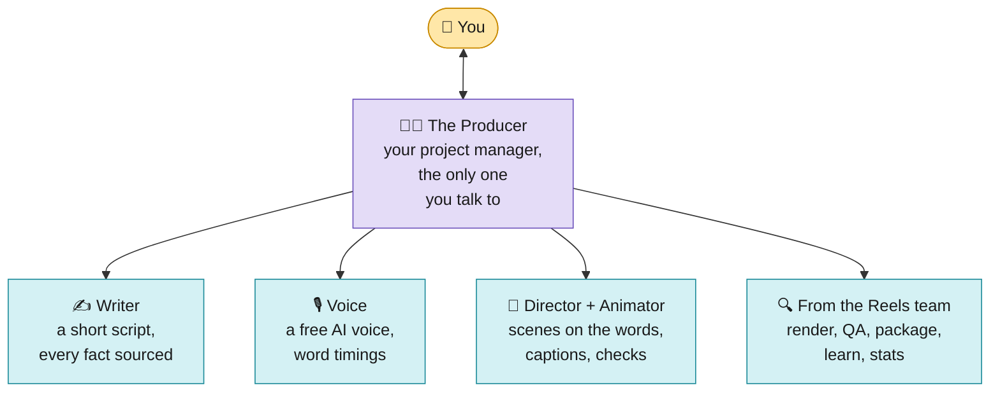
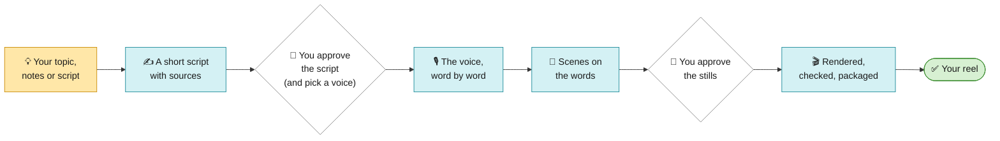
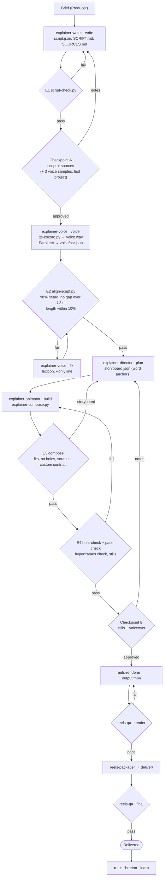

# Explainer: the agent team (free tools only)

The agent team for **faceless animated explainer reels**: a voice explains one idea while code-drawn scenes land on
its words, with word captions on top. No camera, no footage. **1080x1920, 60 fps, 30 to 90 s, free tools only.** The
voice is Kokoro-82M, which runs on your own computer (Apache-2.0); the picture is HyperFrames + GSAP with KaTeX and
Lucide icons. It implements the workflow in [`../README.md`](../README.md) for this profile, reuses five agents from
[`../reels/`](../reels/README.md) for rendering, checking, packaging and learning, and adds tested scripts for the
voice and the scenes. The design is in [`SPEC.md`](SPEC.md), the evidence in [`RESEARCH.md`](RESEARCH.md).

```
explainer/
├── README.md                       this file
├── SPEC.md                         the design
├── PLAN.md                         the build plan it was made from
├── RESEARCH.md                     what works in faceless explainer reels, the voice licence, AI labels
├── skill/explainer/                → install to .claude/skills/explainer/
│   ├── SKILL.md                    the Producer: runs in your main conversation
│   ├── PLAYBOOK.md                 the doctrine every agent follows (§E0 to §E8)
│   ├── tokens.json                 the look: fonts, the Catppuccin Latte palette and its roles, backgrounds, motion timing
│   ├── MOTION.md                   how a reel looks and moves (from motion-graphics-skills, HyperFrames, Remotion)
│   ├── lexicon.json                pronunciations ("WACC" → "wack"), kept across projects
│   ├── assets/fonts/               DM Sans 500/700 and JetBrains Mono 500 (OFL, licences beside them)
│   └── scripts/
│       ├── script-check.py         gate E1: length, hook, sources, payoff and call to action; writes SCRIPT.md
│       ├── tts-kokoro.py           the voice, line by line, joined with pauses, levelled to -16 LUFS
│       ├── align-script.py         gate E2: what Parakeet heard → the shown words with times (transcript.json)
│       ├── plan-storyboard.py      the draft storyboard from the script's viz hints and the aligned words
│       ├── explainer-compose.py    gate E3: storyboard.json → a 1080x1920, 60 fps HyperFrames page and its sound bed
│       ├── transitions.py          how each scene comes in: fade, whip, zoom-through, wipe, burst, cut
│       ├── sound.py                the sound bed: a generated pad or the creator's music, ducked, with sound effects
│       ├── snap-page.py            a real page's screenshot with local Chrome, for the browser scene
│       ├── pace-check.py           gate E4 (pacing): no still stretch over 3 s on the page
│       ├── layout-check.py         gate E5 (a clean picture): every scene in Chromium, no overlap, spill or unsafe text
│       ├── layout-probe.mjs        what layout-check runs in Chromium (HyperFrames' puppeteer and Chrome)
│       ├── explainer_lib.py        shared: word anchors, the scene area, text measured with real glyph widths
│       ├── scenes/                 one module per scene type (21, custom included)
│       ├── dev/                    calibration tools (glyph widths, scene heights in Chromium)
│       └── tests/                  190 tests (python3 -m unittest discover -s tests -t .)
└── agents/                         → install to .claude/agents/
    explainer-writer.md · explainer-voice.md · explainer-director.md · explainer-animator.md
```

---

## 1. What makes an explainer different

| Problem | What the team does | Where |
|---|---|---|
| There is no face to hold the first second | the hook is line 0, at most 12 words, on screen by 0.3 s, a specific promise | PLAYBOOK §E1 |
| The voice must say "one thousand dollars" while the screen shows "$1,000" | every line is kept twice, `say` and `show`; captions show `show`, timed across the whole `say` span | §E2, §E5 |
| A misread acronym spoils the reel | a pronunciation lexicon shared by every project; a bad line is regenerated alone | §E3 |
| Graphics drift off their words | every scene and item is anchored to a word (`word:N`), never to seconds; the kit's beat-check checks every entrance against its word | §E4 |
| A scene that sits still too long | `pace-check.py` fails any stretch over 3 s with nothing changing; ambient motion (glows that travel with each cut, a build's idle motion) never counts as a change | §E1, §E6 |
| A diagram that overflows or collides | gate E5 (`layout-check.py`) opens every scene in Chromium on your machine and fails on text over text, text crossing a shape, text out of its card, anything outside the safe area, small text, clipped text and WCAG contrast; the hub computes its own geometry; every scene type passes it at three lengths of text (`test_every_scene_case_is_clean`) | §E4 |
| A hook that costs tokens to write | the `kinetic` scene: kinetic type from a one-line hint in script.json, no code | §E6 |
| A small widget in an empty frame | every library scene is scaled up (to 1.8x) to fill the scene area, down to y 1420; no ease overshoots, nothing breathes without a reason, every cut is velocity-matched; the hook is kinetic type from data, and custom scenes are kept for what the library can't draw ([MOTION.md](skill/explainer/MOTION.md)) | §E6 |
| Slides instead of a video | six build-up scenes that grow on the words (flow, stack, compare, timeline, cards, hub), automatic transitions, real logos and real page screenshots | §E4, §E6 |
| Silence between lines | a sound bed under the voice (a generated pad or the creator's track), ducked, with a whoosh on transitions and a pop as items land | §E3 |
| A storyboard costs many tokens | the Writer hints a picture for each line (`viz`) and `plan-storyboard.py` writes the draft with every anchor; the Director only edits | §E2, §E4 |
| Text overflowing or under the app's buttons | each scene knows its own height (calibrated in Chromium to within 4 px) and is placed inside the safe zone by construction | §E4 |
| Nothing on screen for a moment | the composer fails on any gap over 0.3 s with no scene | §E4 |
| A number with nothing behind it | every number on screen carries a source, checked twice (script and storyboard) | §E7 |
| An AI voice may need a label | the posting checklist turns on Instagram's AI label, and says to check the other apps' rules | §E3, RESEARCH §5 |

## 2. Install

From the folder you run Claude Code in, with the kit's `youtube-edit` skill and the Reels skill and agents already
installed (see [`../reels/README.md`](../reels/README.md) section 2), and this repository's `Editing-Workflow/`
folder present:

```bash
mkdir -p .claude/skills .claude/agents
cp -R Editing-Workflow/explainer/skill/explainer .claude/skills/
mkdir -p .claude/skills/explainer/templates && cp -R Editing-Workflow/templates/. .claude/skills/explainer/templates/
cp Editing-Workflow/explainer/agents/explainer-*.md .claude/agents/
# the voice (free, runs locally; espeak-ng helps with words outside its dictionary):
pip install kokoro soundfile          # and: sudo apt install espeak-ng   (or: brew install espeak-ng)
npx hyperframes models install parakeet
# free libraries, copied locally so renders work offline:
V=.claude/skills/explainer/assets/vendor && mkdir -p $V/katex $V/lucide $V/three $V/simple-icons && cd $V \
  && npm pack gsap@3.14.2 katex@0.16.11 lucide-static@0.454.0 three@0.169.0 simple-icons@13.21.0 \
  && for f in *.tgz; do mkdir -p "x-$f" && tar -xzf "$f" -C "x-$f"; done \
  && cp x-gsap-*/package/dist/gsap.min.js . \
  && cp -R x-katex-*/package/dist/katex.min.js x-katex-*/package/dist/katex.min.css x-katex-*/package/dist/fonts katex/ \
  && cp x-lucide-static-*/package/icons/*.svg lucide/ \
  && cp x-three-*/package/build/three.module.min.js three/ \
  && cp -R x-simple-icons-*/package/icons x-simple-icons-*/package/_data simple-icons/ \
  && rm -rf x-* *.tgz && cd -
# check the scripts:
cd .claude/skills/explainer/scripts && python3 -m unittest discover -s tests -t . && cd -
```

Then open a **new** conversation and say:

> Make an explainer reel about [topic] for [who]. About 75 seconds, ending with [call to action].

or paste notes or a finished script instead of a topic. Models: every agent says `model: inherit`; a smaller model
suits the Voice agent, and keep the Producer, Writer and Director on the strongest.

## 3. The team



<sub>🟨 yellow = you · 🟦 blue = the AI team · 🟩 green = finished</sub>

| Agent | Jobs | Writes |
|---|---|---|
| **Producer** (skill) | the brief, every stage, both checkpoints, routing, delivery | `STATUS.md`, `NOTES.md`, briefs |
| `explainer-writer` | `write`, `rewrite` | `script.json`, `SCRIPT.md`, `SOURCES.md` |
| `explainer-voice` | `samples` (first project), `voice`, `fix` | `voice.wav`, `lines/`, `voice/asr.json`, `transcript.json`, `VOICE.md` |
| `explainer-director` | `plan`, `replan` | `storyboard.json`, `custom/<id>.md`, `ASSET-REQUESTS.md` |
| `explainer-animator` | `build`, `rebuild`: custom scenes, compose, check, stills | `public/`, `custom/*.html`, `snaps/guides/sheet.png`, `snaps/SCENES.md` |
| `reels-renderer` | 1080x1920, 60 fps, 20 Mb/s, BT.709 | `output.mp4` |
| `reels-qa` | the file checks, captions, loudness, first frame (no footage checks) | `QA.md` |
| `reels-packager` | music (if any), -14 LUFS, covers, `captions.srt`, post caption and checklist | `deliver/` |
| `reels-librarian` | a note → a rule; new pronunciations; custom scenes promoted to the library | PLAYBOOK, lexicon, scenes, tests |
| `reels-analyst` | Insights a week after posting | `INSIGHTS.md` |

## 4. The flow



<sub>🟨 yellow = you · 🟦 blue = the AI team · 🟩 green = finished · ⬜ white = waits for you</sub>

<details>
<summary>The detailed flow (agents, files and gates)</summary>



</details>

## 5. The scripts and how they were verified

| Script | What it does | Tests |
|---|---|---|
| `script-check.py` | gate E1 on `script.json`; writes `SCRIPT.md` | 16: lengths and target (30 to 90 s), the brief's warnings (format, audience, goal, you, a question, an example, the format's shape), hook, sources (objects or plain strings), payoff and call to action, the report |
| `tts-kokoro.py` | Kokoro line by line (`--only` one line), pauses by break, high-pass, compression, two-pass loudnorm to -16 LUFS / -1 dBTP (a peak over -1 dBTP fails); `--samples` for the voice choice; a `fake` engine for tests | 7 (1 needs Kokoro) |
| `align-script.py` | gate E2: sequence alignment of heard to spoken words (tolerant of spelling, of the lexicon's respellings, of digits heard for number words: "1,000", "10%", "2024", "2.5"), shown words timed across their spoken span, spoken-only words at the start included | 11 |
| `pace-check.py` | gate E4's pacing, from the `moments.json` the composer writes next to the page: every tween, count and item is a moment of change, ambient motion is not; a still stretch over 3 s fails, over 2 s warns (the kit's gap-scan can't see it: scenes always cover the voice) | 5, and it runs in the end-to-end test |
| `plan-storyboard.py` | the draft storyboard: `viz` hints into scenes with each item on its word (an unspoken item halfway between its neighbours), money into count-ups, steps into numbers, brands into logo cards, the rest into draft titles; `PLAN.md` says which rule made each scene | 6, including the draft composing and passing pace-check, and a line with two pictures |
| `transitions.py` | the transition for each scene (fade first, wipe on a new background, then a zoom-through and a whip, velocity-matched with a motion blur), the matching exit, the background wipe, the seeded burst | 7 |
| `sound.py` | the generated pad and sound effects (the same bytes every time), the events (a whoosh per moving transition, a chime on the payoff, pops 0.35 s apart), the bed: looped, faded, ducked under the voice | 6: never silent, at least 6 dB of ducking, the creator's track looped and faded |
| `snap-page.py` | a page's screenshot at an exact size with local Chrome in a fresh profile | 2 (1 needs Chrome) |
| `explainer-compose.py` | gate E3: places every scene by its measured height and scales it up to fill the scene area, glows that travel with each cut, transitions, word captions with the highlight box, the voice and the sound bed, the kit's markup; WARNs on a title that repeats the voice and on the same layout twice in a row | 33 (6 for the craft rules: fill, title size, the taller area, same layout), plus the kit's beat-check run on its page; bad storyboard values fail with the scene named |
| `scenes/*.py` | 19 library scenes (6 build-up scenes and the logo card among them) and the sandboxed custom scene | 39 across the scene and asset suites (a screenshot punching in on its focus line among them), 10 for the custom contract (unique build names, and MOTION.md's banned eases, loops and randomness) |
| heights | each scene's predicted height against Chromium, 3 cases × 2 column widths × 19 scene types, and the kinetic hook at the width it was composed at | 2, over 121 measured rows: every one 0 to 4 px over, never under |
| `layout-check.py` | gate E5: every scene in Chromium at the moment it is fully built (overlap, cover, crossing, spill, safe area, size; `hyperframes check` adds clipping and contrast) | 4, including every scene type at three lengths of text, clean |
| theme | the Catppuccin Latte palette, every role pair at its WCAG ratio, every colour on every scene case in the palette | 5 |
| `scenes/kinetic.py` | the kinetic hook: pieces on their words, the accent, bad data refused, any hook fits its width | 5, and the planner's kinetic shorthand |
| `explainer_lib.py` | anchors, tokens, glyph-width text measuring | 5 |
| docs | frontmatter parses, cited scripts exist, § references resolve, links, mermaid fences, the STATUS Voice row, the reused QA and Packager briefs, MOTION.md read first | 10 |
| end to end | script-check → fake voice → alignment → compose → beat-check → `hyperframes check` → a 60 fps render → the kit's `verify-render.py --res 1080x1920` | 1 (needs FFmpeg, the kit, HyperFrames and a local GSAP), plus 1 with real Kokoro and Parakeet |

**How it was verified** (2026-10-14 and 2026-10-15, on Linux with HyperFrames 0.8.157 and 0.8.159, and Chromium):
- the whole suite: 190 tests, all passing; 2 skipped where Kokoro is not installed (re-run 2026-10-16 after the
  Catppuccin Latte pass, HyperFrames 0.8.164);
- the end-to-end run (pace-check included): a 4-line, 30-word script voiced by the fake engine (11.09 s, -15.95 LUFS), aligned 100% with
  the widest gap inside a line 0.02 s, composed into 4 scenes, 4 backgrounds and 8 caption phrases, rendered at
  1080x1920 and 60 fps (11.6 s, about 20 MB) and passed by `verify-render.py`; the frames were looked at by eye;
- the scene heights: glyph widths of the bundled fonts and the laid-out height of every scene type, measured in
  Chromium with `dev/` (see [`skill/explainer/scripts/dev/README.md`](skill/explainer/scripts/dev/README.md)).

**Not yet verified here:** the real voice. Kokoro could not be installed in the build environment (its model downloads
from Hugging Face, which that environment's network blocks), so `test_real_kokoro_parakeet_alignment` (Kokoro voice →
Parakeet → align, 98% at least) and the real speaking rate (RESEARCH §3) are checked on the first real project.

## 6. Known limits

- **One language:** English voices (`a` American, `b` British). Kokoro has other languages; the scripts and lexicon
  assume English.
- **Formula widths** are estimated from the TeX source (KaTeX's real width is only known in the browser); a long
  formula is shrunk to its row in the browser, and gate E5 checks the result.
- **Fonts:** this profile bundles its own copy of DM Sans and JetBrains Mono, so its glyph-width measurements do not
  depend on the kit's files.
