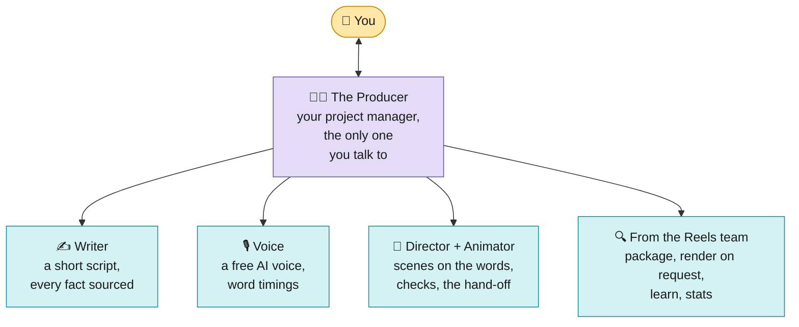
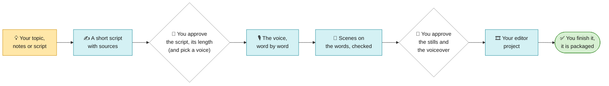
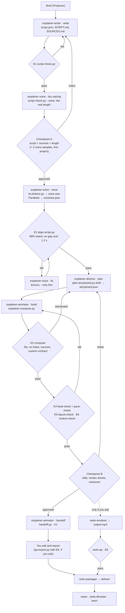

# Explainer: the agent team (free tools only)

The agent team for **faceless animated explainer reels**: a voice explains one idea while code-drawn scenes land on
its words. No camera, no footage. **1080x1920, 60 fps, 30 to 90 s (45 by default), free tools only.** You bring a
topic, notes or a script; a Writer makes a short sourced script, a free voice that runs on your own computer reads it
(Kokoro-82M, Apache-2.0), every word is timed, and scenes build on those words: diagrams, objects, 3D, charts,
formulas, a neural network, a loss surface, or one continuously changing stage. The result is an **editor project**
with each scene its own clip, which you finish; a rendered reel when you ask.

It implements the workflow in [`../README.md`](../README.md) for this profile, reuses five agents from
[`../reels/`](../reels/README.md) for packaging, the opt-in render and learning, and adds tested scripts for the
script, the voice and the scenes. The design is in [`SPEC.md`](SPEC.md), the evidence in [`RESEARCH.md`](RESEARCH.md),
the doctrine in [the PLAYBOOK](skill/explainer/PLAYBOOK.md) and [MOTION.md](skill/explainer/MOTION.md).

```
explainer/
├── README.md                       this file
├── SPEC.md                         the design
├── RESEARCH.md                     what works in faceless explainer reels, the voice licence, AI labels
├── skill/explainer/                → install to .claude/skills/explainer/
│   ├── SKILL.md                    the Producer: runs in your main conversation
│   ├── PLAYBOOK.md                 the doctrine every agent follows (§E0 to §E8), with every scene and its fields
│   ├── MOTION.md                   how a reel looks and moves (from motion-graphics-skills, HyperFrames, Remotion)
│   ├── tokens.json                 the three looks (latte, paper, dark), the five palettes, colour roles per ground, motion
│   ├── lexicon.json                pronunciations ("WACC" → "wack"), kept across projects
│   ├── voice-rates.json            words a second for each voice and speed, measured from its samples
│   ├── assets/fonts/               DM Sans, JetBrains Mono, Archivo (wide), Instrument Serif italic (OFL, licences beside them)
│   └── scripts/
│       ├── script-check.py         gate E1: length, hook, sources, payoff and call to action; writes SCRIPT.md
│       ├── tts-kokoro.py           the voice, line by line, joined with pauses, levelled to -16 LUFS
│       ├── align-script.py         gate E2: what Parakeet heard → the shown words with times (transcript.json)
│       ├── plan-storyboard.py      the draft storyboard from the script's picture hints and the aligned words
│       ├── explainer-compose.py    gate E3: storyboard.json → a 1080x1920, 60 fps HyperFrames page and its sound bed
│       ├── transitions.py          how each scene comes in (fade, push, zoom-through, wipe, burst, cut, brush, leak) and the close (fade or rewind)
│       ├── sound.py                the sound bed: a generated pad or your music, ducked, with sound effects
│       ├── pace-check.py           gate E4 (pacing): no still stretch over 3 s, no picture held over 8 s, one read at a time
│       ├── layout-check.py         gate E5 (a clean picture): every scene, cut and stage beat in Chromium
│       ├── layout-probe.mjs        what layout-check runs in Chromium (formulas measured glyph by glyph)
│       ├── motion-check.py         gate E6 (a living picture): on the page, on a render, on your export
│       ├── stills.py               the Checkpoint B stills: every scene settled, every stage beat, the hook at 0.3, 0.7, 1.0 s
│       ├── review.py               the review sheets: a strip per cut, a timing sheet per scene, 1:1 crops
│       ├── handoff.py              the editor hand-off: each scene a transparent clip, the filmcraft project
│       ├── headline.py             the headline layer: a big top-left headline, kicker, sub or serif aside over any scene
│       ├── thread.py               one line through the reel that morphs on the words (drop, loop, wave...)
│       ├── palettes.py             the five palettes, listed for you to choose (best fit for a topic first)
│       ├── paper.py                the paper look's seeded texture
│       ├── snap-page.py            a real page's screenshot with local Chrome, for the browser scene
│       ├── imagesize.py            an image's size from its own header (PNG, JPEG, WebP, GIF)
│       ├── preflight.py            prepares a machine once (Windows included) and writes PREFLIGHT.md
│       ├── skill-version.py        pins the skill's files at the brief; a changed skill stops the next stage
│       ├── new-version.py          a clean folder for each version of a reel (v2, v3...)
│       ├── explainer_lib.py        shared: word anchors, the scene area, the looks, text measured with real glyph widths
│       ├── scenes/                 one module per scene: 60 library scenes, the custom scene and the stage, found without a list
│       ├── dev/                    calibration tools (glyph widths, scene heights in Chromium) and the scene cases
│       └── tests/                  600 tests (python3 -m unittest discover -s tests -t .)
└── agents/                         → install to .claude/agents/
    explainer-writer.md · explainer-voice.md · explainer-director.md · explainer-animator.md
```

---

## 1. What makes an explainer different

> **The end of every run is a project you edit, not a finished video.** After you approve the stills, the team hands
> you an editor project: open `edit/<project>.fcproj` in [filmcraft](https://github.com/storytold/filmcraft) (free,
> open source; or import the `.xml` into filmcraft, Premiere Pro or DaVinci Resolve). Every scene is its own
> transparent clip on its own track, the voice, music and sound effects are on theirs, captions come as an editable
> `.srt`, and markers show the hook and each scene's word and source. You trim, re-time, mix and export. A finished
> render is still there when you want one: just ask (`python3 Editing-Workflow/wf.py render videos/<project> --profile explainer`).

There is no face, no footage and no take to choose, so the voice and the picture are both made, and both are checked
before you see them.

| Problem | What the team does | Where |
|---|---|---|
| There is no face to hold the first second | the hook is line 0, at most 12 words, a specific promise, kinetic type; E3 fails a hook item later than 0.8 s, so it is whole on screen by 1.0 s | PLAYBOOK §E1 |
| The voice must say "one thousand dollars" while the screen shows "$1,000" | every line is kept twice, `say` and `show`; captions show `show`, timed across the whole `say` span | §E2, §E5 |
| A length guessed from a word count | `script-check.py --voice` times the script at your voice's own measured rate, pauses included; the length is decided at Checkpoint A | §E1 |
| A misread acronym spoils the reel | a pronunciation lexicon shared by every project; a bad line is regenerated alone | §E3 |
| Graphics drift off their words | every scene and item is anchored to a word (`word:N`), never to seconds; the kit's beat-check checks every entrance against its word | §E4 |
| Slides instead of a video | build-up scenes that grow on the words (empty slots fill as they are said, never ghost text), objects instead of boxes, 3D, charts, math scenes, and a **stage** that keeps one picture changing instead of cutting | §E4, §E6 |
| A small widget in an empty frame | every library scene is scaled up (to 1.8x) to fill the scene area, with a slow camera drift and particles; no ease overshoots, every cut velocity-matched | §E6, MOTION.md |
| A diagram that overflows or collides | each scene knows its own height (calibrated in Chromium to within 4 px) and is placed by construction; then gate E5 opens every scene, cut and stage beat in Chromium and fails text over text, text under a shape (a formula judged glyph by glyph), spill, unsafe or small text, clipping and poor contrast | §E4 |
| A scene that sits still | E4 fails any stretch over 3 s with nothing changing and any picture held over 8 s; E6 fails a still stretch over 1 s or a reel still more than 15 % of the time | §E1, §E6 |
| A math reel in the 3Blue1Brown style | the `dark` look, `formula`, `plot`, `network`, `surface` and `outputs`, the `stage`, captions off and a rewind close | §E6.11, §E6.12 |
| A reel that looks like slides, not a magazine | the `paper` look: warm paper, near-black ink, one red accent, a wide heavy headline, a serif aside, a hand-drawn thread through the reel | §E4.6, §E4.11, §E4.12 |
| A number with nothing behind it | every number on screen carries a source, checked twice (script and storyboard) | §E7 |
| Silence between lines | a sound bed under the voice (a generated pad or your track), ducked, a whoosh on transitions, a pop as items land, a chime on the payoff | §E3 |
| A storyboard costs many tokens | the Writer hints a picture for each line and `plan-storyboard.py` writes the draft with every anchor; the Director only edits | §E2, §E4 |
| A machine nobody prepared | `preflight.py` once per machine: the Python command, UTF-8, every tool, every suite, failing tests named | SKILL.md |
| An AI voice may need a label | the posting checklist turns on Instagram's AI label, and says to check the other apps' rules | §E3, RESEARCH §5 |

## 2. Install

From the folder you run Claude Code in, with the kit's `youtube-edit` skill and the Reels skill and agents already
installed (see [`../reels/README.md`](../reels/README.md) section 2), and this repository's `Editing-Workflow/`
folder present:

```bash
mkdir -p .claude/skills .claude/agents
cp -R Editing-Workflow/explainer/skill/explainer .claude/skills/
mkdir -p .claude/skills/explainer/templates && cp -R Editing-Workflow/templates/. .claude/skills/explainer/templates/
cp Editing-Workflow/explainer/agents/explainer-*.md .claude/agents/
# the voice (free, runs locally; espeak-ng helps with words outside its dictionary):
pip install kokoro soundfile          # and: sudo apt install espeak-ng   (or: brew install espeak-ng)
npx hyperframes models install parakeet
# free libraries, copied locally so renders work offline:
V=.claude/skills/explainer/assets/vendor && mkdir -p $V/katex $V/lucide $V/three $V/simple-icons && cd $V \
  && npm pack gsap@3.14.2 katex@0.16.11 lucide-static@0.454.0 three@0.169.0 simple-icons@13.21.0 \
  && for f in *.tgz; do mkdir -p "x-$f" && tar -xzf "$f" -C "x-$f"; done \
  && cp x-gsap-*/package/dist/gsap.min.js . \
  && cp -R x-katex-*/package/dist/katex.min.js x-katex-*/package/dist/katex.min.css x-katex-*/package/dist/fonts katex/ \
  && cp x-lucide-static-*/package/icons/*.svg lucide/ \
  && cp x-three-*/package/build/three.module.min.js three/ \
  && cp -R x-simple-icons-*/package/icons x-simple-icons-*/package/_data simple-icons/ \
  && rm -rf x-* *.tgz && cd -
# check the scripts:
cd .claude/skills/explainer/scripts && python3 -m unittest discover -s tests -t . && cd -
```

Or `python3 Editing-Workflow/wf.py install explainer` for the copy steps (`--dry-run` prints them; the vendor folder
and Kokoro are still the commands above), then `python3 Editing-Workflow/wf.py doctor`. The layout check opens every
scene in the Chrome HyperFrames uses; if it is missing, run `npx hyperframes browser ensure`. For the native `.fcproj`,
install `filmcraft-cli`; without it the hand-off writes the `.xml`. On a new machine (Windows especially), run
`python .claude/skills/explainer/scripts/preflight.py --out videos/_preflight` once.

Then open a **new** conversation and say:

> Make an explainer reel about [topic] for [who]. About 45 seconds, ending with [call to action].

or paste notes or a finished script instead of a topic. For a math or AI reel, add *"dark look, captions off"*.
Models: every agent says `model: inherit`; a smaller model suits the Voice agent, and keep the Producer, Writer and
Director on the strongest.

## 3. Where you decide

| When | What you decide | What you are shown |
|---|---|---|
| **The brief** | nine questions, each with a default ("defaults" is a valid answer): (1) the input and every source you have; (2) who it is for, the pain, the goal (follows, comments, saves, shares, a link, or teaching) and the format (how-to, this vs that, myth and truth, story, plain explainer); (3) the length; (4) the call to action, and a series name, part and handle; (5) terms to say and spell right; (6) the voice; (7) music: the generated pad, your free track, or none; (8) **the look and the palette**, and any images to show, each credited; (9) **captions on or off, and a fade or rewind ending**; optionally your voice profile from 3 to 6 of your own scripts | one numbered message |
| **Checkpoint A** | the script, its angle and hook (two or three offered from a topic), its exact length; on the first project, your channel's voice from three 10-second samples | `SCRIPT.md`, `SOURCES.md`, the length timed at the voice's own rate |
| **Checkpoint B** | every picture, the timing and the voice, before anything is built for real | `stills.py`: every scene once settled, a stage at each of its beats, the hook at 0.3, 0.7 and 1.0 s, the covered areas drawn on; `review.py`'s sheets; a list of what is on screen when; the full voiceover (listening is yours: no check replaces it) |
| **The hand-off** | finish the project yourself (the default) or ask for a render | `edit/`, with `HANDOFF.md` |
| **Notes, "save this to the skill"** | what to change; what becomes a rule | words go to the Writer, a pronunciation to the Voice, timing or pictures to the Director and Animator, a fact to the Writer; a lasting rule to the Librarian |

## 4. The team



<sub>🟨 yellow = you · 🟪 purple = the Producer · 🟦 blue = the AI team</sub>

| Agent | Jobs | Writes |
|---|---|---|
| **Producer** (skill) | the brief, every stage, both checkpoints, routing, the hand-off | `STATUS.md`, `NOTES.md`, briefs |
| `explainer-writer` | `write`, `rewrite` | `script.json`, `SCRIPT.md`, `SOURCES.md` |
| `explainer-voice` | `samples` (first project), `voice`, `fix` | `voice.wav`, `lines/`, `voice/asr.json`, `transcript.json`, `VOICE.md` |
| `explainer-director` | `plan`, `replan` | `storyboard.json`, `custom/<id>.md`, `ASSET-REQUESTS.md` |
| `explainer-animator` | `build`, `rebuild` (custom scenes, compose, checks, stills, review sheets), `handoff` | `public/`, `custom/*.html`, `snaps/`, `layers/`, `edit/` |
| `reels-packager` | from your export: covers, `captions.srt`, `POST.md` through `post-check.py`, the posting checklist | `deliver/` |
| `reels-renderer` | **opt-in**: 1080x1920, 60 fps, 20 Mb/s, BT.709 | `output.mp4` |
| `reels-qa` | on a render: the file checks, captions, loudness, first frame, E6 (no footage checks) | `QA.md` |
| `reels-librarian` | a note → a rule; new pronunciations; custom scenes promoted to the library | PLAYBOOK, lexicon, scenes, tests |
| `reels-analyst` | Insights a week after posting | `INSIGHTS.md` |

## 5. The flow



<sub>🟨 yellow = you · 🟦 blue = the AI team · ⬜ white = waits for you · 🟩 green = finished</sub>

<details>
<summary>The detailed flow (agents, files and gates)</summary>



</details>

| # | Stage | Agent · job | Gate |
|---|---|---|---|
| 2 | Script | `explainer-writer` · write | E1 |
| 2b | Dry voicing | `explainer-voice` · voice, then `script-check.py --voice` | its real length |
| A | **Checkpoint A** | you | approval |
| 3 | Voice | `explainer-voice` · voice | E2 |
| 4 | Storyboard | `explainer-director` · plan (from `plan-storyboard.py`'s draft) | its self-check |
| 5 | Compose | `explainer-animator` · build | E3, E4, E5, E6 on the page |
| B | **Checkpoint B** | you | approval |
| 6 | **Hand-off** | `explainer-animator` · handoff | H1 (`handoff-check.py`) |
| 7 | You edit | you, in filmcraft (or Premiere, or Resolve); `qa-export.py` if you want it | your call |
| 8 | Package | `reels-packager`, from your export | post-check |
| R | Render (opt-in) | `reels-renderer`, then `reels-qa` with E6 | its gates |
| 9 | Notes | you | every note routed |
| 10 | Learn | `reels-librarian` | its tests |

Run a stage's gates yourself with `python3 Editing-Workflow/wf.py gates videos/<project> --profile explainer --stage <id>`.

## 6. What it can draw

Sixty library scenes, a sandboxed custom scene for anything else, and a stage that holds the others. Every scene
builds on the voice's words, holds alive while it is on screen, and leaves cleanly. The PLAYBOOK lists every scene with
its fields.

| Kind | Scenes |
|---|---|
| Hooks | `kinetic` (kinetic type from a one-line hint: a big number or word, a claim, a word struck through, a punch line), `title`, `title-card`, `number` |
| Build-ups | `flow`, `stack`, `compare`, `timeline`, `cards`, `list-cards`, `hub`, `qa-stack`, `icon-row`, `icon-strike`, `crossed-list` |
| Objects | `chat`, `doc`, `prompt-bar`, `storyboard-deck`, `nle-timeline`, `grade-slider`, `eyedropper-grade`, `film-look`, `reel-feed`, `browser`, `file-drop`, `comment-drop`, `comment-cta`, `video-card`, `playing-grid`, `mode-switch`, `waveform`, `jiggle-delete`, `gravity-drop` |
| Data | `count-up`, `stat`, `line-chart`, `bars`, `sheet`, `duration`, `price-sticker`, each number with its source |
| 3D (CSS and SVG, a fixed view) | `bars-3d`, `cube`, `cards-3d`, `briefcase` (opens), `beaker` (fills in layers), `donut`, `coin` (flips in), `balance` (tips) |
| Math | `formula` (KaTeX, a colour per symbol), `plot` (a loss curve whose tangent slides to the minimum), `network` (a handwritten digit in, a forward pass, the answer ringed, the error swept back), `surface` (a loss bowl a ball descends one gradient step at a time), `outputs` (guesses against the right answer, each error and the loss as a square) |
| The stage | `stage`: one continuous picture; any library scenes as objects in boxes that come in, leave, move and resize on their words (the network shrinks aside while the curves come in, the formula above it changes); E5 checks it at every beat |
| Real things | `logo-card` (Simple Icons), page screenshots that zoom to one line (`snap-page.py`), `product-hero` (a cut-out with notes drawn on), `photo-grid`, `line-art`, all credited |
| Words | `giant-captions` (the voice's own words, huge in the middle), the headline layer, word captions |
| Anything else | `custom`: sandboxed HTML and GSAP (three.js allowed), under MOTION.md's lint (no banned eases, loops or randomness) and the same gates |

**Where it draws.** The scene area is x 65 to 1015, y 345 to 1105, clear of the app's buttons; below y 960 only the
narrower column (x 150 to 930) is used; text is never under 28 px. Word captions sit under the picture (44 px, y 1130
to 1235). With **captions off** the scenes centre lower and may grow into that band, down to y 1235, and E5 checks
against the larger area.

**Looks and palettes** (one word each in the script):

| Look | Feel | Best for |
|---|---|---|
| `latte` | soft Catppuccin grounds with a rhythm: the hook on ink, the payoff and every third scene on blue, the rest light | general explainers |
| `paper` | editorial: warm paper, near-black ink, one red accent, a wide heavy headline (Archivo), a serif italic aside, a hand-drawn thread | products and tech |
| `dark` | near-black grounds and manim's colours (accent `#58c4dd`), UI mock-ups kept on light paper | math, AI, how-it-works |

The five palettes, `terracotta`, `monochrome`, `electric-pop`, `nordic-frost` and `bold-citrus`, change colour only,
on any look; each keeps every contrast rule (3:1 or better on its ground, checked by E5), and brand badges keep their
exact colours. `palettes.py` lists them with the best fit for your topic first.

**Motion and sound.** Transitions are picked by what changes: a new place gets a wipe or a brush, the same idea a
fade, and there are push, zoom-through, burst, cut and a light leak. The last scene closes into the hook's ground so
the reel loops, or **rewinds**: it streaks back under a rewind mark. A slow camera drift and particles keep every frame
alive; eases never overshoot, nothing is random, and every frame is the same on every render. Under the voice: a soft
generated pad (or your track), ducked, a whoosh per moving transition, a pop as each item lands, a chime on the payoff.

## 7. The scripts and how they were verified

| Script | What it does | Tests |
|---|---|---|
| `script-check.py` | gate E1 on `script.json` (with the kit's `wording.py`); `--voice` times it at the voice's rate; writes `SCRIPT.md` | `test_script_check.py` |
| `tts-kokoro.py` | Kokoro line by line (`--only` one line), pauses by break, high-pass, compression, two-pass loudnorm to -16 LUFS / -1 dBTP; `--samples` for the voice choice; a `fake` engine for tests | `test_tts.py` (1 needs Kokoro) |
| `align-script.py` | gate E2: heard words aligned to spoken words (tolerant of spelling, the lexicon's respellings and digits heard for number words), shown words timed across their spoken span | `test_align.py` |
| `plan-storyboard.py` | the draft storyboard: picture hints into scenes, every item on its word; carries the look, palette, captions and close | `test_plan.py` |
| `explainer-compose.py` | gate E3: every scene placed by its measured height and scaled up to fill the area, transitions, glows, captions or none, the close, the sound bed, `moments.json` for the checkers | `test_compose.py`, `test_craft.py`, `test_foundations.py`, `test_living.py`, `test_dark.py` |
| `scenes/*.py` | the 60 library scenes, the custom scene's contract and the stage | `test_scenes_*.py`, `test_custom.py`, `test_stage.py`, `test_kinetic.py`, `test_giant.py`, `test_assets.py`, `test_images.py` |
| heights | each scene's predicted height against Chromium, three text lengths × two column widths × every scene type | `test_heights.py`: every row 0 to 4 px over, never under |
| `pace-check.py` | gate E4's pacing and read floor, from `moments.json` | `test_pace.py`, `test_pace_manifest.py` |
| `layout-check.py`, `layout-probe.mjs` | gate E5 in Chromium: every scene settled, every cut 1/30 s apart, every stage beat; formulas glyph by glyph | `test_layout.py`: every scene type at three lengths of text, clean |
| `motion-check.py` | gate E6 on the page (`--index`) and on a video | `test_motion.py` |
| `stills.py`, `review.py` | Checkpoint B's stills (stage beats included) and the review sheets | `test_stills.py`, `test_review.py` |
| `handoff.py` | the editor project: each scene a transparent clip, voice, music and effects on their tracks, captions, markers | `test_handoff.py` |
| `transitions.py`, `sound.py`, `paper.py`, `thread.py`, `headline.py` | transitions and the close, the sound bed, the paper texture and boil, the thread, the headline layer | `test_transitions.py`, `test_sound.py`, `test_paper.py`, `test_boil.py`, `test_thread.py`, `test_editorial.py` |
| looks and palettes | every look and palette, every role pair at its WCAG ratio, every colour on every scene case in its palette | `test_theme.py`, `test_palettes.py`, `test_dark.py` |
| `preflight.py`, `skill-version.py`, `new-version.py` | the machine prepared once; the skill pinned at the brief; a clean folder per version | `test_sops.py`, `test_portable.py` (every text file opened as UTF-8, so Windows passes) |
| docs | frontmatter, cited scripts, § references, links, mermaid fences, the reused Reels briefs, MOTION.md read first | `test_docs.py` |
| end to end | script-check → fake voice → alignment → compose → beat-check → `hyperframes check` → a 60 fps render → `verify-render.py --res 1080x1920` | `test_end_to_end.py` (needs FFmpeg, the kit, HyperFrames and a local GSAP), plus one with real Kokoro and Parakeet |

**How it was verified** (2026-10-14 to 2026-10-24, on Linux with HyperFrames 0.8.157 to 0.8.171, and Chromium):
- the whole suite: **600 tests, all passing**, 3 skipped where Kokoro or a long render is not available;
- every scene type, at three lengths of text, passes E5 in Chromium (`test_every_scene_case_is_clean`);
- a full backprop reel in the dark look (the network, the outputs, the loss curves, the surface and the formula on
  one stage, captions off, a rewind close) was composed, checked, rendered and put side by side with the reference
  reel it was modelled on;
- a 33 s paper-look demo and a 48 s RAG reel passed E1 to E5 before rendering, then E6 and `verify-render.py`;
- the scene heights: glyph widths of the bundled fonts and the laid-out height of every scene type, measured in
  Chromium with `dev/` (see [`skill/explainer/scripts/dev/README.md`](skill/explainer/scripts/dev/README.md)).

**Not yet verified here:** the real voice. Kokoro, Parakeet and Whisper download their models from Hugging Face, which
the build environment's network blocks, so `test_real_kokoro_parakeet_alignment` (Kokoro voice → Parakeet → align,
98 % at least) and the real speaking rate (RESEARCH §3) are checked on the first real project. The backprop
demo's words were timed by their length for the same reason.

## 8. Known limits

- **One language:** English voices (`a` American, `b` British). Kokoro has other languages; the scripts and lexicon
  assume English.
- **Vertical only, 30 to 90 s.**
- **3D is CSS and SVG from a fixed view** (no imported models); a custom scene can use three.js.
- **Text never under 28 px.** A stage object with words can only shrink so far; one without words (a network without
  labels) can shrink to a corner.
- **Formula widths** are estimated from the TeX source (KaTeX's real width is only known in the browser); a long
  formula is shrunk to its row in the browser, and gate E5 checks the result glyph by glyph.
- **Word timing needs a recogniser** (Parakeet, or Whisper). Without one the voice can still be made, but words are
  timed by their length; check the timing at Checkpoint B.
- **Images** are yours: the team never generates or fetches photos; a photo without a credit fails E3.
- **The team never posts.** You export, you post, and you turn on the app's AI-voice label.
