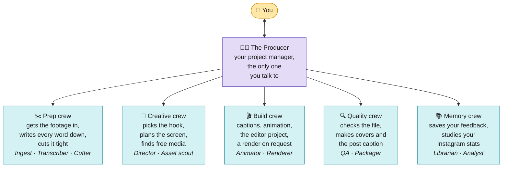
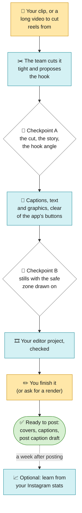
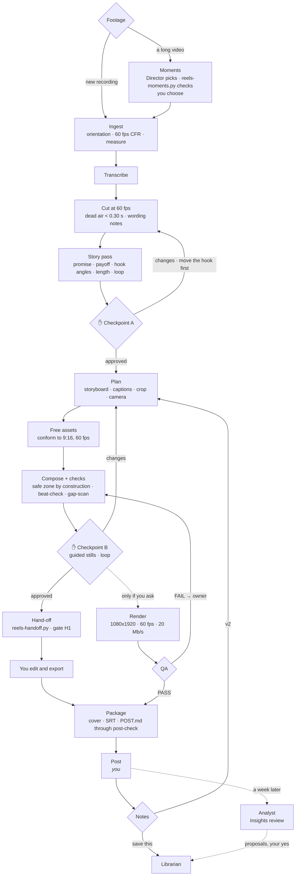

# Reels: the agent team (free tools only)

The agent team for **vertical short videos**: Instagram Reels first, and the same file posts as a YouTube Short and a
TikTok. **1080x1920, 60 fps, 15 to 60 s by default (up to 3 minutes), free tools only.** You bring a vertical clip, or
a long video to cut reels from; the team cuts it tight with the strongest line first, builds word captions and
graphics clear of the app's buttons, and hands you an **editor project** to finish, then writes the covers, the
captions file and a checked draft of the post caption.

It implements the workflow in [`../README.md`](../README.md) for this profile, on top of the kit
([`../kit/`](../kit/README.md)), with the project files from [`../templates/`](../templates/README.md), short-form
practice from [background research](RESEARCH.md), and **tested scripts** for the vertical format the kit doesn't have.
The long-form team's editor hand-off runs on this skill's `reels-handoff.py` too.

```
reels/
├── README.md                       this file
├── RESEARCH.md                     what works in short vertical video, with sources and confidence levels
├── skill/reels/                    → install to .claude/skills/reels/
│   ├── SKILL.md                    the Producer: runs in your main conversation
│   ├── PLAYBOOK.md                 the Reels doctrine every agent follows (§R0 to §R14)
│   └── scripts/
│       ├── reels-compose.py        storyboard.json → a 1080x1920, 60 fps HyperFrames composition with burned-in captions
│       ├── reels-handoff.py        the editor hand-off: the cut on your camera files, each card a transparent clip, the filmcraft project (also long-form's, with --format 16x9)
│       ├── reels-face-x.py         where the speaker sits in each kept segment, so a landscape source is framed on them in the hand-off
│       ├── reels-moments.py        reels from a long video: the transcript in windows, the Director's picks checked and snapped to sentences
│       ├── reels-conform.py        any clip, screen recording or still → a vertical 60 fps cutaway (cover / blur / contain)
│       ├── reels-safezone.py       draws the platforms' UI zones over snapshots so problems are visible
│       ├── reels-captions.py       an SRT caption file for Shorts / TikTok / Facebook
│       ├── reels-storyboard-md.py  the delivery STORYBOARD.md (beats, captions, loop, assets and licences)
│       ├── reels_lib.py            shared: the safe zone, caption chunking, SRT, text measured with DM Sans's real glyph widths
│       ├── glyphs.json             those widths, measured in Chromium (shared with the explainer skill)
│       ├── dev/                    calibration tools: glyph widths and block heights in Chromium
│       └── tests/                  79 tests (python3 -m unittest discover -s tests -t .)
└── agents/                         → install to .claude/agents/
    ├── reels-ingest.md        ├── reels-animator.md
    ├── reels-transcriber.md   ├── reels-renderer.md
    ├── reels-cutter.md        ├── reels-qa.md
    ├── reels-director.md      ├── reels-packager.md
    ├── reels-asset-scout.md   ├── reels-librarian.md
                               └── reels-analyst.md
```

---

## 1. What makes a reel different

> **The end of every run is a project you edit, not a finished video.** After you approve the stills, the team hands
> you an editor project: open `edit/<project>.fcproj` in [filmcraft](https://github.com/storytold/filmcraft) (free,
> open source; or import the `.xml` into filmcraft, Premiere Pro or DaVinci Resolve). Your own camera files are cut by
> word on V1 (never re-encoded, placed on your face), B-roll on V2, every card its own transparent clip on V3, styled
> captions on V4, your voice, music and sound effects on A1 to A3, markers on the hook and every note, and captions as
> an editable `captions.srt`. You trim, re-time, mix and export. A finished render is still there when you want one:
> just ask (`python3 Editing-Workflow/wf.py render videos/<project> --profile reels`).

| Reel problem | What the team does | Where |
|---|---|---|
| The first second decides it (Instagram reports a **skip rate**: gone in 3 s) | hook text on screen by 0.3 s, the strongest line moved to the front, two or three **hook angles** for you at Checkpoint A, the composer warns when nothing lands in 0.5 s | PLAYBOOK §R2 |
| The app's buttons, caption and audio line cover the video | one safe zone (Meta's box, the strictest of the three apps) enforced **by construction**, drawn on every snapshot | §R3 |
| Most people watch muted | **burned-in word captions** from the final cut: 1 to 3 words, the spoken word turns cyan, money amber, names spelled right | §R5 |
| Ranking favours watch time, rewatches and **sends** | built around a promise, a payoff, a send-worthy moment, and a **loop** ending | §R1, §R6 |
| Short-form pacing | dead air under 0.30 s, something changes every 2 to 4 s, alternating framing on jump cuts, no overstim | §R4 |
| Stock phrases and AI-sounding text | `wording.py` reads the kept words and flags preambles ("in this video"), stock phrases and over-long lines; notes for you, never rewrites | `reels-cutter` |
| A post caption that reads like everyone else's | a draft `POST.md` (one call to action with a reason, 2 to 3 niche hashtags), checked by `post-check.py`: a first line the app won't cut, no bait or dead closer ("thoughts?"), no leaked AI text, no number without its source | §R13 |
| Free tools only | free sources for stock, sound and music, licences saved, nothing paid | §R10 |
| Turning long videos into reels | a moments pass on the long transcript, checked by `reels-moments.py`, cut from the 4K source, cropped to vertical, made to stand alone | §R12 |
| Learning what works for *your* audience | an Insights review a week after posting | §R13 |

## 2. Install

From the folder you run Claude Code in, with the kit's `youtube-edit` skill already installed
(`.claude/skills/youtube-edit/`, copied from `Editing-Workflow/kit/youtube-edit`) and this repository's
`Editing-Workflow/` folder present:

```bash
mkdir -p .claude/skills .claude/agents
cp -R Editing-Workflow/reels/skill/reels .claude/skills/
mkdir -p .claude/skills/reels/templates && cp -R Editing-Workflow/templates/. .claude/skills/reels/templates/
cp Editing-Workflow/reels/agents/reels-*.md .claude/agents/
# GSAP (free animation library) locally, so renders work offline:
mkdir -p .claude/skills/reels/assets/vendor && cd .claude/skills/reels/assets/vendor \
  && npm pack gsap@3.14.2 && tar -xzf gsap-3.14.2.tgz && cp package/dist/gsap.min.js . && rm -rf package gsap-3.14.2.tgz && cd -
# check the scripts:
cd .claude/skills/reels/scripts && python3 -m unittest discover -s tests -t . && cd -
```

Or `python3 Editing-Workflow/wf.py install reels` (the same copy steps; `--dry-run` prints them), then
`python3 Editing-Workflow/wf.py doctor` to see what is missing. For the native `.fcproj`, install `filmcraft-cli`;
without it the hand-off writes the `.xml` to import. OpenCV (`pip install opencv-python`) lets `reels-face-x.py` frame
a landscape source on the speaker; without it one test skips and clips keep the Ingest framing.

Then open a **new** conversation and say:

> Make a reel from this clip: [file]. The promise is [one line].

or

> Cut three reels out of my long video [project].

Optional, free: a `PEXELS_API_KEY` in your environment for stock footage. Models: every agent says `model: inherit`;
set smaller models on Ingest, Transcriber, Asset scout, Renderer and Packager to save cost, and keep the Producer,
Director and Librarian on the strongest.

## 3. Where you decide

| When | What you decide | What you are shown |
|---|---|---|
| **The brief** | the promise, the payoff, who it is for and which apps, the length, the footage (new, or from a long video), music in the file or added in the app, names and terms, the language, must-include moments and a call to action; optionally your **voice profile** from 3 to 6 of your own scripts or videos | one numbered message; skip what you already said |
| **Moments** (from a long video) | which moments become reels | `MOMENTS.md`: each candidate with its hook, why it works, its payoff and a score |
| **Checkpoint A: the cut and the story** | what is cut and kept, the hook angle and whether the strongest line moves first, the length, the loop | `PAPER-CUT.md`, `STORY.md`, the wording notes, numbered questions |
| **Checkpoint B: the stills** | every caption, card, crop and camera move | guided stills with the app's covered areas drawn on (`snaps/guides/sheet.png`) and the loop frame pair (`snaps/loop.png`) |
| **The hand-off** | finish the project yourself (the default) or ask for a render | `edit/`, with `HANDOFF.md` |
| **Notes, "save this to the skill"** | what to change; what becomes a rule | each note routed, then the gates again |

## 4. The team



<sub>🟨 yellow = you · 🟪 purple = the Producer · 🟦 blue = the AI team</sub>

| Agent | Jobs | Writes |
|---|---|---|
| **Producer** (skill) | the brief, every stage, both checkpoints, routing, the hand-off, the Insights offer | `STATUS.md`, `NOTES.md`, briefs |
| `reels-ingest` | copy, probe, orientation, constant 60 fps, join, align, measure; or point at a long-form source | `ingest/INGEST.md`, `metadata.json`, `raw-cfr/` |
| `reels-transcriber` | `raw`, `flat`, `render` (Parakeet, or Whisper; windowed for long sources) | `transcript-raw.json`, `transcript.json` (the captions come from it) |
| `reels-cutter` | `cut`, `hook` (move the best line first), `from-long`, `note`; `wording.py` on the kept words | `cut-list.json`, `cut-map.json`, `PAPER-CUT.md`, `public/input-video.mp4` at 60 fps |
| `reels-director` | `moments`, `story`, `plan`, `replan` | `MOMENTS.md`, `STORY.md`, `storyboard.json`, `ASSET-REQUESTS.md` |
| `reels-asset-scout` | logos, pages, screenshots, B-roll, screen recordings, sounds, music: free and licensed | assets + their rows |
| `reels-animator` | `build`, `rebuild` (compose, lint, beat-check, gap-scan, guided snapshots, loop check), `handoff` | `public/index.html`, `snaps/guides/sheet.png`, `snaps/loop.png`, `face-x.json`, `layers/`, `edit/` |
| `reels-renderer` | **opt-in**: 1080x1920, 60 fps, 20 Mb/s, BT.709 | `output.mp4` (versions kept) |
| `reels-qa` | on a render: the 14 checks + 5 reel checks, on frames from the file itself; `qa-export.py` on your export if you ask | `QA.md` |
| `reels-packager` | from your export (or a render): covers, `captions.srt`, `POST.md` through `post-check.py`, the posting checklist; for a render also loudness and the music mix | `deliver/` |
| `reels-librarian` | a note → a rule; a repeat → a check + test | PLAYBOOK, SKILL.md, STYLE-GUIDE, scripts, tests |
| `reels-analyst` | `insights` (a week after posting), `teardown` | `INSIGHTS.md`, `videos/_reels/INSIGHTS.md` |

Compared with long-form there are no sections, so no split and no assembly; the three long-form asset agents are one
**asset scout** (a reel needs few assets, all free); the Assembler becomes a **Packager** (one file, a post caption, a
cover). The explainer team reuses five of these agents: the Renderer, QA, Packager, Librarian and Analyst.

## 5. The flow



<details>
<summary>Show the detailed version (every stage, check and file)</summary>



</details>

| # | Stage | Agent · job | Gate |
|---|---|---|---|
| 2 | Ingest | `reels-ingest` · new or from-long | G1 |
| 2m | Moments (from a long video) | `reels-director` · moments | you pick |
| 3 | Transcribe | `reels-transcriber` · raw | checks |
| 4 | Cut | `reels-cutter` · cut or from-long | G2 G3 G4 |
| 4b | Story pass | `reels-director` · story | G5 (story) |
| A | **Checkpoint A** | you | approval |
| 4c | Apply A | `reels-cutter` · note or hook, then `reels-transcriber` · flat | G2 to G4 |
| 5 | Plan | `reels-director` · plan | G5 |
| 6 | Assets | `reels-asset-scout` | G6 |
| 7 | Compose | `reels-animator` · build | G7 G8 G9 |
| B | **Checkpoint B** | you | approval |
| 8 | **Hand-off** | `reels-animator` · handoff | H1 (`handoff-check.py`) |
| 9 | You edit | you, in filmcraft (or Premiere, or Resolve); `qa-export.py` if you want it | your call |
| 10 | Package | `reels-packager`, from your export | post-check |
| R | Render (opt-in) | `reels-renderer`, then `reels-qa` | G10 G11 |
| 11 | Notes | you | every note routed |
| 12 | Learn | `reels-librarian` | G13 |

Run a stage's gates yourself with `python3 Editing-Workflow/wf.py gates videos/<project> --profile reels --stage <id>`;
rebuild the editor project with `wf.py handoff videos/<project> --profile reels`.

## 6. The scripts, and how they were verified

The kit builds 16:9 only, and its files stay as they came, so Reels has its own scripts. They write the same
structure the kit's checkers read, so `beat-check.py`, `gap-scan.py`, `snap-beats.py` and `verify-render.py` work on
reels (gap-scan leaves the burned-in caption layer out: captions changing is not a beat, §R4).

| Script | Does |
|---|---|
| `reels-compose.py` | 10 formats (hook, headline, point, steps, pills, logo, chip, stat, clip, image), burned-in captions, camera, sounds; fails the build on a block past the safe zone or into the caption slot while captions show (heights measured in Chromium), a caption past the safe zone, a word, pill or number (as it counts) too wide for its column, an item timed outside its beat, a hook over 60 characters, a beat without an anchor, a zoom over 1.6; warns on the same device twice in a row and on an empty first 0.5 s |
| `reels-handoff.py` | the editor project: kept segments mapped back to your camera files through `ingest.json` (a segment across two files becomes two clips), each card rendered once as a transparent clip, B-roll, sounds and music on their tracks, markers for the hook, chapters (16:9) and notes; writes `edit/` with the `.xml`, the `.fcproj` (with `filmcraft-cli`), `captions.srt` and `HANDOFF.md`; `--format 16x9 --section ...` for long-form |
| `reels-face-x.py` | the median centre of the largest face over a few frames of each kept segment, so the framing changes only at a cut, never swims; the hand-off places each clip on it |
| `reels-moments.py` | the long transcript as timed sentences in overlapping windows; checks the Director's picks (15 to 60 s, snapped to whole sentences, overlaps resolved by score, lines that need earlier context flagged), writes `MOMENTS.md` and can scaffold one project per reel |
| `reels-conform.py` | any source → 1080x1920 (or 2160x3840) at 60 fps, no audio, dense keyframes, BT.709; `--fit cover --focus`, `blur` (screen recordings), `contain`; stills become a push; a 3-frame sheet |
| `reels-safezone.py` | red: covered by the app; orange: the button-column band; cyan: the caption slot; on any 9:16 snapshot, plus a sheet |
| `reels-captions.py` | an SRT from the final transcript, names spelled right |
| `reels-storyboard-md.py` | the delivery storyboard with assets and licences |

From the kit, the team also runs `wording.py` (the kept words), `post-check.py` (the post caption), `handoff-check.py`
(gate H1) and `qa-export.py` (your export).

**How they were verified:**
- **79 unit tests pass** (`python3 -m unittest discover -s tests -t .`; one skips without OpenCV), including every
  block's and caption's predicted height against Chromium with real DM Sans, the kit's own `beat-check.py` and
  `gap-scan.py` running on a composed reel, the hand-off's tracks and markers, the face positions and the moments check.
- **A synthetic 12 s reel went through the whole pipeline** on 2026-10-08. It used every format, a conformed landscape
  clip, captions and sounds:
  1. composed
  2. `npx hyperframes check` passed (0 errors)
  3. snapshotted and looked at with the safe zone drawn on
  4. rendered with HyperFrames at **1080x1920, 60/1 fps, 20.1 Mb/s**
  5. passed the kit's `verify-render.py` on size, colour tags, bitrate, duration, A/V and black frames
- **That run caught a real bug.** An SVG logo without its own size rendered as an empty plate. It's fixed, and a test
  now guards it.
- **A code review on 2026-10-09 found two layout gaps.** A headline that wrapped to more lines in the narrow column
  could pass the safe bottom, and a low block could sit in the caption slot. Both now fail the build, and tests guard
  them.

## 7. Limits

- **Not yet run on real footage.** The first real reel is the real test; expect a round of tuning, which the Librarian
  saves.
- **Agents can't listen.** Sound is measured; anything that needs ears comes to you as files.
- **Safe-zone numbers vary by app and version.** The strictest published box is used; a phone preview is the final
  check when anything sits near an edge.
- **Instagram Insights** come from you (a screenshot); the agents have no account access.
- **A 30 fps recording** still makes a 60 fps reel, but the footage itself moves at 30; record at 60.
- **The team never posts.** `POST.md` is a draft; you post.
