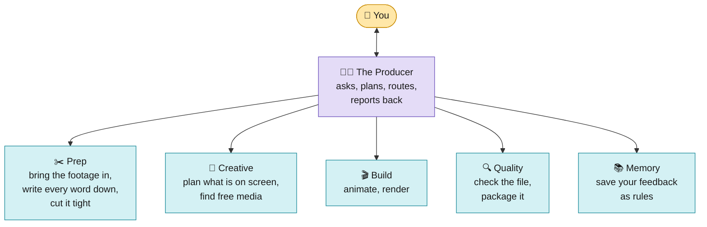
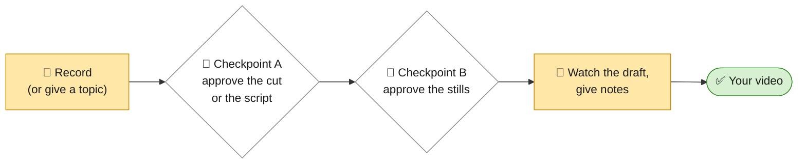

# Video-Workflow

An AI video-editing team that runs inside **Claude Code**, using **free tools only**. You record (or, for explainers,
just bring a topic). A team of AI agents cuts, plans, animates, renders, checks and packages the video. You approve it
at two checkpoints and give notes in plain words. Every note you ask it to keep becomes a rule for the next video.

It makes three kinds of video:

| Profile | You bring | You get | Shape |
|---|---|---|---|
| **YouTube long-form** | your raw talking-head clips and screen recordings | an edited 8 to 25 minute video: tight cuts, on-screen text and graphics, B-roll, sound, music, chapters, captions | 16:9, 4K, 30 fps |
| **Reels** | a vertical clip, or a long video to cut reels from | a 15 to 60 second reel: hook first, word captions, graphics kept clear of the app's buttons, cover frames, a post caption | 9:16, 1080x1920, 60 fps |
| **Explainer** | a topic, notes or a script (no camera) | a 30 to 90 second animated explainer: a free local AI voice, a kinetic-type hook, diagrams that build on every word, captions, a sound bed, sources for every number, in a soft Catppuccin Latte look or an editorial paper look (big top-left headlines, one line running through the reel) | 9:16, 1080x1920, 60 fps |

This page walks you through everything: what you need, how to set it up, and what happens, step by step, when you
make your first video of each kind. The detailed design lives in [`Editing-Workflow/README.md`](Editing-Workflow/README.md).

---

## Contents

1. [How it works](#1-how-it-works)
2. [What you need](#2-what-you-need)
3. [Setup, step by step](#3-setup-step-by-step)
4. [Walkthrough: your first YouTube video](#4-walkthrough-your-first-youtube-video)
5. [Walkthrough: your first Reel](#5-walkthrough-your-first-reel)
6. [Walkthrough: your first explainer reel](#6-walkthrough-your-first-explainer-reel)
7. [Your project folder](#7-your-project-folder)
8. [What to type: a cheat sheet](#8-what-to-type-a-cheat-sheet)
9. [Checks, and what happens when one fails](#9-checks-and-what-happens-when-one-fails)
10. [Teaching it your style](#10-teaching-it-your-style)
11. [Troubleshooting](#11-troubleshooting)
12. [Free tools and licences](#12-free-tools-and-licences)
13. [Where everything is](#13-where-everything-is)

---

## 1. How it works

You talk to one AI, **the Producer**. It is the project manager: it asks what you want, starts the right specialist
agents in order, keeps the project's status, and is the only one that talks to you. Each agent does one job (cutting,
planning the screen, finding free B-roll, animating, rendering, checking...) and hands the next one a file.



<sub>🟨 yellow = you · 🟪 purple = the Producer · 🟦 blue = the AI team</sub>

Your part is four things, and the team stops and waits for you at each:



<sub>🟨 yellow = you · ⬜ white = the team waits for you · 🟩 green = finished</sub>

Three rules hold everywhere:
- **Nothing is made before you approve it.** No planning before you approve the cut (or the script), no render before
  you approve the stills.
- **A maker never grades its own work.** A separate QA agent checks every render, frame by frame and by loudness.
- **Free tools only.** No paid stock, music, voices, avatars, AI video generators or trials. The one paid part is the
  Claude plan that runs Claude Code.

---

## 2. What you need

| What | Why | Cost |
|---|---|---|
| The **Claude desktop app** with a paid plan, Claude Code set to **Local** | the agents run on your computer, where your footage is | paid plan (the $20 plan is enough to set up; full edits use much more) |
| A computer that can run Chrome, Node.js and FFmpeg | rendering draws every frame in a browser | - |
| About 30 minutes for setup | Claude installs the tools itself | - |
| **Free tools**, installed by Claude in step 3.3: Node.js 22+, HyperFrames, FFmpeg, Python 3 with numpy, auto-editor, Parakeet (speech to text), Chrome | cutting, transcribing, animating, rendering | free |
| For explainers, also **Kokoro** (a free AI voice that runs on your computer) | the voiceover | free (Apache-2.0) |
| For Hindi and other languages, **Whisper large-v3** (about 3 GB, downloads on first use) | Parakeet covers English and European languages | free |

---

## 3. Setup, step by step

### 3.1 Open Claude Code in a project folder

1. Install the Claude desktop app (claude.com/download) and sign in.
2. Click **New**, pick **Claude Code**.
3. Set it to **Local**, and choose (or create) a folder for your videos, for example `Video Editing`. Everything
   happens in there.
4. Set permissions to **Auto**, so it doesn't ask yes or no for every command.
5. In **Settings → Claude Code**, turn on the browser setting (the team uses it to find pages and screenshots).
6. Skip the optional Tella and Epidemic Sound connectors the kit mentions: this workflow uses free tools only.

The kit's own guide has the same steps with more detail: [`Editing-Workflow/kit/SETUP.md`](Editing-Workflow/kit/SETUP.md).

### 3.2 Put this repository in the folder

Download this repository (the green **Code** button → **Download ZIP**, or `git clone`) and put its
`Editing-Workflow` folder inside your project folder:

```
Video Editing/                  ← the folder Claude Code is open in
└── Editing-Workflow/           ← from this repository
```

### 3.3 Install the base kit

Every profile builds on the kit's `youtube-edit` skill (its scripts, rules and fonts). Type this in Claude Code:

> Install the youtube-edit skill from the Editing-Workflow/kit folder into this project's .claude/skills folder. Then
> check everything it needs, install what's missing, and run its tests.

Claude copies the skill, installs FFmpeg, HyperFrames, auto-editor, Parakeet and the Python packages, and runs the
kit's tests. You should see **56 tests, OK**.

### 3.4 Install the team for the videos you make

Install one, two or all three. You can paste the commands into a terminal in your project folder, or ask Claude:
*"Install the reels team as Editing-Workflow/reels/README.md section 2 says."*

**YouTube long-form** ([details](Editing-Workflow/longform/README.md#2-install)):

```bash
mkdir -p .claude/skills .claude/agents
cp -R Editing-Workflow/longform/skill/youtube-longform .claude/skills/
mkdir -p .claude/skills/youtube-longform/templates && cp -R Editing-Workflow/templates/. .claude/skills/youtube-longform/templates/
cp Editing-Workflow/longform/agents/longform-*.md .claude/agents/
```

**Reels** ([details](Editing-Workflow/reels/README.md#2-install)):

```bash
mkdir -p .claude/skills .claude/agents
cp -R Editing-Workflow/reels/skill/reels .claude/skills/
mkdir -p .claude/skills/reels/templates && cp -R Editing-Workflow/templates/. .claude/skills/reels/templates/
cp Editing-Workflow/reels/agents/reels-*.md .claude/agents/
# a local copy of GSAP (the free animation library), so renders work offline:
mkdir -p .claude/skills/reels/assets/vendor && cd .claude/skills/reels/assets/vendor \
  && npm pack gsap@3.14.2 && tar -xzf gsap-3.14.2.tgz && cp package/dist/gsap.min.js . && rm -rf package gsap-3.14.2.tgz && cd -
```

**Explainer** (needs the Reels team too: it reuses five of its agents; [details](Editing-Workflow/explainer/README.md#2-install)):

```bash
mkdir -p .claude/skills .claude/agents
cp -R Editing-Workflow/explainer/skill/explainer .claude/skills/
mkdir -p .claude/skills/explainer/templates && cp -R Editing-Workflow/templates/. .claude/skills/explainer/templates/
cp Editing-Workflow/explainer/agents/explainer-*.md .claude/agents/
pip install kokoro soundfile            # the voice; also install espeak-ng from your system's packages
npx hyperframes models install parakeet
```

The explainer also needs local copies of GSAP, KaTeX (formulas), Lucide (icons), Simple Icons (brand logos) and, for
3D scenes, three.js. The exact commands are in [its README](Editing-Workflow/explainer/README.md#2-install); or tell
Claude *"set up the explainer's vendor folder as its README says"*. Its layout check opens every scene in the Chrome
HyperFrames uses; if Chrome is missing, run `npx hyperframes browser ensure`.

Once per machine (Windows especially), prepare it and write down how it runs everything:

```bash
python .claude/skills/explainer/scripts/preflight.py --out videos/_preflight
```

It records the Python command that works there, turns on UTF-8, checks every tool, runs all three skills' tests and
names any that fail, in `videos/_preflight/PREFLIGHT.md`. Every brief links to it.

### 3.5 Check everything works

From each installed skill's `scripts` folder:

| Skill | Command | Expect |
|---|---|---|
| kit | `cd .claude/skills/youtube-edit/scripts && python3 -m unittest tests` | 56 tests, OK |
| Reels | `cd .claude/skills/reels/scripts && python3 -m unittest tests` | 51 tests, OK |
| Explainer | `cd .claude/skills/explainer/scripts && python3 -m unittest discover -s tests -t .` | 446 tests, OK (a few skip without Kokoro, Chrome or the local vendor folder) |

### 3.6 Open a new conversation

Skills and agents load when a conversation starts. **After installing anything, open a new conversation.** Your
folder now looks like this:

```
Video Editing/
├── .claude/
│   ├── skills/        youtube-edit/ (the kit), and youtube-longform/, reels/, explainer/ for the teams you installed
│   └── agents/        longform-*.md, reels-*.md, explainer-*.md
├── Editing-Workflow/  this repository's folder (the source; keep it)
└── videos/            created by the Producer: one folder per video
```

---

## 4. Walkthrough: your first YouTube video

### Step 1. Record

- Record in **4K, 30 fps** if you can: zooms stay sharp.
- Messed up a line? Pause and say it again. The team keeps your **last take** of every line and cuts the rest.
- Keep the file flat: no zooms, captions or transitions baked in.
- Talking-head clips and screen recordings can be separate files. Put them in your project folder.

### Step 2. Start

Open a new conversation and type:

> Use my long-form team to edit this video. The raw clips are C0001.MP4, C0002.MP4, in this order. I also recorded a
> screen recording called demo.mov.

### Step 3. Answer the brief

The Producer asks once, in one numbered message, only what it doesn't know yet:
1. the working title and thumbnail idea;
2. the promise in one line (what will the viewer get?);
3. who it is for;
4. the target length;
5. which files are talking head and which are screen recordings;
6. a sponsor, if any;
7. music, yes or no;
8. names and terms to spell right, and the language you speak (it picks the transcriber);
9. anything that must be in it.

Answer in a few words each. It creates `videos/<project>/` with a `STATUS.md` you can open any time to see where
things are.

### Step 4. Wait while the team cuts

- **Ingest** copies and measures your files (frame rate, colour, sound) and fixes what would break later.
- **Transcribe** writes down every word with its exact time.
- **Cut** keeps your last take of every line, removes pauses, stutters and slivers, and checks every join.
- **Story pass** (the Director) checks the story flows: the hook, the sections, repeats and tangents to cut.

### Step 5. ✋ Checkpoint A: the cut and the story

You get `PAPER-CUT.md` (the transcript with everything removed struck through, each with a reason) and `STORY.md`
(the sections, the hook plan, suggested cuts). Answer in plain words:

> Keep the earlier take of the studio line. The joke at 1:12 goes. Yes to moving the result to the front.

The team applies your answers. Nothing is planned until you say OK.

### Step 6. Wait while the team plans and builds

- The video is **split into sections** (hook, each part, sponsor).
- For each section the **Director** plans what is on screen and when (text, cards, diagrams, B-roll, zooms), every
  element landing on its spoken word.
- **Researcher, B-roll scout and Sound designer** fetch free pages, logos, stock clips and sounds, each with its licence.
- The **Animator** builds each section and takes a still of every moment.

### Step 7. ✋ Checkpoint B: the stills

You get a sheet of stills (`snaps/sheet.png`) and a list of what is on screen when, plus anything waiting for a yes
(a diagram, a voice-polish before/after pair). Answer in plain words:

> The card at 0:14 covers my face. Make the logo bigger. No sound on the logo.

Nothing renders until you say OK.

### Step 8. Wait while it renders, is checked and assembled

- The **Renderer** makes each section in 4K.
- The **QA agent** checks every file: black frames, size, colour tags, bitrate, clipped words, loudness. A failure goes
  back to the agent that owns it, automatically.
- The **Assembler** joins the sections, mixes the music under your voice, levels everything to -14 LUFS, and writes
  chapters, captions and the description.

### Step 9. Your draft

Delivered to `~/Movies/YouTube Renders/<project>/` (`~/Videos/...` off a Mac): the video, a no-music version,
`chapters.txt`, `captions.srt`, `STORYBOARD.md`, `DESCRIPTION.md` and a publish checklist.

### Step 10. Notes, then version 2

Watch the whole draft, then give notes with times:

> At 0:22 there's no sound on the pop. Around 3:14 there's a quick flash, take it out. This middle part is too busy.

Each note goes to the agent that owns it; version 2 goes through the same checks. When something should never happen
again, say **"save this to the skill"** (section 10).

**A week after publishing**, you can share a screenshot of your YouTube Studio retention graph; the Analyst reads it
and proposes rules for next time.

More detail: [`Editing-Workflow/longform/README.md`](Editing-Workflow/longform/README.md).

---

## 5. Walkthrough: your first Reel

### Step 1. Record (or pick a long video)

- Record **vertical** (9:16), ideally 4K at **60 fps**. A 30 fps clip is flagged, never faked.
- Or use one of your long videos: the team can find the moments that stand alone as reels.

### Step 2. Start

> Make a reel from this clip: IMG_4410.MOV. The promise is "I edit my videos with zero paid tools".

or

> Cut three reels out of my long video [project name].

### Step 3. Answer the brief

The promise and the payoff (where the promise is kept), who it is for and where it goes (Instagram, Shorts, TikTok),
the target length (15 to 60 s), music in the file or added in the app, names to spell right and **the language you
speak** (Hindi uses Whisper large-v3), and a call to action if any.

### Step 4. Wait while the team cuts

The cut is tighter than long-form: pauses under 0.3 s. The Director finds the **hook** (the strongest line) and can
move it to the front, proposes a length, and a **loop** (a last line that leads back into the first).

### Step 5. ✋ Checkpoint A: the cut and the story

The paper cut, the hook line and whether to move it first, the proposed length, the loop idea, and for a landscape
source, the crop. Answer: *"Yes, move the result first. Cut it to 30 seconds."*

### Step 6. Wait while the team builds

Word-by-word **burned-in captions** (most people watch muted), text and graphics placed inside the platforms' safe
zone **by construction** (never under the like/comment buttons or the caption strip), free assets made vertical.

### Step 7. ✋ Checkpoint B: stills with the safe zone drawn on

`snaps/guides/sheet.png` shows every moment with the app's covered areas drawn in red and orange, plus the first and
last frame side by side (the loop). Answer: *"Move the price card up. Captions off during the hook."*

### Step 8. Wait while it renders and is checked

1080x1920 at 60 fps, checked frame by frame, levelled to -14 LUFS.

### Step 9. Ready to post

`deliver/reel.mp4` with cover-frame candidates, `captions.srt` (for Shorts and TikTok), a post caption and a posting
checklist (`POST.md`). Post it as a Reel, pick the cover, add music in the app if you chose that.

**A week later**, share a screenshot of the reel's Insights (skip rate, watch time, sends); the Analyst learns what
works for your audience.

More detail: [`Editing-Workflow/reels/README.md`](Editing-Workflow/reels/README.md).

---

## 6. Walkthrough: your first explainer reel

No camera. A voice explains one idea while code-drawn scenes land on its words:
- **the hook** as kinetic type: a big number or word, a claim, a word struck through, a punch line;
- **diagrams that build** piece by piece as each one is said: a flow, a stack, a comparison, a timeline, cards, a hub;
  empty slots fill in as they are said;
- **objects, not boxes**: a chat, a document with its passage marked, a big hero number, a prompt bar being typed, a
  storyboard deck, an editor's timeline, a grade slider, a reel feed, a comment call to action and more;
- **giant captions**: the voice's own words, huge in the middle of the frame;
- titles, numbered steps, count-ups, charts, bars, lists, formulas and icons;
- **real brand logos and real page screenshots**, which can zoom in on one line;
- custom scenes, only when nothing in the library fits.

Scenes move from one to the next with transitions. A soft sound bed sits under the voice, with a whoosh on each
transition, a pop as each item lands and a chime on the payoff. The picture is never still: a slow camera drift and
drifting particles sit under every scene. There are two looks. [Catppuccin Latte](https://github.com/catppuccin/catppuccin)
(the default) runs on four grounds with a rhythm: the hook on dark ink, the payoff and every third scene on blue, the
rest light. **Paper** (`"look": "paper"` in the script) is editorial: warm paper, near-black ink, one red accent, a
big wide headline top-left, a serif italic aside, and one line (the *thread*) that drops in, loops, turns into a wave
and lifts off on the voice's words. It can show your own product cut-outs and photos (each one credited), with
circles and labels drawn on them. The captions stay small, under the picture, so the centre is always the animation.

### Step 1. Start

> Make an explainer reel about what a P/E ratio is, for people new to investing. About 45 seconds, ending with
> "follow for part 2".

You can also paste notes or a finished script instead of a topic.

### Step 2. Answer the brief

The Producer asks its questions in one numbered message, each with a default you can accept by saying "defaults":
- the input: a topic, notes or a script;
- **who it is for**: one viewer, described in a line;
- **the goal**: follow, comment, save, share, a link, or simply teach;
- **the format**: a how-to, a versus, a myth and its truth, a story or a plain explainer;
- the length: 30 to 90 s, with 30 to 60 s recommended;
- for a series, its name and the part number, and your handle (both shown quietly above the captions);
- terms to say and spell right;
- music: none in the file, or a free track in it.

### Step 3. Wait while the Writer writes

A script of 81 to 240 words. It has a hook of at most 12 words, one idea, a concrete example, a payoff and a call to
action that asks for **your goal**. It is written to one viewer, using "you" and asking a question, and it follows its
format's shape: steps for a how-to, the myth before the truth, the problem before the answer.

Every line is kept twice: **what the voice says** ("one thousand dollars") and **what the screen shows** ("$1,000").
**Every number and claim gets a source** you can open, listed in `SOURCES.md`. The writer also gives each line a short
hint for its picture, so planning the scenes costs few tokens.

### Step 4. ✋ Checkpoint A: the script (and, the first time, the voice)

You get the script (`SCRIPT.md`), its sources and its length, timed at your voice's own measured speed; the length
is decided here. On your first project you also get **three
10-second voice samples** to choose your channel's voice from; it stays the same on every video after that. Answer:
*"Line 3 is too long. Use the second voice."* Nothing is voiced before you approve.

### Step 5. Wait while the voice is made

Kokoro reads the script line by line on your computer, with pauses between lines; it is cleaned and levelled. Parakeet
listens back and every word gets its exact time. A word it can't say ("WACC") gets a pronunciation in a shared lexicon
("wack"), and only that line is voiced again.

### Step 6. Wait while the scenes are built

A planner script turns the writer's hints into a draft storyboard. For each stretch of words it picks a scene that
matches what the words do:
- a claim → a title;
- a number → a count-up;
- a list → cards;
- change over time → a line chart;
- a brand → its logo.

Every scene and item is anchored to a word, so nothing drifts from the voice. The Director only edits the draft.

The Animator then builds the page. Each scene is scaled up to fill the frame.

Before you see anything, the checks make sure that:
- every scene fits the screen, with text and cards ending by y 1235;
- the hook is whole on screen by 1 second;
- something changes every 3 seconds, and no picture is held longer than 8;
- the old scene is gone by the cut, so two scenes are never on screen together;
- every number on screen has its source;
- the **layout check** passes. It opens every scene in Chrome on your computer and fails on:
  - text over text, or text covered by a shape;
  - text spilling out of its card;
  - anything outside the safe area;
  - text too small to read;
  - text clipped by its box;
  - text with poor contrast on its ground.

### Step 7. ✋ Checkpoint B: the stills and the voiceover

A still of every scene once it has settled (with the app's covered areas drawn on), the hook at 0.3, 0.7 and 1.0 s,
a list of what is on screen when, and the full voiceover to listen to: listening is yours, no check replaces it. Answer: *"The chart comes in too late. Say 'EBITDA' slower."*

### Step 8. Render, check, package

The Reels renderer, QA and packager finish it: `deliver/reel.mp4`, covers, `captions.srt` and the posting checklist.
The checklist covers:
- the cover;
- 3 to 5 hashtags that fit: one broad, one for the format, the rest for the topic;
- the series part in the post caption;
- a trending sound only when it truly fits, added in the app quietly under the voice;
- posting on a steady rhythm, since consistency beats bursts.

**Before posting:** Instagram asks you to label realistic AI-generated voices (its "AI info" label). The checklist
reminds you; check each app's current rule.

More detail: [`Editing-Workflow/explainer/README.md`](Editing-Workflow/explainer/README.md).

---

## 7. Your project folder

Every video gets its own folder under `videos/`. You don't need to open anything in it, but these are the files worth
knowing:

| File | What it is | Who writes it |
|---|---|---|
| `STATUS.md` | where the video is, what is waiting on whom, every decision for you | the Producer |
| `NOTES.md` | every note you gave, word for word, per version, and what was done about it | the Producer |
| `raw/` | your original files, never changed | you |
| `PAPER-CUT.md`, `STORY.md` | what was cut and why; the story plan (Checkpoint A) | Cutter, Director |
| `SCRIPT.md`, `SOURCES.md` | the explainer's script and its sources (Checkpoint A) | Writer |
| `transcript.json` | every word with its time | Transcriber or Voice |
| `storyboard.json` | the plan: every on-screen moment, its type and the word it lands on | Director |
| `ASSET-REQUESTS.md` | every picture, clip and sound: where it came from and its licence | Director and the asset agents |
| `public/index.html` | the animated page that becomes the video | Animator |
| `snaps/` | the stills you approve at Checkpoint B | Animator |
| `QA.md` | the check results: PASS or FAIL, and who fixes what | QA agent |
| `deliver/` (or your Movies / Videos folder) | the finished files | Assembler or Packager |

The full list, file by file: [`Editing-Workflow/README.md` § 4](Editing-Workflow/README.md#4-the-project-folder-every-file-who-writes-it-who-reads-it).
The templates, with every field explained: [`Editing-Workflow/templates/`](Editing-Workflow/templates/README.md).

---

## 8. What to type: a cheat sheet

| When | Type |
|---|---|
| Install the kit (once) | *Install the youtube-edit skill from the Editing-Workflow/kit folder into this project's .claude/skills folder. Then check everything it needs, install what's missing, and run its tests.* |
| A YouTube video | *Use my long-form team to edit this video. The raw clips are [files], in this order.* |
| A hook only | *Please use my YouTube editing skill to edit this hook for my YouTube video.* |
| A reel | *Make a reel from this clip: [file]. The promise is [one line].* |
| Reels from a long video | *Cut three reels out of my long video [project].* |
| An explainer | *Make an explainer reel about [topic] for [who]. About 45 seconds, ending with [call to action].* |
| At Checkpoint A | *Keep the earlier take of the studio line.* · *The joke at 1:12 goes.* · *Line 3 is too long.* |
| At Checkpoint B | *The card at 0:14 covers my face.* · *Make the logo bigger.* · *The chart comes in too late.* |
| Notes on the draft | *At 0:22 there's no sound.* · *Around 0:14 there's a quick flash, take it out.* · *This is way too busy.* |
| Make it remember | *Save this to the skill.* · *Learn from what we did and add it to the skill.* |
| Where are we? | *What's the status?* (the Producer reads `STATUS.md` and tells you what is waiting on whom) |
| Your stats | *Here's my retention graph* / *Here are the Insights for my reel* + a screenshot |

Notes work best with **a time and one idea each**. A vague note ("make it better") gets one specific question back.

---

## 9. Checks, and what happens when one fails

Between the stages, automatic **gates** check the work before it moves on. A few you'll hear about:

| Check | What it catches |
|---|---|
| Edge audit, dead air | half-words and breaths left at a cut; pauses that are too long |
| Beat check | a card or caption that lands before or after the word it belongs to |
| Gap scan / pace check | stretches where nothing on screen changes for too long |
| Safe zone (Reels, explainer) | text under the app's buttons or caption strip (prevented by construction, then checked on stills) |
| Script check (explainer) | too long or short, a long hook, a number without a source; it also warns when the script never says "you", asks no question, gives no example, skips its format's shape, or ends with a call to action that doesn't ask for your goal |
| Layout check (explainer) | in Chrome, on every scene and every handover: text over text or under a shape, text out of its card or the safe area, small or clipped text, poor contrast, two scenes at once |
| Motion check (explainer) | on the rendered file: a picture still for over 1 s, or still more than 15% of the reel |
| Voice check (explainer) | a word the voice skipped or misread, a long gap, a peak too loud, the wrong length |
| Render verify | black frames or flashes, wrong size or frame rate, missing colour tags, low bitrate, clipped words |
| Loudness | the whole video at -14 LUFS, the voice clear over the music |

When a check fails, the Producer sends it to the agent that owns the problem (a clipped word → the Cutter; a card on the
wrong word → the Director; a black frame → the Renderer). That agent fixes it and the check runs again. **If the same
check fails twice, the Producer stops and tells you** what was tried, instead of looping.

The full list of gates: [`Editing-Workflow/README.md` § 7](Editing-Workflow/README.md#7-quality-gates).

---

## 10. Teaching it your style

Every note you give is written down in `NOTES.md`. When you say **"save this to the skill"**, the **Librarian** turns
it into a rule in the right place:

- a one-off preference ("I like the logo bigger") becomes a line in the playbook;
- a mistake that keeps happening becomes an automatic **check with a test**, so it can't come back.

The skills you installed under `.claude/` are the live copies. When the Librarian changes a file, it tells you which;
**copy those files back into `Editing-Workflow/`** so this repository keeps what it learned.

To change the whole look (colours, fonts, card style), give it your style guide: *"Here's my style guide. Update the
youtube-edit skill to match it."* The explainer's look is one file, `tokens.json`: the Catppuccin Latte palette and the paper look,
with each colour given a role (text, accent, card, good, bad...), so a new palette changes every scene at once.

---

## 11. Troubleshooting

| Problem | Fix |
|---|---|
| Claude doesn't seem to know the skill or the agents | Open a **new conversation**: skills and agents load only at the start of one. |
| "HyperFrames not found" | Ask Claude to install it (`npx hyperframes --version`, then `npx hyperframes doctor`). |
| The transcriber or Kokoro can't download its model | The model files come from Hugging Face: your network must allow `huggingface.co` (and `*.huggingface.co`, `*.hf.co`). Behind a proxy, set `NODE_USE_ENV_PROXY=1`. |
| Words come out wrong for Hindi (or another language) | Say the language in the brief: it uses Whisper large-v3 instead of Parakeet. |
| The first render needs internet | Install the local GSAP copy (section 3.4). Without it, the page loads GSAP from the web. |
| The explainer says a vendor file is missing | It names the `npm pack ...` command to run; or ask Claude to set up the vendor folder. |
| The layout check says it needs Chrome or puppeteer | Run `npx hyperframes browser ensure`; it uses the same Chrome HyperFrames renders with. |
| A test is "skipped" | Normal when an optional tool (Kokoro, Chrome, a local GSAP) isn't installed; skipped is not failed. |
| A render is slow | Rendering draws every frame in a browser; long 4K videos take time. Reels and explainers render much faster. |
| "No space left on device" | Delete old renders (`output-*.mp4`) and `broll/raw/` downloads of finished projects. |
| A check keeps failing | After two tries the Producer stops and tells you. Read its message: it says what it tried and what it needs from you. |

---

## 12. Free tools and licences

| Tool | Used for | Licence |
|---|---|---|
| HyperFrames (by HeyGen) | turns the animated HTML page into video | free |
| GSAP | the animation | free to use |
| FFmpeg | cutting, joining, encoding, loudness | LGPL / GPL |
| auto-editor | finding where you speak | Unlicense |
| Parakeet / Whisper | speech to text with word times | free models |
| Kokoro-82M | the explainer's voice, on your computer | Apache-2.0 |
| KaTeX · Lucide · three.js | formulas · icons · 3D (explainer) | MIT · ISC · MIT |
| Simple Icons | brand logos (explainer; each brand's own trademark rules still apply) | CC0 |
| Catppuccin | the explainer's Latte colour palette (the paper look is the kit's own) | MIT |
| DM Sans · JetBrains Mono · Archivo · Instrument Serif | the fonts (shipped in this repository) | SIL Open Font License |

Stock footage, sounds and music come only from free, licensed sources, and each file's source and licence is written
into `ASSET-REQUESTS.md`. This repository is under the [MIT License](LICENSE). The kit began from a YouTube creator's
skill; see [`Editing-Workflow/kit/README.md`](Editing-Workflow/kit/README.md) for its notices.

---

## 13. Where everything is

```
Video-Workflow/
├── README.md                      this walkthrough
├── LICENSE
└── Editing-Workflow/
    ├── README.md                  the full design: every stage, agent, file, gate and hand-off
    ├── kit/                       the base skill (youtube-edit): scripts, rules, fonts, setup guide, prompts
    ├── templates/                 the project files: STATUS, NOTES, QA, ASSET-REQUESTS (with filled examples)
    ├── longform/                  the YouTube team: Producer skill, playbook, 13 agents, research
    ├── reels/                     the Reels team: Producer skill, playbook, 11 agents, vertical scripts, research
    └── explainer/                 the explainer team: Producer skill, playbook, 4 agents (+5 from Reels),
                                   voice and scene scripts, design spec, research
```

| Read this | When you want |
|---|---|
| [`Editing-Workflow/README.md`](Editing-Workflow/README.md) | the whole system in detail: the stages, the agents, the gates, the learning loop |
| [`Editing-Workflow/kit/SETUP.md`](Editing-Workflow/kit/SETUP.md) | the Claude Code setup with more detail |
| [`Editing-Workflow/kit/PROMPTS.md`](Editing-Workflow/kit/PROMPTS.md) | the kit's prompts |
| [`Editing-Workflow/longform/README.md`](Editing-Workflow/longform/README.md) | the YouTube team, its flow and research |
| [`Editing-Workflow/reels/README.md`](Editing-Workflow/reels/README.md) | the Reels team, its scripts and how they were verified |
| [`Editing-Workflow/explainer/README.md`](Editing-Workflow/explainer/README.md) | the explainer team, its scenes, voice and how they were verified |
| [`Editing-Workflow/templates/README.md`](Editing-Workflow/templates/README.md) | every project file and field |
