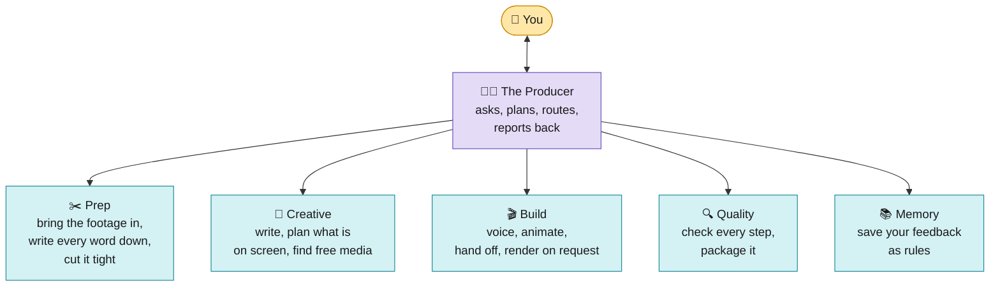
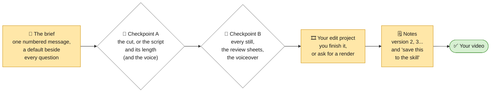

# Video-Workflow

An AI video-editing team that runs inside **Claude Code**, using **free tools only**. You record (or, for explainers,
just bring a topic). A team of AI agents cuts, plans, animates, checks and packages the video, and hands you an editor
project to finish. **You stay in charge the whole way:** it asks before it starts, stops for your approval twice, never
renders or publishes on its own, and every note you ask it to keep becomes a rule for the next video.

It makes three kinds of video:

| Profile | You bring | You get | Shape |
|---|---|---|---|
| **YouTube long-form** | your raw talking-head clips and screen recordings | an edited 8 to 25 minute video: tight cuts on your last takes, on-screen text and graphics, B-roll, sound, music, chapters, captions | 16:9, 4K, 30 fps |
| **Reels** | a vertical clip, or a long video to cut reels from | a 15 to 60 second reel: hook first, a loop back to the start, word captions, graphics kept clear of the app's buttons, cover frames, a post caption | 9:16, 1080x1920, 60 fps |
| **Explainer** | a topic, notes or a script (no camera) | a 30 to 90 second animated explainer: a free local AI voice, a kinetic-type hook, scenes that build on every word (diagrams, 3D objects, charts, formulas, neural networks, loss curves), sources for every number, a sound bed, in one of three looks and five palettes | 9:16, 1080x1920, 60 fps |

This page walks you through everything: how it works and where you decide things, what you need, how to set it up,
what each kind of video goes through step by step, what the explainer can draw, and its limits. The detailed design
lives in [`Editing-Workflow/README.md`](Editing-Workflow/README.md).

---

## Contents

1. [How it works](#1-how-it-works)
2. [You decide: the human in the loop](#2-you-decide-the-human-in-the-loop)
3. [What you need](#3-what-you-need)
4. [Setup, step by step](#4-setup-step-by-step)
5. [Walkthrough: your first YouTube video](#5-walkthrough-your-first-youtube-video)
6. [Walkthrough: your first Reel](#6-walkthrough-your-first-reel)
7. [Walkthrough: your first explainer reel](#7-walkthrough-your-first-explainer-reel)
8. [What the explainer can draw](#8-what-the-explainer-can-draw)
9. [Limits worth knowing](#9-limits-worth-knowing)
10. [Your project folder](#10-your-project-folder)
11. [What to type: a cheat sheet](#11-what-to-type-a-cheat-sheet)
12. [Checks, and what happens when one fails](#12-checks-and-what-happens-when-one-fails)
13. [Teaching it your style](#13-teaching-it-your-style)
14. [Troubleshooting](#14-troubleshooting)
15. [Free tools and licences](#15-free-tools-and-licences)
16. [Where everything is](#16-where-everything-is)

---

## 1. How it works

> **The end of every run is a project you edit, not a finished video.** After you approve the stills, the team hands
> you an editor project: open `<project>.fcproj` in [filmcraft](https://github.com/storytold/filmcraft) (free, open
> source; or import the `.xml` into filmcraft, Premiere Pro or DaVinci Resolve). Your own camera files are cut by word
> on the first track (never re-encoded), every card or scene is its own transparent clip on its own track, the voice,
> music and sound effects are on theirs, captions come as an editable `.srt`, and markers show the hook and each
> scene's word and source. You trim, re-time, mix and export. A finished render is there when you want one: just ask
> (`python3 Editing-Workflow/wf.py render ...`).

You talk to one AI, **the Producer**. It is the project manager: it asks what you want, starts the right specialist
agents in order, keeps the project's status, and is the only one that talks to you. Each agent does one job (cutting,
writing, voicing, planning the screen, finding free B-roll, animating, rendering, checking...) and hands the next one a
file.



<sub>🟨 yellow = you · 🟪 purple = the Producer · 🟦 blue = the AI team</sub>

Three rules hold everywhere:
- **Nothing is made before you approve it.** No planning before you approve the cut (or the script), no voice before
  the script, no hand-off or render before you approve the stills.
- **A maker never grades its own work.** Automatic checks run between every stage, and a separate QA agent checks any
  render frame by frame and by loudness.
- **Free tools only.** No paid stock, music, voices, avatars, AI video generators or trials. The one paid part is the
  Claude plan that runs Claude Code.

---

## 2. You decide: the human in the loop

The team does the work; the choices are yours. It stops and waits at each of these points, and only you can move it on.



<sub>🟨 yellow = you · ⬜ white = the team waits for you · 🟩 green = finished</sub>

| When | What you decide | What you see |
|---|---|---|
| **The brief** | who it is for, the goal, the length, names to spell right, music; for explainers also the look, the palette, captions on or off, the ending, and any images to show | one message of numbered questions, each with its default, so "defaults" is a valid answer |
| **Checkpoint A** | the cut and the story (long-form, Reels); the script, its angle and its exact length (explainer). The first explainer also picks the channel's voice from three samples | the paper cut with every removal and its reason, or the script with every number's source, timed at your voice's real speed |
| **Checkpoint B** | the pictures, before anything is rendered | a full-size still of every scene once it has settled (a stage at each of its beats), the hook at 0.3, 0.7 and 1.0 s, the app's covered areas drawn on, strips of every cut, and the full voiceover to listen to |
| **The hand-off** | how it ends up: you finish the editor project yourself, or ask for a render | an editor project with every layer separate and every scene on its own track |
| **Notes** | what to change, in plain words with a time | each note routed to the agent that owns it, then the checks again |
| **"Save this to the skill"** | what becomes a lasting rule | a line in the playbook, or a new automatic check with a test |

A vague note ("make it better") gets one specific question back. A check that fails twice stops the team and comes to
you with what was tried, instead of looping.

---

## 3. What you need

| What | Why | Cost |
|---|---|---|
| The **Claude desktop app** with a paid plan, Claude Code set to **Local** | the agents run on your computer, where your footage is | paid plan (the $20 plan is enough to set up; full edits use much more) |
| A computer that can run Chrome, Node.js and FFmpeg | rendering and every layout check draw frames in a browser | - |
| About 30 minutes for setup | Claude installs the tools itself | - |
| **Free tools**, installed by Claude in step 4.3: Node.js 22+, HyperFrames, FFmpeg, Python 3 with numpy, auto-editor, Parakeet (speech to text), Chrome | cutting, transcribing, animating, rendering | free |
| For explainers, also **Kokoro** (a free AI voice that runs on your computer) | the voiceover | free (Apache-2.0) |
| For Hindi and other languages, **Whisper large-v3** (about 3 GB, downloads on first use) | Parakeet covers English and European languages | free |
| A network that reaches `huggingface.co` the first time | Parakeet, Whisper and Kokoro download their models from there | - |

---

## 4. Setup, step by step

### 4.1 Open Claude Code in a project folder

1. Install the Claude desktop app (claude.com/download) and sign in.
2. Click **New**, pick **Claude Code**.
3. Set it to **Local**, and choose (or create) a folder for your videos, for example `Video Editing`. Everything
   happens in there.
4. Set permissions to **Auto**, so it doesn't ask yes or no for every command.
5. In **Settings → Claude Code**, turn on the browser setting (the team uses it to find pages and screenshots).
6. Skip the optional Tella and Epidemic Sound connectors the kit mentions: this workflow uses free tools only.

The kit's own guide has the same steps with more detail: [`Editing-Workflow/kit/SETUP.md`](Editing-Workflow/kit/SETUP.md).

### 4.2 Put this repository in the folder

Download this repository (the green **Code** button → **Download ZIP**, or `git clone`) and put its
`Editing-Workflow` folder inside your project folder:

```
Video Editing/                  ← the folder Claude Code is open in
└── Editing-Workflow/           ← from this repository
```

### 4.3 Install the base kit

Every profile builds on the kit's `youtube-edit` skill (its scripts, rules and fonts). Type this in Claude Code:

> Install the youtube-edit skill from the Editing-Workflow/kit folder into this project's .claude/skills folder. Then
> check everything it needs, install what's missing, and run its tests.

Claude copies the skill, installs FFmpeg, HyperFrames, auto-editor, Parakeet and the Python packages, and runs the
kit's tests. You should see **114 tests, OK**.

### 4.4 Install the team for the videos you make

Install one, two or all three. You can paste the commands into a terminal in your project folder, ask Claude
(*"Install the reels team as Editing-Workflow/reels/README.md section 2 says."*), or use `wf.py install` (step 4.6).

**YouTube long-form** ([details](Editing-Workflow/longform/README.md#2-install)):

```bash
mkdir -p .claude/skills .claude/agents
cp -R Editing-Workflow/longform/skill/youtube-longform .claude/skills/
mkdir -p .claude/skills/youtube-longform/templates && cp -R Editing-Workflow/templates/. .claude/skills/youtube-longform/templates/
cp Editing-Workflow/longform/agents/longform-*.md .claude/agents/
```

**Reels** ([details](Editing-Workflow/reels/README.md#2-install)):

```bash
mkdir -p .claude/skills .claude/agents
cp -R Editing-Workflow/reels/skill/reels .claude/skills/
mkdir -p .claude/skills/reels/templates && cp -R Editing-Workflow/templates/. .claude/skills/reels/templates/
cp Editing-Workflow/reels/agents/reels-*.md .claude/agents/
# a local copy of GSAP (the free animation library), so renders work offline:
mkdir -p .claude/skills/reels/assets/vendor && cd .claude/skills/reels/assets/vendor \
  && npm pack gsap@3.14.2 && tar -xzf gsap-3.14.2.tgz && cp package/dist/gsap.min.js . && rm -rf package gsap-3.14.2.tgz && cd -
```

**Explainer** (needs the Reels team too: it reuses five of its agents; [details](Editing-Workflow/explainer/README.md#2-install)):

```bash
mkdir -p .claude/skills .claude/agents
cp -R Editing-Workflow/explainer/skill/explainer .claude/skills/
mkdir -p .claude/skills/explainer/templates && cp -R Editing-Workflow/templates/. .claude/skills/explainer/templates/
cp Editing-Workflow/explainer/agents/explainer-*.md .claude/agents/
pip install kokoro soundfile            # the voice; also install espeak-ng from your system's packages
npx hyperframes models install parakeet
```

The explainer also needs local copies of GSAP, KaTeX (formulas), Lucide (icons), Simple Icons (brand logos) and, only
for custom 3D scenes, three.js. The exact commands are in [its README](Editing-Workflow/explainer/README.md#2-install);
or tell Claude *"set up the explainer's vendor folder as its README says"*. Its layout check opens every scene in the
Chrome HyperFrames uses; if Chrome is missing, run `npx hyperframes browser ensure`.

Once per machine (Windows especially), prepare it and write down how it runs everything:

```bash
python .claude/skills/explainer/scripts/preflight.py --out videos/_preflight
```

It records the Python command that works there, turns on UTF-8, checks every tool, runs all three skills' tests and
names any that fail, in `videos/_preflight/PREFLIGHT.md`. Every brief links to it.

### 4.5 Check everything works

From each installed skill's `scripts` folder:

| Skill | Command | Expect |
|---|---|---|
| kit | `cd .claude/skills/youtube-edit/scripts && python3 -m unittest discover -s tests -t .` | 114 tests, OK |
| Reels | `cd .claude/skills/reels/scripts && python3 -m unittest discover -s tests -t .` | 79 tests, OK (1 skips without OpenCV) |
| Explainer | `cd .claude/skills/explainer/scripts && python3 -m unittest discover -s tests -t .` | 600 tests, OK (a few skip without Kokoro, Chrome or the local vendor folder) |

### 4.6 One command for everything: `wf.py`

`Editing-Workflow/wf.py` wraps the steps above and the checks the agents run, so you can do them yourself:

```bash
python3 Editing-Workflow/wf.py install reels            # the copy steps above (kit, longform, reels, explainer)
python3 Editing-Workflow/wf.py doctor                   # what is installed, and what is missing
python3 Editing-Workflow/wf.py test                     # every suite
python3 Editing-Workflow/wf.py handoff videos/my-reel --profile reels       # make the editor project again
python3 Editing-Workflow/wf.py gates videos/my-reel --profile reels --stage H1
python3 Editing-Workflow/wf.py render videos/my-reel --profile reels        # opt-in: a finished file
```

For the native filmcraft project, install `filmcraft-cli` (see `Editing-Workflow/kit/README.md`); without it you get
the `.xml` to import.

### 4.7 Open a new conversation

Skills and agents load when a conversation starts. **After installing anything, open a new conversation.** Your
folder now looks like this:

```
Video Editing/
├── .claude/
│   ├── skills/        youtube-edit/ (the kit), and youtube-longform/, reels/, explainer/ for the teams you installed
│   └── agents/        longform-*.md, reels-*.md, explainer-*.md
├── Editing-Workflow/  this repository's folder (the source; keep it)
└── videos/            created by the Producer: one folder per video
```

---

## 5. Walkthrough: your first YouTube video

### Step 1. Record

- Record in **4K, 30 fps** if you can: zooms stay sharp.
- Messed up a line? Pause and say it again. The team keeps your **last take** of every line and cuts the rest.
- Keep the file flat: no zooms, captions or transitions baked in.
- Talking-head clips and screen recordings can be separate files. Put them in your project folder.

### Step 2. Start

Open a new conversation and type:

> Use my long-form team to edit this video. The raw clips are C0001.MP4, C0002.MP4, in this order. I also recorded a
> screen recording called demo.mov.

### Step 3. Answer the brief

The Producer asks once, in one numbered message, only what it doesn't know yet:
1. the working title and thumbnail idea;
2. the promise in one line (what will the viewer get?);
3. who it is for;
4. the target length;
5. which files are talking head and which are screen recordings;
6. a sponsor, if any;
7. music, yes or no;
8. names and terms to spell right, and the language you speak (it picks the transcriber);
9. anything that must be in it.

Answer in a few words each. It creates `videos/<project>/` with a `STATUS.md` you can open any time to see where
things are.

### Step 4. Wait while the team cuts

- **Ingest** copies and measures your files (frame rate, colour, sound) and fixes what would break later.
- **Transcribe** writes down every word with its exact time.
- **Cut** keeps your last take of every line, removes pauses, stutters and slivers, and checks every join.
- **Story pass** (the Director) checks the story flows: the hook, the sections, repeats and tangents to cut.

### Step 5. ✋ Checkpoint A: the cut and the story

You get `PAPER-CUT.md` (the transcript with everything removed struck through, each with a reason) and `STORY.md`
(the sections, the hook plan, suggested cuts). Answer in plain words:

> Keep the earlier take of the studio line. The joke at 1:12 goes. Yes to moving the result to the front.

The team applies your answers. Nothing is planned until you say OK.

### Step 6. Wait while the team plans and builds

- The video is **split into sections** (hook, each part, sponsor).
- For each section the **Director** plans what is on screen and when (text, cards, diagrams, B-roll, zooms), every
  element landing on its spoken word.
- **Researcher, B-roll scout and Sound designer** fetch free pages, logos, stock clips and sounds, each with its licence.
- The **Animator** builds each section and takes a still of every moment.

### Step 7. ✋ Checkpoint B: the stills

You get a sheet of stills (`snaps/sheet.png`) and a list of what is on screen when, plus anything waiting for a yes
(a diagram, a voice-polish before/after pair). Answer in plain words:

> The card at 0:14 covers my face. Make the logo bigger. No sound on the logo.

Nothing renders until you say OK.

### Step 8. Your edit project (a render only if you ask)

By default the team hands you `videos/<project>/edit/`: one sequence with every section end to end on your camera
files, each card a transparent clip, chapter markers, captions; open it in filmcraft and finish it your way. If you
ask for a finished master instead:
- The **Renderer** makes each section in 4K.
- The **QA agent** checks every file: black frames, size, colour tags, bitrate, clipped words, loudness. A failure goes
  back to the agent that owns it, automatically.
- The **Assembler** joins the sections, mixes the music under your voice, levels everything to -14 LUFS, and writes
  chapters, captions and the description.

### Step 9. Your draft

Delivered to `~/Movies/YouTube Renders/<project>/` (`~/Videos/...` off a Mac): the video, a no-music version,
`chapters.txt`, `captions.srt`, `STORYBOARD.md`, `DESCRIPTION.md` and a publish checklist.

### Step 10. Notes, then version 2

Watch the whole draft, then give notes with times:

> At 0:22 there's no sound on the pop. Around 3:14 there's a quick flash, take it out. This middle part is too busy.

Each note goes to the agent that owns it; version 2 goes through the same checks. When something should never happen
again, say **"save this to the skill"** (section 13).

**A week after publishing**, you can share a screenshot of your YouTube Studio retention graph; the Analyst reads it
and proposes rules for next time.

More detail: [`Editing-Workflow/longform/README.md`](Editing-Workflow/longform/README.md).

---

## 6. Walkthrough: your first Reel

### Step 1. Record (or pick a long video)

- Record **vertical** (9:16), ideally 4K at **60 fps**. A 30 fps clip is flagged, never faked.
- Or use one of your long videos: the team can find the moments that stand alone as reels.

### Step 2. Start

> Make a reel from this clip: IMG_4410.MOV. The promise is "I edit my videos with zero paid tools".

or

> Cut three reels out of my long video [project name].

### Step 3. Answer the brief

The promise and the payoff (where the promise is kept), who it is for and where it goes (Instagram, Shorts, TikTok),
the target length (15 to 60 s), music in the file or added in the app, names to spell right and **the language you
speak** (Hindi uses Whisper large-v3), and a call to action if any.

### Step 4. Wait while the team cuts

The cut is tighter than long-form: pauses under 0.3 s. The Director finds the **hook** (the strongest line) and can
move it to the front, proposes a length, and a **loop** (a last line that leads back into the first).

### Step 5. ✋ Checkpoint A: the cut and the story

The paper cut, the hook line and whether to move it first, the proposed length, the loop idea, and for a landscape
source, the crop. Answer: *"Yes, move the result first. Cut it to 30 seconds."*

### Step 6. Wait while the team builds

Word-by-word **burned-in captions** (most people watch muted), text and graphics placed inside the platforms' safe
zone **by construction** (never under the like/comment buttons or the caption strip), free assets made vertical.

### Step 7. ✋ Checkpoint B: stills with the safe zone drawn on

`snaps/guides/sheet.png` shows every moment with the app's covered areas drawn in red and orange, plus the first and
last frame side by side (the loop). Answer: *"Move the price card up. Captions off during the hook."*

### Step 8. Your edit project (a render only if you ask)

`videos/<project>/edit/`: your clip cut by word on V1, b-roll, each card a transparent clip, sound effects, captions,
markers. Open it in filmcraft, finish it, export at 1080x1920. Ask for a render if you want the team to finish it.

### Step 9. Ready to post

`deliver/reel.mp4` with cover-frame candidates, `captions.srt` (for Shorts and TikTok), a post caption and a posting
checklist (`POST.md`). Post it as a Reel, pick the cover, add music in the app if you chose that.

**A week later**, share a screenshot of the reel's Insights (skip rate, watch time, sends); the Analyst learns what
works for your audience.

More detail: [`Editing-Workflow/reels/README.md`](Editing-Workflow/reels/README.md).

---

## 7. Walkthrough: your first explainer reel

No camera. A voice explains one idea while code-drawn scenes land on its words. Section 8 lists everything it can draw.

### Step 1. Start

> Make an explainer reel about what a P/E ratio is, for people new to investing. About 45 seconds, ending with
> "follow for part 2".

You can also paste notes or a finished script, and bring every source, link, diagram or screenshot you have up front.

### Step 2. Answer the brief

The Producer asks its questions in one numbered message, each with a default you can accept by saying "defaults":
1. **the input**, all of it: a topic, notes or a script, and your sources (with a topic only, the Writer offers two
   or three angles at Checkpoint A);
2. **who it is for**, the pain it solves and **the goal** (follows, comments, saves, shares, a link, or simply
   teaching), and the format if you have one in mind (a how-to, this vs that, a myth and its truth, a story, a plain
   explainer);
3. **the length**: 30 to 90 s (45 by default: short wins on Reels and TikTok);
4. **the call to action**, and for a series, its name and part number and your handle;
5. **terms** to say and spell right;
6. **the voice**: on the first project you pick from three samples; after that, your channel's voice;
7. **music**: the generated pad under the voice (the default), a free track of yours, or none (add it in the app);
8. **the look and the palette**: `paper`, `latte` or `dark`, and one of five palettes or the look's own colours (the
   Producer suggests the best fit for your topic), plus any images to show, each with its credit;
9. **captions and the ending**: word captions on (the default) or off (for math and how-it-works reels, where the
   formulas carry the words), and a fade back into the hook (the default) or a rewind.

### Step 3. Wait while the Writer writes

A script of 81 to 240 words. It has a hook of at most 12 words, one idea, a concrete example, a payoff and a call to
action that asks for **your goal**. It is written to one viewer, using "you" and asking a question, and it follows its
format's shape: steps for a how-to, the myth before the truth, the problem before the answer.

Every line is kept twice: **what the voice says** ("one thousand dollars") and **what the screen shows** ("$1,000").
**Every number and claim gets a source** you can open, listed in `SOURCES.md`. The Writer also gives each line a short
hint for its picture, so planning the scenes costs few tokens.

### Step 4. ✋ Checkpoint A: the script (and, the first time, the voice)

You get the script (`SCRIPT.md`), its sources and its length, timed at your voice's own measured speed; the length is
decided here, and if it runs long you choose what to cut. With a topic only, you also pick the angle and the hook from
two or three. On your first project you get **three 10-second voice samples** to choose your channel's voice from; it
stays the same on every video after that. Answer: *"Line 3 is too long. Use the second voice."* Nothing is voiced
before you approve.

### Step 5. Wait while the voice is made

Kokoro reads the script line by line on your computer, with pauses between lines; it is cleaned and levelled. Parakeet
listens back and every word gets its exact time. A word it can't say ("WACC") gets a pronunciation in a shared lexicon
("wack"), and only that line is voiced again.

### Step 6. Wait while the scenes are built

A planner script turns the Writer's hints into a draft storyboard, picking a scene that matches what the words do (a
claim → a title, a number → a count-up, a list → cards, change over time → a chart, a brand → its logo), and carries
your look, palette, captions and ending from the brief. Every scene and item is anchored to a word, so nothing drifts
from the voice. The Director edits the draft: the right picture for each idea, a scene that builds instead of a slide,
or one continuously changing **stage** where an idea keeps its picture on screen.

The Animator then builds the page. Each scene is scaled up to fill the frame, the camera drifts slowly through it,
and transitions are chosen for a reason (a new place gets a wipe or a brush, the same idea a fade). Before you see
anything, the checks make sure that:
- every scene fits the screen, with text 28 px or larger and inside the safe area;
- the hook is whole on screen by 1 second, and the last scene runs at least 1 second;
- something changes every 3 seconds, no picture is held longer than 8, and only one thing is read at a time;
- the old scene is gone by the cut, so two scenes are never on screen together;
- every number on screen has its source;
- the **layout check** passes. It opens the page in Chrome at every scene, every cut and every beat of a stage, and
  fails on text over text, text covered by a shape (a formula judged by its glyphs, so even a subscript counts), text
  spilling out of its card or the safe area, text too small or clipped, and poor contrast on its ground;
- the **motion check** passes: no still stretch over 1 s, and still under 15% of the reel.

### Step 7. ✋ Checkpoint B: the stills and the voiceover

A still of every scene once it has settled (a stage at each of its beats), the hook at 0.3, 0.7 and 1.0 s, the app's
covered areas drawn on, the review sheets (a strip of every cut, a timing sheet per scene, a crop of every hero
number), a list of what is on screen when, and the full voiceover to listen to: listening is yours, no check replaces
it. Answer: *"The chart comes in too late. Say 'EBITDA' slower."* Changes to words or timing go to the Director and
the Animator, a pronunciation to the Voice, a fact to the Writer; then you see the changed stills again.

### Step 8. Your edit project, then the package

The team hands you `videos/<project>/edit/` (each scene a transparent clip, the voice, music and sound effects on their
own tracks, captions, markers); you finish it in filmcraft and export. The Packager then writes the covers,
`captions.srt` and the posting checklist, and checks the post caption with `post-check.py` (a render only if you ask).
The checklist covers:
- the cover;
- 3 to 5 hashtags that fit: one broad, one for the format, the rest for the topic;
- the series part in the post caption;
- a trending sound only when it truly fits, added in the app quietly under the voice;
- posting on a steady rhythm, since consistency beats bursts.

**Before posting:** Instagram asks you to label realistic AI-generated voices (its "AI info" label). The checklist
reminds you; check each app's current rule.

More detail: [`Editing-Workflow/explainer/README.md`](Editing-Workflow/explainer/README.md).

---

## 8. What the explainer can draw

Sixty library scenes, a sandboxed custom scene for anything else, and a stage that holds the others. Each one builds
on the voice's words, holds alive while it is on screen, and leaves cleanly. The full list, with every field, is in
[the playbook](Editing-Workflow/explainer/skill/explainer/PLAYBOOK.md).

| Kind | What it can show |
|---|---|
| **Hooks** | kinetic type: a big number or word, a claim, a word struck through, a punch line; whole by 1 second |
| **Build-ups** | a flow, a stack, a comparison, a timeline, cards, a hub; empty slots fill in as each piece is said, never faint text |
| **Objects, not boxes** | a chat, a document with its passage marked, a hero number, a prompt bar being typed, a storyboard deck, an editor's timeline, a grade slider, a reel feed, a browser, a file drop, a comment call to action |
| **Data** | count-ups, line charts, bars, a sheet, a duration, stats, price stickers, all with their source |
| **3D objects** | 3D bars, a cube, 3D cards, a briefcase that opens, a beaker that fills in layers, a donut chart, a coin that flips in, a balance scale that tips |
| **Math** | formulas (KaTeX, colour-coded per symbol), loss curves whose tangents slide to the minimum, a neural network (a handwritten digit in, a forward pass, the answer ringed, the error swept back), a loss surface a ball descends step by step, guesses against the right answer with each error and the loss as a square |
| **The stage** | one picture that keeps changing instead of a cut per idea: any library scenes as objects in boxes, coming in, leaving, moving and resizing on their words (the network shrinks aside while the curves come in, the formula above it changes) |
| **Real things** | brand logos (Simple Icons), page screenshots that can zoom to one line, your product cut-outs and photos with circles and labels drawn on them |
| **Words** | giant captions (the voice's own words, huge in the middle), headlines in the paper look, word captions under the picture |

**Transitions:** fade, push, zoom-through, wipe, burst, cut, a paper brush and a light leak, picked by what changes. The
last scene closes into the hook's ground, so the reel loops cleanly (or rewinds, if you chose that).

**Looks** (one word in the script) and **palettes** (colour only, on any look):

| Look | Feel | Best for |
|---|---|---|
| `latte` | soft Catppuccin grounds that change with the story: light, a strong blue, dark ink | general explainers |
| `paper` | editorial: warm paper, near-black ink, one red accent, a big wide headline, a serif aside, one hand-drawn line running through the reel | products and tech |
| `dark` | near-black grounds and manim's colours (the 3Blue1Brown style) | math, AI and how-it-works |

The five palettes are `terracotta`, `monochrome`, `electric-pop`, `nordic-frost` and `bold-citrus`; each keeps every
contrast rule, and buttons and badges keep their exact brand colours.

**Sound and motion:** a soft generated pad under the voice, a whoosh on each transition, a pop as each item lands and a
chime on the payoff. The picture is never still: a slow camera drift, drifting particles and glows that move with
each cut. Eases never overshoot, nothing is random, and every frame is the same on every render.

---

## 9. Limits worth knowing

- **Explainers are vertical, 30 to 90 s, and voiced in English** (Kokoro's American and British voices).
- **Text is never drawn under 28 px**, so it reads on a phone. A stage object with words can only shrink so far; one
  without words (a network without labels) can shrink to a corner.
- **The picture stays in the scene area**, clear of the app's buttons and caption strip; below the middle of the frame
  only a narrower column is used. With captions off, scenes also take the caption band.
- **3D is drawn with CSS and SVG** from a fixed view (no imported models); a custom scene can use three.js.
- **Every number needs a source**, and images come only from you or from free, licensed sources.
- **Word timing needs a speech recogniser** (Parakeet, or Whisper for other languages), downloaded once from Hugging
  Face. Without it the voice can still be made, but words can only be timed by their length, so check the timing at
  Checkpoint B.
- **The team never posts anything.** You export, you post.

---

## 10. Your project folder

Every video gets its own folder under `videos/`. You don't need to open anything in it, but these are the files worth
knowing:

| File | What it is | Who writes it |
|---|---|---|
| `STATUS.md` | where the video is, what is waiting on whom, every decision for you | the Producer |
| `NOTES.md` | every note you gave, word for word, per version, and what was done about it | the Producer |
| `raw/` | your original files, never changed | you |
| `PAPER-CUT.md`, `STORY.md` | what was cut and why; the story plan (Checkpoint A) | Cutter, Director |
| `SCRIPT.md`, `SOURCES.md` | the explainer's script and its sources (Checkpoint A) | Writer |
| `transcript.json` | every word with its time | Transcriber or Voice |
| `storyboard.json` | the plan: every on-screen moment, its type and the word it lands on | Director |
| `ASSET-REQUESTS.md` | every picture, clip and sound: where it came from and its licence | Director and the asset agents |
| `public/index.html` | the animated page that becomes the video | Animator |
| `snaps/` | the stills and review sheets you approve at Checkpoint B | Animator |
| `edit/` | the editor project: every layer separate, markers, captions | the hand-off |
| `QA.md` | the check results: PASS or FAIL, and who fixes what | QA agent |
| `deliver/` (or your Movies / Videos folder) | the finished files | Assembler or Packager |

The full list, file by file: [`Editing-Workflow/README.md` § 4](Editing-Workflow/README.md#4-the-project-folder-every-file-who-writes-it-who-reads-it).
The templates, with every field explained: [`Editing-Workflow/templates/`](Editing-Workflow/templates/README.md).

---

## 11. What to type: a cheat sheet

| When | Type |
|---|---|
| Install the kit (once) | *Install the youtube-edit skill from the Editing-Workflow/kit folder into this project's .claude/skills folder. Then check everything it needs, install what's missing, and run its tests.* |
| A YouTube video | *Use my long-form team to edit this video. The raw clips are [files], in this order.* |
| A hook only | *Please use my YouTube editing skill to edit this hook for my YouTube video.* |
| A reel | *Make a reel from this clip: [file]. The promise is [one line].* |
| Reels from a long video | *Cut three reels out of my long video [project].* |
| An explainer | *Make an explainer reel about [topic] for [who]. About 45 seconds, ending with [call to action].* |
| A math explainer | *Make an explainer on how a neural network learns, in the dark look, captions off, ending with a rewind.* |
| At Checkpoint A | *Keep the earlier take of the studio line.* · *The joke at 1:12 goes.* · *Line 3 is too long.* · *The second angle.* |
| At Checkpoint B | *The card at 0:14 covers my face.* · *Make the logo bigger.* · *The chart comes in too late.* · *Keep the network on screen while the curves come in.* |
| Notes on the draft | *At 0:22 there's no sound.* · *Around 0:14 there's a quick flash, take it out.* · *This is way too busy.* |
| Make it remember | *Save this to the skill.* · *Learn from what we did and add it to the skill.* |
| Where are we? | *What's the status?* (the Producer reads `STATUS.md` and tells you what is waiting on whom) |
| Your stats | *Here's my retention graph* / *Here are the Insights for my reel* + a screenshot |

Notes work best with **a time and one idea each**. A vague note ("make it better") gets one specific question back.

---

## 12. Checks, and what happens when one fails

Between the stages, automatic **gates** check the work before it moves on. A few you'll hear about:

| Check | What it catches |
|---|---|
| Edge audit, dead air | half-words and breaths left at a cut; pauses that are too long |
| Beat check | a card or caption that lands before or after the word it belongs to |
| Gap scan / pace check | stretches where nothing on screen changes for too long; two things to read at once |
| Safe zone (Reels, explainer) | text under the app's buttons or caption strip (prevented by construction, then checked on stills) |
| Script check (explainer, E1) | too long or short, a long hook, a number without a source; it also warns when the script never says "you", asks no question, gives no example, skips its format's shape, or ends with a call to action that doesn't ask for your goal |
| Voice check (explainer, E2) | a word the voice skipped or misread, a long gap, a peak too loud, the wrong length |
| Compose check (explainer, E3) | a scene with bad data, a box outside the screen, text that would draw under 28 px, a number without its source, a last scene too short to read |
| Layout check (explainer, E5) | in Chrome, at every scene, cut and stage beat: text over text or under a shape (formulas by their glyphs), text out of its card or the safe area, small or clipped text, poor contrast, two scenes at once |
| Motion check (explainer, E6) | on the page and on the rendered file: a picture still for over 1 s, or still more than 15% of the reel |
| Hand-off check (H1) | the editor project: a clip whose media is missing or runs past its source, the wrong sequence size or frame rate, a hole in the voice track where a word is said, a scene with no clip, captions missing words |
| Render verify | black frames or flashes, wrong size or frame rate, missing colour tags, low bitrate, clipped words |
| Loudness | the whole video at -14 LUFS, the voice clear over the music |

When a check fails, the Producer sends it to the agent that owns the problem (a clipped word → the Cutter; a card on
the wrong word → the Director; a black frame → the Renderer). That agent fixes it and the check runs again. **If the
same check fails twice, the Producer stops and tells you** what was tried, instead of looping.

The full list of gates: [`Editing-Workflow/README.md` § 7](Editing-Workflow/README.md#7-quality-gates).

---

## 13. Teaching it your style

Every note you give is written down in `NOTES.md`. When you say **"save this to the skill"**, the **Librarian** turns
it into a rule in the right place:

- a one-off preference ("I like the logo bigger") becomes a line in the playbook;
- a mistake that keeps happening becomes an automatic **check with a test**, so it can't come back.

The skills you installed under `.claude/` are the live copies. When the Librarian changes a file, it tells you which;
**copy those files back into `Editing-Workflow/`** so this repository keeps what it learned.

To change the whole look (colours, fonts, card style), give it your style guide: *"Here's my style guide. Update the
youtube-edit skill to match it."* The explainer's look is one file, `tokens.json`: the three looks and the five
palettes, with each colour given a role (text, accent, card, good, bad...) per background, so a new palette changes
every scene at once and every contrast rule is checked against it.

---

## 14. Troubleshooting

| Problem | Fix |
|---|---|
| Claude doesn't seem to know the skill or the agents | Open a **new conversation**: skills and agents load only at the start of one. |
| "HyperFrames not found" | Ask Claude to install it (`npx hyperframes --version`, then `npx hyperframes doctor`). |
| The transcriber or Kokoro can't download its model | The model files come from Hugging Face: your network must allow `huggingface.co` (and `*.huggingface.co`, `*.hf.co`). Behind a proxy, set `NODE_USE_ENV_PROXY=1`. |
| Words come out wrong for Hindi (or another language) | Say the language in the brief: it uses Whisper large-v3 instead of Parakeet. |
| The first render needs internet | Install the local GSAP copy (section 4.4). Without it, the page loads GSAP from the web. |
| The explainer says a vendor file is missing | It names the `npm pack ...` command to run; or ask Claude to set up the vendor folder. |
| The layout check says it needs Chrome or puppeteer | Run `npx hyperframes browser ensure`; it uses the same Chrome HyperFrames renders with. |
| The compose check refuses a stage box | It names the box, how tall it is and where the area ends (or the width its words need to stay at 28 px); move or widen the box. |
| A test is "skipped" | Normal when an optional tool (Kokoro, Chrome, a local GSAP, the vendor folder) isn't installed; skipped is not failed. |
| A render is slow | Rendering draws every frame in a browser; long 4K videos take time. Reels and explainers render much faster. |
| "No space left on device" | Delete old renders (`output-*.mp4`) and `broll/raw/` downloads of finished projects. |
| A check keeps failing | After two tries the Producer stops and tells you. Read its message: it says what it tried and what it needs from you. |

---

## 15. Free tools and licences

| Tool | Used for | Licence |
|---|---|---|
| HyperFrames (by HeyGen) | turns the animated HTML page into video | free |
| GSAP | the animation | free to use |
| FFmpeg | cutting, joining, encoding, loudness | LGPL / GPL |
| auto-editor | finding where you speak | Unlicense |
| Parakeet / Whisper | speech to text with word times | free models |
| Kokoro-82M | the explainer's voice, on your computer | Apache-2.0 |
| KaTeX · Lucide · three.js | formulas · icons · 3D in custom scenes (explainer) | MIT · ISC · MIT |
| Simple Icons | brand logos (explainer; each brand's own trademark rules still apply) | CC0 |
| Catppuccin · manim's colour constants | the `latte` look's palette · the `dark` look's colours (the paper look is the kit's own) | MIT · MIT |
| filmcraft | the editor project you finish | open source |
| DM Sans · JetBrains Mono · Archivo · Instrument Serif | the fonts (shipped in this repository) | SIL Open Font License |

Stock footage, sounds and music come only from free, licensed sources, and each file's source and licence is written
into `ASSET-REQUESTS.md`. This repository is under the [MIT License](LICENSE). The kit began from a YouTube creator's
skill; see [`Editing-Workflow/kit/README.md`](Editing-Workflow/kit/README.md) for its notices.

---

## 16. Where everything is

```
Video-Workflow/
├── README.md                      this walkthrough
├── LICENSE
└── Editing-Workflow/
    ├── README.md                  the full design: every stage, agent, file, gate and hand-off
    ├── wf.py                      one command for install, doctor, tests, gates, hand-off and render
    ├── kit/                       the base skill (youtube-edit): scripts, rules, fonts, setup guide, prompts
    ├── templates/                 the project files: STATUS, NOTES, QA, ASSET-REQUESTS (with filled examples)
    ├── longform/                  the YouTube team: Producer skill, playbook, 13 agents, research
    ├── reels/                     the Reels team: Producer skill, playbook, 11 agents, vertical scripts, research
    └── explainer/                 the explainer team: Producer skill, playbook, motion doctrine, 4 agents (+5 from
                                   Reels), voice and scene scripts, 60 library scenes, design spec, research
```

| Read this | When you want |
|---|---|
| [`Editing-Workflow/README.md`](Editing-Workflow/README.md) | the whole system in detail: the stages, the agents, the gates, the learning loop |
| [`Editing-Workflow/kit/SETUP.md`](Editing-Workflow/kit/SETUP.md) | the Claude Code setup with more detail |
| [`Editing-Workflow/kit/PROMPTS.md`](Editing-Workflow/kit/PROMPTS.md) | the kit's prompts |
| [`Editing-Workflow/longform/README.md`](Editing-Workflow/longform/README.md) | the YouTube team, its flow and research |
| [`Editing-Workflow/reels/README.md`](Editing-Workflow/reels/README.md) | the Reels team, its scripts and how they were verified |
| [`Editing-Workflow/explainer/README.md`](Editing-Workflow/explainer/README.md) | the explainer team, its scenes, voice and how they were verified |
| [`Editing-Workflow/explainer/skill/explainer/PLAYBOOK.md`](Editing-Workflow/explainer/skill/explainer/PLAYBOOK.md) | every explainer scene and its fields, the looks, palettes, the stage |
| [`Editing-Workflow/templates/README.md`](Editing-Workflow/templates/README.md) | every project file and field |
